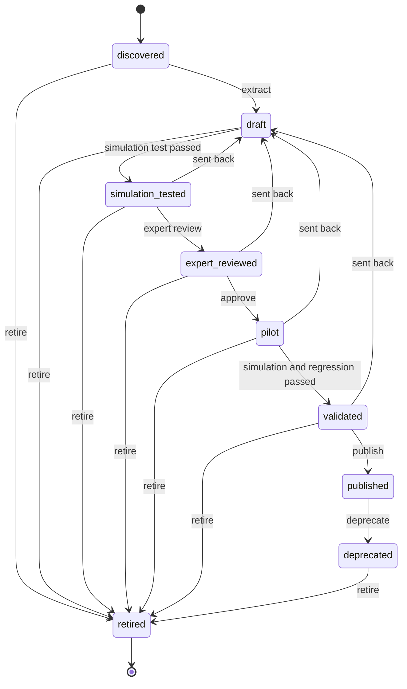
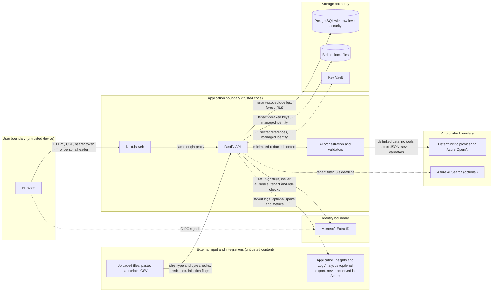
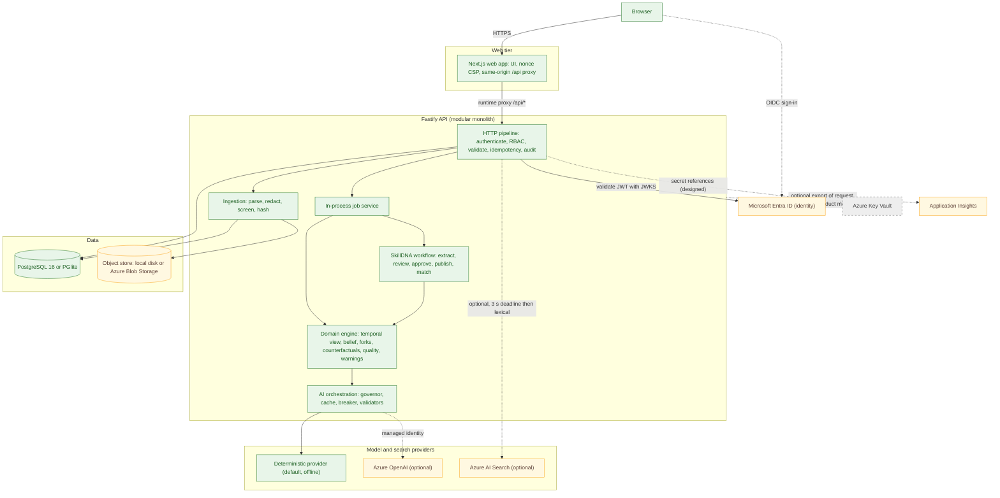
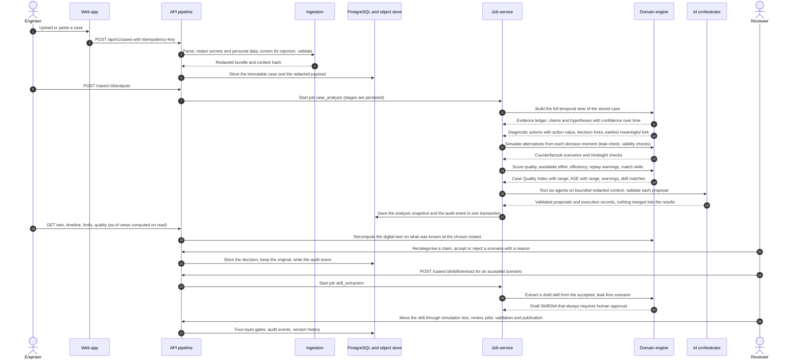
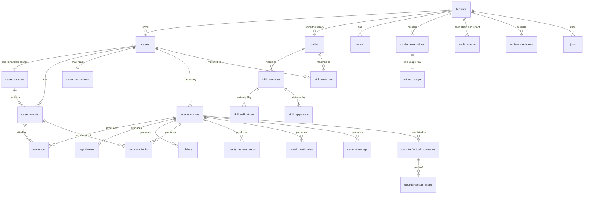
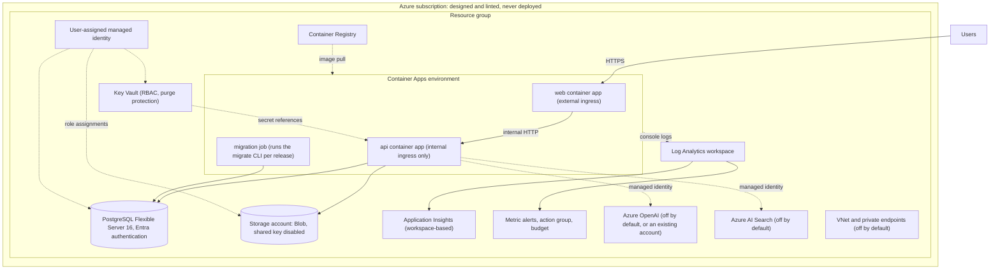

<div align="center">


# CaseGuard AI

**Find the moment a support case could have been solved better, and turn that learning into a reusable skill for the next case.**

Evidence-grounded counterfactual quality intelligence for technical support. Synthetic demo data only.

[](https://github.com/snowjug/CaseGuard-Ai/actions/workflows/ci.yml)
[](https://github.com/snowjug/CaseGuard-Ai/actions/workflows/codeql.yml)
[](https://github.com/snowjug/CaseGuard-Ai/actions/workflows/dependency-review.yml)
[](https://github.com/snowjug/CaseGuard-Ai/actions/workflows/deploy.yml)

</div>

The logo is the name in text plus the web app's own mark ([`apps/web/src/app/icon.svg`](apps/web/src/app/icon.svg): three connected
nodes for evidence, a decision fork and a hypothesis); besides the screenshots below, no other image asset is shipped. The badges
are the workflows in [`.github/workflows`](.github/workflows) (`ci`, `codeql`, `dependency-review` and the manual `deploy`;
`deploy-environment` is the reusable part of `deploy` and has no badge of its own). **A badge reports the latest run of its workflow
on the default branch.** Before the foundation work all 27 CI runs failed; the first fully green run
(41495498658) is on the unmerged branch `build/p0-foundation`, and `build/wave-1` is green too (for example run 41546529865), so
the CI badge cannot show a pass until that work reaches the default branch. Dependency review (13 runs, all failed) fails because the repository's
Dependency graph setting is off. No CodeQL or Deploy run
is recorded here (CodeQL runs on pushes and pull requests to `main`, which does not exist yet, on a weekly schedule and on demand), so those two badges say nothing yet.

**Hackathon track: C+AI Hack for Quality.**

> **Status, in short.** CaseGuard AI is a working prototype on **synthetic data only**. The **deterministic AI provider is the
> default and is what the demo uses**: no model is called and nothing leaves your machine. The Azure OpenAI, Microsoft Entra ID,
> Azure Blob Storage, Azure AI Search and Azure Monitor integrations are **implemented but validated against local mocks only**.
> **Nothing has been deployed to Azure.** Docker image builds were **not run** locally (no Docker daemon); CI builds both images and
> smoke-tests them (run 41546529865: both were built and the compose smoke test passed 12 checks). The data tier is exercised on
> **PGlite** locally and on PostgreSQL 16 in the CI integration job.
> **CI was never fully green until the foundation branch**: all 27 earlier runs failed (the one on `2ecb454`, run 41182982903,
> had only the production build fully green). The first fully green run is 41495498658 on the unmerged branch
> `build/p0-foundation`; run 41546529865 on `build/wave-1` is fully green too (8 of 8 jobs: 6,152 unit tests, 1,033 integration tests on
> PostgreSQL 16 and 374 end-to-end tests passed, none failed; see [Running tests](#running-tests)). None of this has reached the
> default branch.
> Every score is an **estimate**, shown with its basis and range. CaseGuard AI is not a Microsoft product.
> The repository is **UNLICENSED** (the owner has to choose a license). One known HIGH advisory (`@azure/msal-node`, reached through
> `@azure/identity`) is carried as a time-boxed exception until 2027-01-15 and needs a human to accept the risk or upgrade.
> Details: [Known limitations](#known-limitations).

## Where to find what

| Group       | Sections                                                                                                                                                                                                                                                                                                                                                           |
| ----------- | ------------------------------------------------------------------------------------------------------------------------------------------------------------------------------------------------------------------------------------------------------------------------------------------------------------------------------------------------------------------ |
| The product | [Overview](#thirty-second-overview) · [Problem](#problem) · [Why existing approaches fall short](#why-existing-approaches-are-insufficient) · [Solution](#solution) · [Key innovation](#key-innovation) · [Screenshots](#product-screenshots) · [Capabilities](#main-capabilities) · [End-to-end use case](#end-to-end-use-case)                                   |
| The ideas   | [Counterfactual analysis](#counterfactual-analysis) · [Evidence integrity](#evidence-integrity-model) · [Case Quality Index](#case-quality-index) · [Avoidable Support Effort](#avoidable-support-effort) · [SkillDNA](#skilldna) · [Token and compute efficiency](#token-and-compute-efficiency) · [Trust and responsible AI](#trust-security-and-responsible-ai) |
| The system  | [Architecture](#architecture) · [Diagrams](#architecture-diagram) ([data flow](#data-flow-diagram), [sequence](#sequence-diagram), [domain model](#domain-model)) · [Azure resources](#azure-resources)                                                                                                                                                            |
| Run it      | [Local development](#local-development) · [Environment variables](#environment-variables) · [Mock AI](#running-with-mock-ai) · [Azure OpenAI](#running-with-azure-openai) · [Tests](#running-tests) · [Deploying to Azure](#deploying-to-azure) · [CI/CD](#cicd)                                                                                                   |
| Show it     | [Demo walkthrough](#demo-walkthrough) · [Repository structure](#repository-structure) · [API](#api-documentation) · [Evaluation](#evaluation-methodology)                                                                                                                                                                                                          |
| The project | [Known limitations](#known-limitations) · [Roadmap](#roadmap) · [Contributing](#contributing) · [Security reporting](#security-reporting) · [License](#license) · [Acknowledgements](#acknowledgements)                                                                                                                                                            |

## Thirty-second overview

CaseGuard AI is an evidence-grounded counterfactual quality platform for technical support. It reconstructs case timelines,
identifies decision forks, simulates safer and more efficient troubleshooting paths, measures avoidable support effort, and turns
validated reasoning into governed, reusable **SkillDNA**.

Load a finished support case and CaseGuard AI rebuilds what was known at every decision, marks the earliest moment a better step
was available, and simulates that step using **only what was known at that moment**. It scores the case with ranges, shows the
evidence behind every claim, and lets a reviewer accept the better path. An accepted path can be turned into a draft skill that must
pass a four-eyes lifecycle before it is published and matched against the next case.

In the built-in synthetic story, Case One (an intermittent Microsoft Teams sign-in failure that took about three days) is
analysed, a better path from its earliest meaningful fork is accepted, a skill is extracted and approved by different people, and
Case Two (a related but different failure) is matched against it as of its first email.

## Problem

A support case leaves a long written record: customer emails, case notes, engineer actions, log excerpts, exact timestamps. When a
quality team reviews it afterwards, the reviewer reads it knowing how it ended. That makes the engineer's choices look obvious,
makes reviews differ from reviewer to reviewer, and hides the question that matters: **given only what was known at that moment, was
a safer, shorter or lighter step available?**

The cost of that unanswered question is real but invisible: heavy requests to the customer, diagnostics repeated, escalations made
before the minimum evidence existed, hours or days of waiting. And the lesson usually stays in the heads of the people who did the
review.

## Why existing approaches are insufficient

- **Checklist and form scores** grade whether a note has the right fields. They cannot say that a different action at 09:41 would
  have found the cause sooner.
- **Summarisers and chat assistants** re-tell the record. They tend to state a root cause as a fact, mix assumptions with evidence,
  and, once they see the whole case, let the outcome leak into the analysis of earlier decisions.
- **Retrieval over past cases** finds similar text, not a validated way of investigating: nothing says whether the advice was tested,
  who approved it or whether it has been retired.
- **Dashboards of averages** show that effort was high, not which decision made it so.

CaseGuard AI is deliberately none of these: it is not a chatbot, a summariser, a retrieval demo or a checklist.

## Solution

Seven steps, each visible in the product:

1. **Reconstruct** the case as a timeline of events and actions (the digital twin), with what was known at each moment.
2. **Separate** facts from assumptions: every claim is classified into one of eight evidence categories and cites its source events.
3. **Weigh** competing hypotheses, each with a confidence range that moves as evidence arrives.
4. **Find forks**: decision points where a materially better, safe alternative existed given only what was known then.
5. **Simulate** the alternative from the earliest meaningful fork, check that nothing later leaked in, and label the result as
   simulated and estimated.
6. **Measure** the case (Case Quality Index, Avoidable Support Effort, efficiency) with ranges and a stated basis.
7. **Learn**: turn a reviewer-accepted path into a draft SkillDNA, and govern it through simulation tests, expert review, pilot,
   validation and publication by different people.

A human decides at every point that matters: re-categorising a claim, accepting or rejecting a simulated path (with a reason), and
every skill approval. Nothing closes a case automatically and nothing ranks a person.

## Key innovation

1. **Temporal integrity is enforced, not promised.** A counterfactual at time T may only use information available at or before T.
   The engine takes a branded `TemporalView`, a leak check scans every scenario for identifiers that first appear later, mutation
   tests rewrite everything after a cut and expect byte-identical results, and AI output is validated against the same boundary
   ([explained below](#evidence-integrity-model)).
2. **LLM proposes, code disposes.** Every number (confidence, impact, quality, effort) is computed by deterministic, reproducible
   code with an injected clock, ids and seed. A language model, when one is configured, can only propose wording or a judgement
   inside a bounded, redacted context; seven validators accept or discard it, and a deterministic result is the fallback.
3. **Reasoning becomes a governed asset.** SkillDNA is extracted only from a reviewer-accepted, leak-free scenario and moves through
   a nine-state lifecycle (Discovered to Published, then Deprecated and Retired) with separation of duties. A skill is never published automatically and is matched against a new case
   using only what was known at that case's first email.
4. **Honest by construction.** Every score carries a range, a basis and a label (estimated, simulated, measured, synthetic), and the
   interface says so on every page.

## Product screenshots

<!-- SCREENSHOTS:BEGIN -->

Screenshots of the running product (production build, seeded synthetic demo, deterministic provider) are produced by `pnpm screenshots` into `docs/assets/screenshots/`; none is shown here until that run has been done.

<!-- SCREENSHOTS:END -->

## Demo video

There is no demo video yet. This section is a placeholder until one is recorded; the [demo script](docs/DEMO_SCRIPT.md) says what to
show instead.

## Main capabilities

The web app has 13 destinations (`apps/web/src/lib/nav.ts`), all backed by the typed route registry (78 routes, see
[API documentation](#api-documentation)). Roles decide what a person can open and change: five roles and 30 permissions
([RBAC matrix](docs/SECURITY.md#4-rbac-matrix)).

| Page               | Route                                              | What it does today                                                                                                                                                                                                                                                                                                                                                                                                                                                                                                                                      |
| ------------------ | -------------------------------------------------- | ------------------------------------------------------------------------------------------------------------------------------------------------------------------------------------------------------------------------------------------------------------------------------------------------------------------------------------------------------------------------------------------------------------------------------------------------------------------------------------------------------------------------------------------------------- |
| Command Center     | `/`                                                | Key metrics of the active case (seven estimates), leading hypothesis, SkillDNA match, critical missing evidence, open warnings, recent cases, skill candidates and system health                                                                                                                                                                                                                                                                                                                                                                        |
| Cases              | `/cases`, `/cases/new`, `/cases/[caseId]`          | Ingest a case (paste, upload, or a built-in sample) with a preview that runs the same pipeline as the create; browse cases; the case overview shows the digital twin and the analysis job                                                                                                                                                                                                                                                                                                                                                               |
| Guided Review      | `/cases/[caseId]/review`, `/cases/[caseId]/report` | One scrolling read of an analysed case in the order a person decides: the verdict, the chronology, what went wrong, what a better-supported path would have looked like, what to do next, what to learn, and how to share it. Evidence opens in one drawer with the stored message and a checked excerpt; each section explains how it was calculated and a section the role may not read says so while the rest still works. The report holds the same figures as a page to read, print, copy as a summary or download as one self-contained HTML file |
| Case Timeline      | `/cases/[caseId]/timeline`                         | Events with delays, repeats and decision-fork flags, a confidence chart over time, and a time cursor ("What was known") that withholds later events                                                                                                                                                                                                                                                                                                                                                                                                     |
| Evidence Ledger    | `/cases/[caseId]/evidence`                         | Every claim in one of eight evidence categories with its source events; a reviewer can re-categorise (the original classification is kept); missing evidence is listed                                                                                                                                                                                                                                                                                                                                                                                  |
| Hypothesis Arena   | `/cases/[caseId]/hypotheses`                       | Competing hypotheses ranked by confidence with ranges over time, and the action ranking at a decision moment with reviewer overrides                                                                                                                                                                                                                                                                                                                                                                                                                    |
| Counterfactual Lab | `/cases/[caseId]/counterfactual`                   | Decision forks (the earliest meaningful one first), the temporal boundary and validity checks, simulated paths against the recorded one, the evidence behind each step, the investigation graph, hindsight kept apart, review                                                                                                                                                                                                                                                                                                                           |
| Quality Review     | `/quality`, `/cases/[caseId]/quality`              | Portfolio analytics; per case: quality index, effort and metrics, live warnings, SkillDNA matches, coaching, and comparison with another case                                                                                                                                                                                                                                                                                                                                                                                                           |
| SkillDNA Library   | `/skills`, `/skills/[skillId]`                     | Skills with their lifecycle, governance (who decided what), versions, validation runs, and the cases a skill was applied to with its estimated effectiveness                                                                                                                                                                                                                                                                                                                                                                                            |
| Efficiency Monitor | `/efficiency`                                      | Token usage, estimated savings, the real process against a simulated better path, usage by agent and model, budgets, circuit breakers and model executions                                                                                                                                                                                                                                                                                                                                                                                              |
| Governance         | `/governance`                                      | Versioned settings (model, prompts, scoring, retention, redaction, feature flags, export), roles, the audit log with hash-chain verification, reviewer decisions, provider status and demo reset                                                                                                                                                                                                                                                                                                                                                        |
| System Health      | `/system`                                          | Dependencies with simulated stand-ins labelled, migrations, the AI provider, request metrics, and a "What is real here" panel                                                                                                                                                                                                                                                                                                                                                                                                                           |
| Demo Guide         | `/demo`                                            | The 13-step story with progress derived from stored data, presenter notes and (administrators only) seed and reset                                                                                                                                                                                                                                                                                                                                                                                                                                      |

**Start with the Guided Review.** For an analysed case it is the one page to read: the verdict, the chronology, what went wrong,
what a better-supported path would have looked like, what to do next and what to learn, each with its evidence one click away,
and a report to print, copy or download. The other case pages are the drill-downs it links to. What each section reads for each
role, how it degrades, and what it does not claim: [GUIDED_REVIEW.md](docs/GUIDED_REVIEW.md).

Around them: **Presentation Mode** (`?present=1`: a presenter strip with the next action outlined, concise presenter notes and a
guarded reset; development controls are hidden, the honesty labels stay), a command palette (Ctrl or Cmd + K), global search (`/`),
and a persona switcher for the synthetic users of a local run.

## End-to-end use case

The built-in demo plays the 13-step story of the product specification on two fictional cases. The Demo Guide lists the steps and
derives their progress from stored data, so a step is Done only when the data it produces exists. Each step names the persona who
performs it; the seeder plays the same story through the real services as the synthetic users, so permissions, four-eyes approval
and the audit trail apply exactly as they do over HTTP.

| #   | Who           | Step                                                         | What happens                                                                                                                            |
| --- | ------------- | ------------------------------------------------------------ | --------------------------------------------------------------------------------------------------------------------------------------- |
| 1   | Engineer      | Import Case One                                              | The synthetic Case One is loaded from the built-in samples; ingestion validates, redacts and screens it, and stores an immutable record |
| 2   | Engineer      | Timeline reconstructed                                       | The analysis rebuilds the investigation as a timeline, with what was known at each moment                                               |
| 3   | Engineer      | Evidence ledger built                                        | Every statement becomes a claim in an evidence category, linked to its source                                                           |
| 4   | Engineer      | Competing hypotheses shown                                   | Several explanations stay alive together, each with a confidence range                                                                  |
| 5   | Engineer      | Decision forks found                                         | The moments where a safer or shorter path existed; the earliest meaningful one is highlighted                                           |
| 6   | Reviewer      | A better path simulated and accepted                         | A path from the earliest meaningful fork is simulated from what was known then; the reviewer accepts it with a reason                   |
| 7   | Manager       | Quality and efficiency metrics calculated                    | Seven estimates, each with a range and a formula                                                                                        |
| 8   | Engineer      | Draft SkillDNA generated                                     | The accepted path becomes a skill that starts as Discovered and is never published automatically                                        |
| 9   | Skill curator | Governed approval completed                                  | Draft, simulation test, expert review, pilot, validation, publication; the pilot approver and the publisher must be different           |
| 10  | Engineer      | Import Case Two                                              | A related but different case, with another root cause                                                                                   |
| 11  | Engineer      | The validated skill applies to Case Two                      | The published skill is matched using only what was known at Case Two's first email                                                      |
| 12  | Engineer      | The second investigation is shorter and more evidence-driven | The guided plan is applied and conformance with it is recorded                                                                          |
| 13  | Manager       | Outcomes compared                                            | Both cases are compared with estimate labels                                                                                            |

What the story produces, **observed in a local run of the deterministic provider** (see the [demo script](docs/DEMO_SCRIPT.md) for the
conditions). Every figure is an **estimate** from an authored knowledge pack, with a range and a basis shown in the product:

| Measure                  | Case One (CG-SYN-1001)                                                                               | Case Two (CG-SYN-1002)                                         |
| ------------------------ | ---------------------------------------------------------------------------------------------------- | -------------------------------------------------------------- |
| The case                 | Intermittent Teams sign-in failures for about 140 branch users; 31 events; closed after about 3 days | Related failure for about 60 users; 15 events; about 8.5 hours |
| Decision forks           | 9; the earliest meaningful one is event e03, 9 March 2026 09:41 UTC                                  | 0                                                              |
| Case Quality Index       | 36 of 100 (band: poor)                                                                               | 99.1 of 100 (band: strong)                                     |
| Avoidable Support Effort | 55 percent (estimate; range 44 to 83, low confidence)                                                | 0 percent (no decision forks)                                  |
| Customer effort          | 430 minutes (range 301 to 602)                                                                       | 50 minutes                                                     |
| Token efficiency         | 0.029 bits per 1k tokens                                                                             | 0.158 bits per 1k tokens                                       |

The skill extracted from Case One ("Isolate a pre-authentication failure before pursuing identity policy") matched Case Two with a
score of 0.754 (shown as 75 percent), was applied, and the recorded conformance with its guided plan was 4 of 4 steps.

The two cases were written alongside the engine, so n = 2 and there is no held-out data. The difference demonstrates the
measurement pipeline; it is **not evidence of real-world effectiveness**.

## Counterfactual analysis

The Counterfactual Lab answers one question: **what would a safer path have looked like from this fork, using only what was known
then?**

1. **Start from the decision moment.** The belief, the open requirements and the observed signals are those of the exclusive view
   at the fork: the decision event itself, every later event and the final resolution are out.
2. **Walk a policy tree.** At each node the engine picks the top-ranked safe action for the strategy, excluding actions already
   taken, and stops when a hypothesis reaches the diagnosis threshold (0.75) with its confirmation requirements met, or after 8 steps.
3. **Sample the outcomes.** Each action's outcome is drawn from its predictive distribution over 200 seeded rollouts; every metric is
   reported as p10, median and p90.

Three strategies are generated for the earliest meaningful fork (the other forks get the balanced one): **Balanced path**,
**Lowest customer effort** and **Fastest to diagnosis**. They may converge on the same path, which is a valid result.

Every scenario carries `simulated` and `estimated` labels, the assumptions used, the evidence behind each step, and **eight
validity checks** (boundary respected, resolution excluded, no future identifiers, steps safe, steps supported, requirements
respected, labelled as simulated, reproducible). A scenario is valid only if all pass. **Hindsight is kept apart**: after
generation a separate check re-simulates conditioned on the recorded resolution; it needs the `quality:review` permission, is
labelled "not used to generate" and never feeds back into the paths.

**In Case One** the earliest meaningful fork is the engineer's request at 09:41 UTC on 9 March for HAR and Fiddler traces from three
users, the full user list, an export of every Conditional Access policy and client versions (very high customer effort). The
simulated alternative starts with "Ask for minimal scoping data": the exact client error text or code, three failing sample users
with UTC failure times, and which sites or networks are affected versus unaffected (low customer effort). A reviewer accepts or
rejects a path with a reason; only an accepted, leak-free path can seed a skill.
Details: [DOMAIN_ENGINE.md](docs/DOMAIN_ENGINE.md#8-counterfactual-simulation).

## Evidence integrity model

The product separates what was observed from what was assumed or inferred. Every claim in the Evidence Ledger is in one of eight
categories and cites the events it comes from. The category is assigned by transparent rules over the case text; a reviewer can
re-categorise a claim with a reason, and the original classification is never overwritten.

| Category                      | How the rule-based engine assigns it                                                                                                     |
| ----------------------------- | ---------------------------------------------------------------------------------------------------------------------------------------- |
| Confirmed fact                | Stated as fact and backed by diagnostic evidence, or a closing statement made after a before-and-after validation was on record          |
| Customer-reported observation | A spontaneous statement or a value stated by the customer (values are kept so contradicting statements can be detected)                  |
| Engineer assumption           | Hedged wording, or something stated as established without supporting diagnostic evidence (flagged "assumption stated as fact")          |
| Diagnostic evidence           | An observation matched by the knowledge pack's signal detectors, such as output the engineer asked for and the customer relayed          |
| AI inference                  | A pack inference or a "leading hypothesis is now ..." statement, computed from the evidence at that moment; a model estimate, not a fact |
| Conflicting evidence          | Different values stated for the same attribute, or a working hypothesis the record had already made much less likely than the leader     |
| Missing evidence              | A requirement that became relevant, is not merely "helpful", and has not been satisfied                                                  |
| Simulated outcome             | Reserved for a simulated result so it can never read as an observation; nothing in the rule-based engine assigns it today                |

Claims also carry flags for reasoning problems: an assumption stated as a fact, an unsupported root cause, an ignored
contradiction, a template without evidence, a contradicted claim, or a closure that was not validated.

**Temporal integrity, in plain words.** When the product judges a decision at time T, it may use only what was recorded before T.
The final resolution can never leak into the analysis of an earlier decision. On every case page the "What was known" panel shows
this: move the time cursor to an earlier event and later events are only counted ("Later events withheld"), never shown, so you can
review a decision with exactly the information the engineer had. The guarantee is enforced at five layers (the `TemporalView` type,
the engine, a leak check on every scenario, the AI boundary, and the read path that recomputes views as of the chosen instant), and
it is tested with mutation tests that rewrite everything after a cut and expect identical results
([ARCHITECTURE.md](docs/ARCHITECTURE.md#8-temporal-integrity-design), [evidence](docs/EVALUATION.md#4-temporal-integrity-evidence)).
It covers the code paths and the two synthetic cases that were tested; it is not a proof for arbitrary input.

## Case Quality Index

A rule-based estimate (0 to 100) about the **written record, never a rating of a person**. Six dimensions are assessed from
sub-checks, rule-based penalties are deducted (capped at 40 points so one failure cannot zero a case), and the composite carries a
range and a band.

| Dimension                      | Weight |
| ------------------------------ | ------ |
| Evidence integrity             | 0.25   |
| Diagnostic reasoning           | 0.20   |
| Scoping completeness           | 0.15   |
| Customer communication         | 0.15   |
| Resolution validation          | 0.15   |
| Efficiency and proportionality | 0.10   |

Bands: strong at 85 and above, adequate at 70, needs attention at 50, otherwise poor. A sub-check that cannot be decided from the
record **widens the range** instead of being guessed, and a dimension with nothing decidable is shown as "not assessable". Weights,
penalty points, the cap and the bands are governed settings. Each finding links to the evidence, actions or forks it rests on
([DOMAIN_ENGINE.md](docs/DOMAIN_ENGINE.md#9-case-quality-index-cqi)).

## Avoidable Support Effort

How much of the effort between the **earliest usable decision fork** and the **confirmed diagnosis** the best valid simulated
alternative would have avoided, as a percentage with a range and a confidence. It is a weighted mean over components that have data:
engineer effort, customer effort, repeated interactions, diagnostic executions, escalations, waiting time, token usage, compute
usage and low-information actions. Weights are re-normalised over the components that have data, and the output says which.

Three states are shown honestly: **estimated** (a figure with its range), **no decision forks** (0 percent; nothing to avoid) and
**no valid counterfactual** (no figure, with the reason). The range is the p10 to p90 of the rollouts across the valid strategies,
and the confidence drops to low when the range is wider than 50 points. It is never a measurement. A time-travel view of an
earlier moment has no Avoidable Support Effort figure, because it depends on counterfactuals computed from the full record
([DOMAIN_ENGINE.md](docs/DOMAIN_ENGINE.md#10-avoidable-support-effort-ase)).

## SkillDNA

SkillDNA is a reusable, versioned investigation skill extracted from a reviewer-accepted, leak-free counterfactual path. It holds
**trigger conditions** (at least one must be decision-time) and exclusions, a **decision sequence** with the information each step is
expected to give, candidate actions and cheaper alternatives, stop, success and escalation conditions, **safety constraints**, query
templates (KQL and PowerShell, never executed by the product), known failure modes, its source cases and a confidence with a
rationale.



**Governance.** Every transition needs a reason of at least 5 characters and an optimistic version, and **publication is always a
human act**. The gates enforce separation of duties: expert review needs someone who is not the creator or the version's author, the
pilot needs an approver who is not the creator, and publication needs someone who is neither the creator nor a pilot approver, with
a pilot approval on record. Only a full-scope run of the simulation set or the regression suite can satisfy or fail a gate (a run on
one case is stored but inconclusive). System actors never approve, and a database constraint (an approval cannot come from the person
who requested it) backs the service-level checks; the API answers 403 with the reason `separation_of_duties`. Only pilot, validated
and published skills are matched against cases.

**Matching and effectiveness.** A skill is matched against a case using only what was known at an instant (the demo matches Case Two
as of its first email). Applying it records conformance with the guided plan, which describes the route and never the person.
Effectiveness is aggregated from the recorded applications on two named bases, both estimates: a simulated baseline, and the recorded
path of the case the skill came from. With two synthetic cases these demonstrate the measurement, not that a skill works
([DOMAIN_ENGINE.md](docs/DOMAIN_ENGINE.md#13-skilldna)).

## Token and compute efficiency

Every model-capable task writes an execution record (provider, model, status, tokens, duration, cache hit, fallback reason, and
hashes of the prompt and the minimised input; the prompts and raw model output are not stored). With the default deterministic
provider the token counts are **estimates** (characters divided by 4, rounded up) and the cost is **unknown** unless the operator
supplies unit prices; prices are never hard-coded. A measured figure appears only when a real provider reports its own counts.

The Efficiency Monitor shows token usage, the estimated savings by mechanism (context compression, duplicate removal, cache hits,
early stops), the real process against a simulated better path ("Tokens used by the investigation"), usage by agent and model,
budgets and limits, circuit breakers, and the individual executions. The case-level **token efficiency** metric is bits of
information gained per 1,000 tokens. On the synthetic cases the telemetry recorded in the case is itself simulated, and the
interface says "simulated telemetry" rather than "measured".

Observed in a local run of the deterministic provider (estimates): the Case One process used 40,850 tokens against 7,900 for the
simulated better path, an estimated saving of 80.7 percent.

## Trust, security, and responsible AI

| Control                  | What it does                                                                                                                                                                               | Status                                                                                                                             |
| ------------------------ | ------------------------------------------------------------------------------------------------------------------------------------------------------------------------------------------ | ---------------------------------------------------------------------------------------------------------------------------------- |
| Tenant isolation         | The tenant comes from the credential only; tenant-scoped repositories, composite keys and forced row-level security                                                                        | Tested on PGlite; CI on PostgreSQL 16: 1,011 passed, 0 failed; **not verified on a managed server**                                |
| Identity                 | Development persona login only for `APP_ENV` local or test (refused elsewhere); Microsoft Entra JWT validation for deployed environments                                                   | Persona login tested. Entra validation tested with locally generated keys only, never against a live tenant                        |
| Authorization            | Five roles, 30 permissions, one declared permission per route, checked before the body is parsed                                                                                           | Implemented and tested                                                                                                             |
| Input handling           | Size and type checks from the bytes, redaction of secrets and personal data (a tenant pattern that cannot be applied fails closed), prompt-injection screening that flags and never blocks | Redaction is pattern-based. The malware scanner is a stub (`not_scanned`): nothing scans uploads for malware                       |
| AI boundary              | Minimised, redacted, delimited context; no tools; strict JSON; seven validators; repair once, then the deterministic result; a circuit breaker and token budgets                           | Tested with the deterministic provider and a mock Azure server; **no real model was ever called**                                  |
| Audit                    | Per-tenant append-only hash chain, verified from the Governance page                                                                                                                       | Tamper-evident, not tamper-proof (no external anchor)                                                                              |
| Web and API hardening    | Nonce-based CSP in the web tier, security headers, CORS allow-list, rate limits applied before authentication, idempotency keys                                                            | Tested locally; the client address behind the web tier is tested with simulated headers only                                       |
| Secrets and supply chain | No secrets in the repository (scanner in the pre-commit hook and CI, gitleaks in CI), managed identity by design, CodeQL, dependency review and an audit gate in CI                        | CI is green only on unmerged branches; one time-boxed advisory exception for `@azure/msal-node` that needs a human risk acceptance |

**Responsible AI.** Synthetic data only: the product says so everywhere, a tenant flagged synthetic refuses a payload declaring
`"synthetic": false`, and redaction runs as a safety net, but nothing can prove that a payload is fictional (it is self-attested).
Nothing ranks, scores or disciplines a person: coaching is supportive and describes the route, analytics are aggregated, and the
footer of the app says scores "must not be used to rank, rate or discipline individual employees". The consequential steps are
human decisions: re-categorising a claim, accepting a path, and the four-eyes approval of a skill. Uncertainty is shown as ranges
and "estimated" or "simulated" labels, and the System Health page states which integrations were validated against mocks only.
Known failure modes and bias risks: [RESPONSIBLE_AI.md](docs/RESPONSIBLE_AI.md), [SECURITY.md](docs/SECURITY.md),
[PRIVACY.md](docs/PRIVACY.md) and the [threat model](docs/THREAT_MODEL.md).



Diagram C: what crosses each boundary and what stops it. Threats per boundary are in [THREAT_MODEL.md](docs/THREAT_MODEL.md).

## Architecture

CaseGuard AI is a pnpm monorepo: a **Fastify 5 API** built as a modular monolith, a **Next.js 16** web app whose server forwards
`/api/*` to the API (the browser only ever talks to its own origin), and eight packages. One design rule shapes everything: **a
deterministic domain engine computes every number, and a language model, if one is used at all, can only propose text that code then
validates** ("LLM proposes, code disposes"). Dependencies point one way (`schemas` at the bottom; the web app never imports the API;
the diagram is in [ARCHITECTURE.md](docs/ARCHITECTURE.md#3-module-boundaries)).

| Module                   | Owns                                                                                                                                                               |
| ------------------------ | ------------------------------------------------------------------------------------------------------------------------------------------------------------------ |
| `packages/schemas`       | Zod contracts: entities, case bundle, knowledge-pack format, the route registry `ROUTES` (78 routes, a permission per route)                                       |
| `packages/config`        | Environment parsing, defaults and the fail-fast guards                                                                                                             |
| `packages/security`      | RBAC, identity strategies (development persona, Entra JWT), tenant assertions, redaction, injection screening, upload validation, URL safety, security headers     |
| `packages/observability` | Logger with redaction, correlation context, in-process metrics, health registry                                                                                    |
| `packages/domain`        | The deterministic engine: parsers, knowledge pack, temporal view, belief, forks, counterfactuals, quality, metrics, warnings, coaching, SkillDNA. No I/O, no clock |
| `packages/ai`            | Provider abstraction (deterministic and Azure OpenAI), prompt registry, context builder, validators, governor, cache, resilience, orchestrator, evaluation harness |
| `apps/api`               | HTTP pipeline, routes, services, the PostgreSQL and PGlite layer with migrations, object storage, search, jobs, composition root                                   |
| `packages/ui`            | Design tokens, Fluent theme, accessible charts, the investigation graph, shared components                                                                         |
| `apps/web`               | Next.js pages, the same-origin proxy, nonce CSP, development-persona and MSAL authentication                                                                       |
| `packages/testing`       | Fixture loaders, builders, a fake clock, an in-memory database harness                                                                                             |

**Every API request** passes the same pipeline ([ARCHITECTURE.md](docs/ARCHITECTURE.md#5-request-pipeline)): request id and security
headers; a general rate limit that runs _before_ authentication; authentication in `onRequest`, **before the body is parsed**, which
derives the user, roles and **tenant from the credential only**; the route's declared permission (403 and an audit event on refusal);
schema validation (422 with field paths); size limits; idempotency keys private to the calling user; a handler that calls a service;
audit events written in the same transaction as the change; a response validated against its schema. Long operations (analysis,
counterfactuals, skill extraction, demo seeding) are **jobs** with persisted stages, a heartbeat and a ten-minute limit (twenty for the
demo seed).

**Tenants are isolated twice**: in the application (tenant-scoped repositories; the tenant is never read from a request) and in the
database (every table has `tenant_id` in a composite primary key, and row-level security is forced for the `caseguard_app` role). The
**audit trail** is a per-tenant hash chain whose verification you can run from the Governance page. **Configuration fails fast**:
`packages/config` refuses unsafe combinations at start-up (persona login outside `local` and `test`, wildcard CORS, PGlite in
staging or production, an API-key credential for Azure OpenAI in a deployed environment, and others listed in
[SECURITY.md](docs/SECURITY.md#23-fail-closed-configuration-guards-packagesconfig)).

**Status of each part** ([ARCHITECTURE.md](docs/ARCHITECTURE.md#2-what-is-implemented-validated-designed)):

| Status                                    | Components                                                                                                                                                                                                                                                                                               |
| ----------------------------------------- | -------------------------------------------------------------------------------------------------------------------------------------------------------------------------------------------------------------------------------------------------------------------------------------------------------- |
| Implemented and tested locally            | Domain engine and all computed outputs; ingestion; redaction and injection screening; the deterministic AI provider, orchestrator and validators; RBAC; tenant isolation and RLS on PGlite; audit chain; idempotency; jobs; PostgreSQL full-text search; local object store; the API; the web app        |
| Implemented, validated against mocks only | Azure OpenAI provider; Entra JWT validation and just-in-time user provisioning; MSAL browser sign-in; Azure Blob adapter; Azure AI Search adapter; the optional Application Insights export. The `pg` driver ran on PostgreSQL 16 only in CI (1,011 passed, 0 failed), and **never on a managed server** |
| Designed only                             | Everything in Azure (Bicep, Key Vault references, managed identities, private networking, alerts, budget); a Redis cache; Content Safety; real malware scanning; retention enforcement; external anchoring of the audit chain; a durable multi-replica job queue                                         |

**Failure modes** ([ARCHITECTURE.md](docs/ARCHITECTURE.md#14-failure-modes-and-degradation)): a provider that is down, slow or
returns invalid output yields the deterministic result with a recorded reason; Azure AI Search failures fall back to PostgreSQL
full-text search; an unavailable object store keeps reads working but fails case creation; a database outage answers 503
`provider_unavailable` and makes `/readyz` fail. Each of these is tested against mocks or stand-ins, not against Azure.

## Architecture diagram



Diagram A. Green: implemented and tested locally. Amber: implemented, validated only against local mocks (for Blob, the local-disk
default is tested and the Azure path is mock-validated). Grey dashed: designed, never run. The web app, API and database run
locally; nothing in the Azure part has been deployed.

## Data-flow diagram

```mermaid
flowchart LR
    Src["Case source: built-in sample, JSON bundle, upload, pasted text or CSV"]
    Ing["Ingestion: size and type checks, parse, redact, screen for injection, validate, hash"]
    Obj[("Object store: redacted payload")]
    DB[("PostgreSQL or PGlite: immutable case and events, audit event")]
    Job["case_analysis job: load, analyse, counterfactuals, assess, warnings, skills, agents, save"]
    Eng["Domain engine on the temporal view: evidence, hypotheses, forks, simulations, quality, effort"]
    AIO["AI orchestrator: six agents on minimised redacted context, each proposal validated"]
    Snap[("Analysis snapshot and model execution records")]
    Views["Views: the digital twin, timeline, ledger and metrics, recomputed on read for the chosen instant"]
    Rev["Reviewer decisions with a reason"]
    Skill["SkillDNA: extract, four-eyes governance, match"]
    Src --> Ing
    Ing --> Obj
    Ing --> DB
    DB --> Job
    Job --> Eng
    Eng --> AIO
    Eng --> Snap
    AIO -.->|"proposals recorded, not merged"| Snap
    Snap --> Views
    Views --> Rev
    Rev --> Skill
    Skill -.->|"matches a new case as of its first email"| Views
```



Diagram G reads left to right. Two properties hold at every step: nothing reaches a model before it is redacted and minimised, and
nothing recorded after the chosen instant reaches a view, a prompt or a skill match. A model's proposals are stored beside the
results with their validation outcome; **in the committed pipeline they are never merged into a result** (every stored artefact
comes from the engine).

## Sequence diagram



Diagram B. The same flow is described stage by stage, with the code behind each, in
[ARCHITECTURE.md](docs/ARCHITECTURE.md#6-case-analysis-data-flow-diagram-b).

## Domain model

Diagram D is condensed from the two entity-relationship diagrams in [DATA_MODEL.md](docs/DATA_MODEL.md#2-entity-relationship-diagrams-diagram-d),
which are taken from the SQL migrations and carry every table. Every tenant-owned table has `tenant_id` as the first column of its
primary key, every foreign key includes it, and every case child cascades on delete from `cases`.



What the model guarantees, in four sentences. The stored case and its source are **immutable**. Analysis artefacts have
deterministic ids derived from the case and a stable key, so a re-analysis replaces them and carries reviewer decisions forward.
Audit events, skill approvals and validations are **insert-only**. Search is a stored generated `tsvector` column with a GIN index on
six tables (cases, events, claims and others), so there is no second index to keep in step. Details, indexes, the role model and the
migration policy (checksums, an advisory lock, CRLF normalisation) are in [DATA_MODEL.md](docs/DATA_MODEL.md).

## Azure resources

**Nothing has been deployed to Azure.** `infra/bicep/main.bicep` is a subscription-scope template that composes the modules below.
It has been built and linted with Bicep CLI 0.48.1 (0 errors) and its parameter file scanned; no what-if, validate or deploy call
was ever made, and the Docker images the container apps need were built only by CI, which pushes them nowhere
([DEPLOYMENT.md](docs/DEPLOYMENT.md), [infra/bicep/README.md](infra/bicep/README.md)).

| Resource                                                         | Module                                                      | Created                                                                     | Notes                                                                                                                                                                                          |
| ---------------------------------------------------------------- | ----------------------------------------------------------- | --------------------------------------------------------------------------- | ---------------------------------------------------------------------------------------------------------------------------------------------------------------------------------------------- |
| Log Analytics workspace and workspace-based Application Insights | `monitoring`                                                | always                                                                      | Container console logs go to Log Analytics; the API's telemetry export is optional                                                                                                             |
| User-assigned managed identity                                   | `identity`                                                  | always                                                                      | Holds the roles below; the container apps run as it                                                                                                                                            |
| Container Registry                                               | `registry` (acr)                                            | always                                                                      | Admin user disabled                                                                                                                                                                            |
| Storage account with a private `cases` container                 | `storage`                                                   | always                                                                      | Shared-key access disabled                                                                                                                                                                     |
| PostgreSQL Flexible Server 16                                    | `postgres`                                                  | always                                                                      | Entra authentication for staging and production                                                                                                                                                |
| Key Vault                                                        | `keyvault`                                                  | always                                                                      | RBAC authorisation; purge protection on by default                                                                                                                                             |
| Role assignments                                                 | `rbac` (and `rbac-openai-existing` for an existing account) | always                                                                      | Built-in roles: AcrPull, Key Vault Secrets User, Storage Blob Data Contributor, Search Index Data Contributor, Cognitive Services OpenAI User (the last two only when those services are used) |
| Container Apps environment, web app, API app, migration job      | `containerapps`                                             | `deployContainerApps` (default true)                                        | Web has external ingress, **API has internal ingress only**; the migration job runs once per release                                                                                           |
| Budget                                                           | `budget`                                                    | always (`monthlyBudgetAmount` is a required parameter)                      | Actual and forecast thresholds                                                                                                                                                                 |
| Metric alerts and an action group                                | `alerts`                                                    | `deployAlerts` (default true) and Container Apps                            |                                                                                                                                                                                                |
| VNet and private endpoints                                       | `network`, `private-endpoint`                               | `enablePrivateNetworking` (default false)                                   |                                                                                                                                                                                                |
| Azure AI Search                                                  | `search`                                                    | `deploySearch` (default false)                                              | The API falls back to PostgreSQL full-text search                                                                                                                                              |
| Azure OpenAI account and model deployment                        | `openai`                                                    | `deployOpenAi`, `deployOpenAiModel` (default false), or an existing account | The deterministic provider is used unless an endpoint is configured                                                                                                                            |
| Redis                                                            | `redis`                                                     | `deployRedis` (default false)                                               | **The application has no Redis support**; the cache is in memory                                                                                                                               |



Diagram F is **designed and linted, never deployed**: its arrows describe the template, not behaviour anyone has observed. The same
diagram, with the facts hard-wired by the template (`AUTH_MODE=entra`, `DEV_AUTH_ENABLED=false`, `DB_AUTO_MIGRATE=false`,
`STORAGE_PROVIDER=azure-blob`), is in [ARCHITECTURE.md](docs/ARCHITECTURE.md#15-azure-deployment-diagram-f).

## Local development

Prerequisites: **Node.js 24 or newer**, **pnpm 10.34.7** (pinned in `packageManager`) and Git. No cloud account, API key or network
access is needed to run, test or demo the product. Docker is optional and was not available while this was written, so the
`docker compose` PostgreSQL and every image build are untested here.

Windows PowerShell 5.1 (use `pnpm.cmd`; there is no `&&`):

```powershell
pnpm.cmd install
Copy-Item .env.example .env      # optional: without a .env the built-in local defaults apply
pnpm.cmd dev                     # API on http://localhost:4000, web on http://localhost:3000
```

macOS, Linux or PowerShell 7:

```bash
pnpm install
cp .env.example .env
pnpm dev
```

Open <http://localhost:3000>. The API listens only after the migrations and, by default, the demo seed: its log shows
`demo.auto_seed` with `completedSteps=13 totalSteps=13`. In local runs the seeding itself took about 11 seconds and a cold start on
a slow, cloud-synced disk about a minute (observed, not a guarantee). Set `DEMO_AUTO_SEED=false` to skip the seed. `pnpm dev` loads
the repository `.env`; `pnpm dev:api` and `pnpm dev:web` start one side only (`dev:api` reads `apps/api/.env`).

`node scripts/dev.mjs --dry-run` prints the plan and starts nothing. Its output on a machine with no `.env`:

```text
CaseGuard AI dev servers (synthetic demo data only)
  API  http://localhost:4000   health: /livez  /readyz
  Web  http://localhost:3000
Config: no .env found, using built-in local defaults (copy .env.example to .env to customise)
Dev personas (synthetic users; accepted only when APP_ENV is local or test):
  send the header  x-cg-persona: <userId>  to the API
  user_ava_engineer (engineer)   user_riley_reviewer (reviewer)   user_morgan_manager (manager)
  user_casey_curator (skill_curator)   user_alex_admin (administrator)   all in tenant_contoso_support
  user_fabi_engineer (engineer) lives in tenant_fabrikam_lab and exists for tenant-isolation checks
Stop with Ctrl+C.

[dry-run] api: pnpm.cmd --filter @caseguard/api dev
[dry-run] web: pnpm.cmd --filter @caseguard/web dev
```

**Personas.** The local login has no real authentication: any client can send the header, which is why it is refused outside
`APP_ENV` local and test. In the browser, the **Choose persona** button lists the synthetic users; the product badges the
development identity as such.

| Persona (`x-cg-persona`) | Role          | Does in the demo                                                                      |
| ------------------------ | ------------- | ------------------------------------------------------------------------------------- |
| `user_ava_engineer`      | engineer      | Imports and analyses cases, extracts a skill, applies it                              |
| `user_riley_reviewer`    | reviewer      | Accepts a simulated path, validates skills, reads the audit trail                     |
| `user_morgan_manager`    | manager       | Read-only: quality, efficiency and the comparison of both cases                       |
| `user_casey_curator`     | skill_curator | Moves a skill through draft, pilot and approval                                       |
| `user_alex_admin`        | administrator | Every permission: publishes a skill, governance, and demo seed and reset              |
| `user_fabi_engineer`     | engineer      | In the other tenant (`tenant_fabrikam_lab`), to demonstrate that tenants are isolated |

**Demo data on the command line** (the seed also runs at API start-up). Stop the API first when it uses the same on-disk database:
PGlite belongs to one process. Both scripts load the repository `.env` and start in `apps/api`, so they use the database `pnpm dev`
uses (`apps/api/.data`).

```powershell
pnpm.cmd demo:seed                    # the portfolio profile: all 13 story steps done
pnpm.cmd demo:seed --profile base     # a clean workspace with the story at step 1, to perform it live
pnpm.cmd demo:reset                   # erase the tenant's case data (users, settings and the audit trail stay)
```

Both were run once against a throw-away PGlite database and ended with `Demo seeded (portfolio): 13 of 13 story steps complete.` and
`Demo data reset: 0 of 13 story steps complete.` The seed is idempotent. Over HTTP the same actions are `POST /api/v1/demo/seed` and
`/demo/reset`, which need the `demo:manage` permission (administrator only); both work only in a synthetic demo tenant.

**Databases.** PGlite on disk is the default (`DATABASE_URL=pglite://.data/caseguard`, one process at a time);
`pglite://memory` is ephemeral; `docker compose up postgres` offers PostgreSQL 16 on `127.0.0.1:55432` (never run here). A real
server needs a non-superuser member of `caseguard_app` for row-level security to apply. `pnpm db:migrate` applies the migrations
(`--status` only reports). Everything else (troubleshooting on OneDrive paths, PowerShell, port clashes, slow PGlite starts) is in
[LOCAL_DEVELOPMENT.md](docs/LOCAL_DEVELOPMENT.md).

## Environment variables

The full, commented list is [`.env.example`](.env.example); `packages/config` validates every variable at start-up and **refuses to
start** on an invalid or unsafe combination (the message lists each problem and never a value). Defaults below are the local ones.

| Area             | Variables (default)                                                                                                                                                                                           | Notes                                                                                                                                       |
| ---------------- | ------------------------------------------------------------------------------------------------------------------------------------------------------------------------------------------------------------- | ------------------------------------------------------------------------------------------------------------------------------------------- |
| Runtime          | `APP_ENV` (`local`), `SERVICE_NAME`, `LOG_LEVEL` (`info`)                                                                                                                                                     | `NODE_ENV=production` with no `APP_ENV` fails at start-up                                                                                   |
| HTTP             | `API_HOST` (`0.0.0.0`), `API_PORT` (`4000`), `CORS_ALLOWED_ORIGINS` (`http://localhost:3000`)                                                                                                                 | Explicit allow-list, never `*`; a deployed environment refuses to start without it                                                          |
| Client address   | `TRUST_PROXY` (`false`), `TRUST_CLIENT_IP_HEADER` (`false`)                                                                                                                                                   | Rate-limit buckets behind the web tier; tested with simulated headers only ([SECURITY.md](docs/SECURITY.md#client-address-for-rate-limits)) |
| Authentication   | `AUTH_MODE` (`dev`), `DEV_AUTH_ENABLED` (`true`), `ENTRA_TENANT_ID`, `ENTRA_AUDIENCE`, `ENTRA_ISSUER`, `ENTRA_JWKS_URI`, `ENTRA_TENANT_MAP`, `ENTRA_ROLE_MAP`                                                 | Persona login only for `APP_ENV` local or test; deployed environments need `entra` and `false`. Entra: mocks only                           |
| Database         | `DATABASE_URL` (`pglite://.data/caseguard`), `DATABASE_AUTH` (`password`), `DB_AUTO_MIGRATE` (`true` locally, `false` deployed), `DB_POOL_MAX`, `TEST_DATABASE_URL`                                           | PGlite is refused in staging and production                                                                                                 |
| Object storage   | `STORAGE_PROVIDER` (`local`), `STORAGE_LOCAL_DIR` (`.data/objects`), `AZURE_STORAGE_ACCOUNT`, `AZURE_STORAGE_CONTAINER` (`cases`)                                                                             | `azure-blob` uses managed identity; no key or connection string is supported                                                                |
| Search and cache | `SEARCH_PROVIDER` (`lexical`), `AZURE_SEARCH_ENDPOINT`, `AZURE_SEARCH_INDEX` (`caseguard`), `CACHE_PROVIDER` (`memory`)                                                                                       | `lexical` is PostgreSQL full-text; `memory` is the only implemented cache                                                                   |
| AI               | `AI_PROVIDER` (`deterministic`), `AZURE_OPENAI_ENDPOINT`, `AZURE_OPENAI_DEPLOYMENT`, `AZURE_OPENAI_API_VERSION` (`2024-10-21`), `AZURE_OPENAI_AUTH` (`managed-identity`), `AZURE_OPENAI_API_KEY`              | See the two sections below                                                                                                                  |
| AI limits        | `AI_MAX_INPUT_TOKENS` (`24000`), `AI_MAX_OUTPUT_TOKENS` (`4000`), `AI_TIMEOUT_MS` (`30000`), `AI_MAX_RETRIES` (`2`), `AI_COST_LIMIT_USD_PER_DAY`, `AI_UNIT_PRICE_INPUT_PER_1K`, `AI_UNIT_PRICE_OUTPUT_PER_1K` | Prices are never hard-coded; a cost cap needs both unit prices or start-up fails                                                            |
| Limits           | `RATE_LIMIT_MAX` (`300`), `RATE_LIMIT_WINDOW_MS` (`60000`), `RATE_LIMIT_AI_MAX` (`30`), `BODY_LIMIT_BYTES` (`1048576`), `UPLOAD_MAX_BYTES` (`2097152`), `MALWARE_SCAN_MODE` (`none`)                          | In memory, per replica. `eicar-test` is a test hook; no malware scanner is bundled                                                          |
| Telemetry        | `APPLICATIONINSIGHTS_CONNECTION_STRING`, `OTEL_SERVICE_NAME`, `OTEL_SAMPLING_RATIO` (`1`)                                                                                                                     | The export is optional and off unless the connection string is set; never observed in Azure                                                 |
| Demo             | `DEMO_MODE` (`true`), `DEMO_AUTO_SEED` (`true`)                                                                                                                                                               | Production requires both `false`                                                                                                            |
| Web              | `NEXT_PUBLIC_AUTH_MODE` (`dev`), `NEXT_PUBLIC_APP_ENV` (`local`), `NEXT_PUBLIC_ENTRA_*`, `NEXT_PUBLIC_API_VALIDATION`, `API_INTERNAL_URL` (`http://localhost:4000`)                                           | `NEXT_PUBLIC_*` are public and inlined at build time; `API_INTERNAL_URL` is read at runtime and required in production                      |

## Running with mock AI

This is the default and needs no configuration: `AI_PROVIDER=deterministic`. The deterministic provider runs the domain engine and
narrative templates for each agent, with no network and no model. Results are reproducible, labelled simulated, and token counts are
estimates (`ceil(characters / 4)`) with no cost. Start `pnpm dev` and use the product as described above.

To confirm which provider is active, sign in as a persona with `telemetry:read` (the manager, for example):

```powershell
Invoke-RestMethod -Uri http://localhost:4000/api/v1/system/provider -Headers @{ 'x-cg-persona' = 'user_morgan_manager' }
```

The response reports the provider kind, whether it is simulated and a validation note; the same facts appear on the System Health
page (the "Dependencies" panel with the "Simulated stand-in" badge) and in the Efficiency Monitor. Details:
[AI_ORCHESTRATION.md](docs/AI_ORCHESTRATION.md#93-running-with-mock-ai-the-default).

## Running with Azure OpenAI

**No real Azure OpenAI call has ever been made.** The provider is implemented (chat completions with strict `json_schema` output, no
tools, managed-identity token acquisition, bounded retries, typed errors) and tested against fakes and a local mock server only.
Even with a real model the committed pipeline validates every proposal and records it without merging it into a stored result, so a
model cannot change a number.

```text
AI_PROVIDER=azure-openai
AZURE_OPENAI_ENDPOINT=https://<resource>.openai.azure.com    # a bare https origin: no path, query or credentials
AZURE_OPENAI_DEPLOYMENT=<your deployment name>               # 1 to 64 letters, digits, ".", "_" or "-"
AZURE_OPENAI_API_VERSION=2024-10-21                          # default; verify it against the model you deploy
AZURE_OPENAI_AUTH=managed-identity                           # the default, and the only option when APP_ENV is staging or production
```

For a local experiment you may use `AZURE_OPENAI_AUTH=api-key` with `AZURE_OPENAI_API_KEY` in your own untracked `.env`. A key is
refused (start-up error) in staging and production, and must never be committed. Set `AI_COST_LIMIT_USD_PER_DAY` only together with
both unit prices. If the provider cannot be created, the API logs it, reports `degraded` on the system pages and serves the
deterministic results, retrying every 60 seconds. Full rules: [AI_ORCHESTRATION.md](docs/AI_ORCHESTRATION.md#94-configuring-azure-openai-not-validated-against-a-live-service).

## Running tests

Everything below runs offline. Counts, timings and coverage are not repeated here from memory: each result cell is the outcome of
[GitHub Actions run 41546529865](https://github.com/snowjug/CaseGuard-Ai/actions/runs/41546529865) (the CI workflow on commit
`69c4c85` of the unmerged branch `build/wave-1`, 2026-11-02, fully green; the commits after it change documents and the tolerance
of one property test, see [CI_CD.md](docs/CI_CD.md#9-what-was-and-was-not-validated)), a local measurement that says so, or "NOT RUN in CI". The 27 runs before the foundation work
all failed; run 41182982903 on `2ecb454` is the last one whose counts were recorded, and run 41495498658 on `build/p0-foundation`
(5,843 unit, 1,011 integration and 342 end-to-end tests) was the first fully green
([CI_CD.md](docs/CI_CD.md#9-what-was-and-was-not-validated)). [EVALUATION.md](docs/EVALUATION.md#2-test-inventory) records how the earlier local counts were taken.

| Layer                         | Command                   | What it runs                                                                                                                                                                                                                                  | Result                                                                                                                                                                 |
| ----------------------------- | ------------------------- | --------------------------------------------------------------------------------------------------------------------------------------------------------------------------------------------------------------------------------------------- | ---------------------------------------------------------------------------------------------------------------------------------------------------------------------- |
| Unit and property tests       | `pnpm test:unit`          | Every workspace except `*.int.test.ts`: schemas, config, security, observability, the domain engine (with `fast-check` property tests), the AI package, UI and web components (jsdom), API tests                                              | CI run 41546529865: 6,152 passed, 0 failed, 4 expected failures that pin known defects (256 files)                                                                     |
| Integration tests             | `pnpm test:int`           | `*.int.test.ts`: database, HTTP and mock-service tests on PGlite (CI points them at a `postgres:16` service container)                                                                                                                        | CI run 41546529865, on PostgreSQL 16: 1,033 passed, 0 failed (56 files)                                                                                                |
| Coverage                      | `pnpm test:coverage`      | `vitest run --coverage` (V8; HTML, lcov and a text summary under `coverage/`)                                                                                                                                                                 | NOT RUN in CI; no figure recorded ([TESTING.md](docs/TESTING.md#8-not-run-and-not-verifiable))                                                                         |
| End-to-end and accessibility  | `pnpm test:e2e`           | Playwright desktop and mobile projects against a real API (in-memory PGlite, deterministic AI, seeded demo) and a production build of the web app: every page, the demo flow, axe checks, themes, HTTP security headers and failure behaviour | CI run 41546529865: 374 passed (axe checks included), including the Case Two step of `demo-flow.spec.ts`, the guided review and report spec and the phone-width checks |
| Domain benchmark              | `pnpm bench`              | The engine on the synthetic cases and scaled cases ([EVALUATION.md](docs/EVALUATION.md#6-performance))                                                                                                                                        | NOT RUN in CI; measured locally under load: Case One analysis mean 509.3 ms, p95 1242.5 ms ([EVALUATION.md](docs/EVALUATION.md#6-performance))                         |
| Engine benchmark by case size | `pnpm bench:engine`       | The whole analysis the API runs, on Case One stretched to 15 to 2,000 events, split by stage; writes `docs/PERFORMANCE_ENGINE.md` (`--no-write` prints only)                                                                                  |
| API micro-benchmark           | `pnpm bench:api`          | One in-process API on in-memory PGlite with the seeded demo; writes `docs/PERFORMANCE.md` (`--no-write` prints only)                                                                                                                          | NOT RUN in CI; measured locally, noisy: timeline retrieval p50 34.53 ms, p95 41.76 ms ([PERFORMANCE.md](docs/PERFORMANCE.md))                                          |
| Everything, as CI runs it     | `node scripts/verify.mjs` | Format, lint, typecheck, generated files, docs links, tests, build, e2e, secret scan, dependency audit, Bicep, images, demo replay; every step reports PASSED, FAILED or NOT RUN, never a silent pass                                         | CI runs it one step per job; run 41546529865: 8 of 8 jobs fully green                                                                                                  |

Use `node scripts/verify.mjs --list` to see the steps and `--only lint,typecheck` to run a subset. Exit code 3 of a step means it was
**not run** (for example `docker:build` without a Docker daemon, or `infra:validate` without a Bicep CLI), never "passed". `pnpm
screenshots` regenerates the product screenshots from the running application. The suites that start PGlite are slow on a
cloud-synced folder; `*.int.test.ts` files and several others open a database. A real PostgreSQL for the API suites needs
`TEST_DATABASE_URL`; that path has not been exercised locally.

## Deploying to Azure

**Design only: nothing has been deployed, and no Azure command was run while this was written.** The path, as designed, is:

1. A person with a subscription registers the resource providers, requests quota (PostgreSQL, Container Apps, and Azure OpenAI with
   model access if wanted) and creates the Microsoft Entra app registrations ([ENTRA_ID_SETUP.md](docs/ENTRA_ID_SETUP.md)).
2. Copy `infra/bicep/main.dev.bicepparam` to a local, untracked parameter file and fill it in (owner, cost centre, Entra identifiers,
   tenant map, a monthly budget). Prices are never stored in the repository ([COST_GUIDE.md](docs/COST_GUIDE.md)).
3. Preview with `infra/scripts/what-if.ps1` or `what-if.sh` (read-only; they print the target and ask before doing anything).
4. Deploy with `infra/scripts/deploy-dev.ps1` or `deploy-dev.sh`, in two stages: the infrastructure, then the images
   (`az acr build` of `apps/api/Dockerfile` and `apps/web/Dockerfile`) and the three container apps, followed by the migration job
   and the smoke tests.
5. Add the web URL as a single-page-application redirect URI on the Entra app registration.
6. Remove a dev environment with `infra/scripts/destroy-dev.ps1` or `.sh` (typed confirmation of the resource group).

[`deploy.yml`](.github/workflows/deploy.yml) wraps the same template in GitHub Actions and is **inert by default**: it does nothing
until the one-time setup in [CI_CD.md](docs/CI_CD.md#6-deployment-to-azure-inert-until-configured) is complete and
`AZURE_DEPLOY_ENABLED=true` is set. Production needs a manual dispatch and approval from the reviewers of the `production`
environment. The full guide, with every step marked as not run, is [DEPLOYMENT.md](docs/DEPLOYMENT.md); runbooks for the failure
cases are in [docs/runbooks](docs/runbooks/README.md).

## CI/CD

Five workflows exist in [`.github/workflows`](.github/workflows). **Two have run on GitHub; CI is green only on the unmerged
branches**: `ci.yml` ran 27 times before the foundation work and every run failed. Since then it has been fully green on
`build/p0-foundation` (run 41495498658) and on `build/wave-1` (for example run 41546529865: 8 jobs, all green); the wave's own failed
and cancelled runs, among them two whose unit job found a counterexample to a property test on a documents-only commit (test-side
flaws, fixed), are accounted for in [CI_CD.md](docs/CI_CD.md#9-what-was-and-was-not-validated). `dependency-review.yml` has run 13 times and failed every
time because the repository's Dependency graph setting is off. No CodeQL or deploy run is recorded here, so every statement about
those two is a reading of the configuration, not an observed result ([CI_CD.md](docs/CI_CD.md#9-what-was-and-was-not-validated)).

| Workflow                                             | Trigger                                                                        | What it does                                                                                                                                                                                                                                                                                                                                                                                                                                      |
| ---------------------------------------------------- | ------------------------------------------------------------------------------ | ------------------------------------------------------------------------------------------------------------------------------------------------------------------------------------------------------------------------------------------------------------------------------------------------------------------------------------------------------------------------------------------------------------------------------------------------- |
| `ci.yml` (CI)                                        | Pull request, push to any branch except `main`, manual, called by `deploy.yml` | Eight jobs: quality (format, lint, typecheck, generated files, docs links, unit tests); integration (tests against `postgres:16` and the demo reset-and-seed replay); production build; end-to-end and accessibility (Playwright, axe); security (secret scan, gitleaks, dependency audit); Bicep validation; container images (both built, `docker compose up --wait`, a smoke test; nothing is pushed); and a "CI gate" that merges the reports |
| `codeql.yml`                                         | Push and pull request on `main`, weekly, manual                                | CodeQL analysis of the TypeScript and JavaScript                                                                                                                                                                                                                                                                                                                                                                                                  |
| `dependency-review.yml`                              | Pull request                                                                   | Blocks new or bumped dependencies with a known HIGH or CRITICAL vulnerability                                                                                                                                                                                                                                                                                                                                                                     |
| `deploy.yml` and `deploy-environment.yml` (reusable) | Manual dispatch, or a version tag when opted in                                | Azure what-if or deploy with OIDC; inert until configured                                                                                                                                                                                                                                                                                                                                                                                         |
| `.github/dependabot.yml`                             | Weekly                                                                         | Version updates for npm, GitHub Actions, Docker and Compose                                                                                                                                                                                                                                                                                                                                                                                       |

**Docker images were not built locally** (no Docker daemon was available); the `containers` job builds both Dockerfiles (in run
41546529865 both images were built and the compose smoke test passed 12 checks).
Every gate runs through `scripts/verify.mjs`, so the local loop and CI share one runner and one honest status model.
Secret scanning has three layers (a pre-commit hook, the repository scanner and gitleaks in CI, and GitHub push protection when
enabled). The repository settings a person must apply (branch protection, required checks, environments) are listed in
[CI_CD.md](docs/CI_CD.md#7-required-repository-settings-a-human-must-apply-these) and in the human-actions table of
[KNOWN_LIMITATIONS.md](docs/KNOWN_LIMITATIONS.md#5-human-actions-required).

## Demo walkthrough

The Demo Guide page lists the 13 steps (above) with their progress, the persona for each, presenter notes and a button to the next
screen. **Presentation Mode** (`/?present=1`, or the Present button) adds a presenter strip, hides the development controls and
keeps the honesty labels. The full script, with timings, a 30-second introduction, three-, five- and eight-minute versions and
answers to the questions judges are likely to ask, is [DEMO_SCRIPT.md](docs/DEMO_SCRIPT.md). The six moments the demo is built
around:

| #   | Moment                                                                   | Where to see it                                                                                                                  |
| --- | ------------------------------------------------------------------------ | -------------------------------------------------------------------------------------------------------------------------------- |
| 1   | The system highlights the earliest meaningful decision fork              | Counterfactual Lab, fork selector badge "Earliest meaningful"; "Decision fork" on event e03 in the Case Timeline                 |
| 2   | The actual and counterfactual paths visually diverge                     | Counterfactual Lab, tabs "Compare paths" and "Investigation graph"                                                               |
| 3   | The user can inspect exactly which evidence supported the alternative    | Counterfactual Lab, tab "Evidence behind each step" and the eight "Validity checks"                                              |
| 4   | SkillDNA is generated from validated reasoning                           | Counterfactual Lab, tab "Review and SkillDNA"; then the SkillDNA Library detail and its Governance, Validation and Versions tabs |
| 5   | A second case resolves more efficiently because of the learned skill     | Case Two: the "SkillDNA match" panel in the Command Center, the "SkillDNA" tab of Quality Review, and its "Compare cases" tab    |
| 6   | Token and customer-effort improvement shown with honest estimated labels | Efficiency Monitor, "Real process versus a simulated better path"; Quality Review, tab "Effort and metrics"                      |

## Repository structure

```text
.
├── apps/
│   ├── api/              Fastify API: src/{db,http,routes,services,storage,samples}; SQL migrations 0001-0012
│   └── web/              Next.js 16 app: 13 destinations, same-origin proxy, nonce CSP
├── packages/
│   ├── ai/               Providers, prompt registry, context builder, validators, governor, cache, resilience, evaluation harness
│   ├── config/           Environment parsing and the fail-fast guards
│   ├── domain/           The deterministic engine: ingest, knowledge, engine, quality, metrics, warnings, coaching, skills
│   ├── observability/    Logger, correlation context, metrics, health registry
│   ├── schemas/          Zod contracts and the route registry (78 routes)
│   ├── security/         RBAC, identity, redaction, injection screening, upload validation, security headers
│   ├── testing/          Fixtures, builders, fake clock, in-memory database harness
│   └── ui/               Design tokens, Fluent theme, accessible charts, investigation graph
├── e2e/                  Playwright specs: pages, demo flow, accessibility, mobile, themes, security, resilience, screenshots
├── scripts/              dev, verify, demo-seed, demo-reset, scan-secrets, audit-deps, infra-validate, docker-build, smoke-test, docs tooling
├── infra/
│   ├── bicep/            main.bicep, a dev parameter file and the modules (never deployed)
│   └── scripts/          what-if, deploy-dev, destroy-dev in PowerShell and bash
├── synthetic-data/       The two synthetic cases, examples, and the JSON Schemas of the knowledge pack
├── docs/                 Architecture, data model, AI, security, privacy, evaluation, API; adr/ and runbooks/
├── .github/              Five workflows, two composite actions, Dependabot, issue and pull request templates, CODEOWNERS
└── docker-compose.yml    PostgreSQL 16, the two images, and an optional Azurite profile (never started here)
```

## API documentation

The API has **78 routes in 13 groups**, all under `/api/v1`, each declaring exactly one permission in the registry
(`packages/schemas/src/api.ts`). [API.md](docs/API.md) holds the conventions (authentication, authorization and tenancy, request
ids, `application/problem+json` errors, pagination, idempotency, asynchronous jobs, as-of reads, rate limits, size limits), worked
examples and the route tables, which are **generated** from the registry: `pnpm docs:api` rewrites them and `pnpm docs:api --check`
fails when they are stale (CI runs it with the other generated files). A local API also serves OpenAPI 3.1 at
`/api/v1/openapi.json` and a Swagger UI at `/api/docs`, unless `APP_ENV` is staging or production.

```bash
curl -s "http://localhost:4000/api/v1/cases?limit=1" -H "x-cg-persona: user_ava_engineer"
```

```powershell
Invoke-RestMethod -Uri "http://localhost:4000/api/v1/cases?limit=1" -Headers @{ 'x-cg-persona' = 'user_ava_engineer' }
```

The development persona header works only for `APP_ENV` local and test. With `AUTH_MODE=entra` the credential is
`Authorization: Bearer <access token>`, validated for signature, issuer, audience, lifetime, tenant and app roles; that path has only
been tested with locally generated keys. A request without a valid credential is a 401, and the tenant always comes from the
credential, never from the request.

## Evaluation methodology

How the product was evaluated, with the evidence for each layer in [EVALUATION.md](docs/EVALUATION.md):

| Question                                               | Method                                                                                                                                                                                               | Result                                                                                                                                                                      |
| ------------------------------------------------------ | ---------------------------------------------------------------------------------------------------------------------------------------------------------------------------------------------------- | --------------------------------------------------------------------------------------------------------------------------------------------------------------------------- |
| Does the engine produce sensible results on the cases? | Calibration on the two synthetic cases: forks, the earliest meaningful fork, the Case Quality Index with range and band, Avoidable Support Effort, warnings, and a skill match as of the first email | The table in [End-to-end use case](#end-to-end-use-case) and EVALUATION.md section 3                                                                                        |
| Does the engine read text it was not written for?      | 16 independent synthetic cases (paraphrased, noisy, negative controls, reordered) labelled before the engine ran, and a ReDoS probe over every shipped pattern                                       | 13 of 66 labelled signals read (recall 20 %, precision 76 %); the 4 false positives all deny the signal; two quadratic patterns found and bounded (EVALUATION.md section 7) |
| Can the future leak into an earlier decision?          | Property tests (a prefix analysis equals the full analysis restricted to it), mutation tests that rewrite everything after a cut, a leak check on every scenario, AI-boundary validators             | Local runs passed (EVALUATION.md section 4); CI run 41546529865 unit tests: 6,152 passed, 0 failed                                                                          |
| Do the AI contracts hold?                              | `runEvaluation` over 42 adversarial fixtures and 12 controls, graded by 8 gates, with the deterministic provider on both cases                                                                       | Two local runs: 8 of 8 gates passed, 42 of 42 fixtures rejected, 12 of 12 controls accepted (EVALUATION.md section 5)                                                       |
| Is it fast enough?                                     | The domain benchmark and the in-process API micro-benchmark (not a load test; machine and caveats are recorded with the numbers)                                                                     | NOT RUN in CI; local figures in the two benchmark rows above (EVALUATION.md section 6)                                                                                      |
| Does it work end to end and is it accessible?          | Playwright against the real API and web build, with axe checks on every page, in light and dark themes, on desktop and a phone viewport                                                              | CI run 41546529865: 374 passed (axe checks included)                                                                                                                        |

**What this evaluation cannot show.** There are two synthetic cases, written alongside the engine, plus an independent set of 16
synthetic cases with one annotator (on which the detectors read 13 of 66 labelled signals: recall 20 percent, precision 76
percent; EVALUATION.md section 7). There is one knowledge pack of authored
priors, no real data, no second annotator and no user study. Every score is an estimate from those priors, and the AI
gates check contracts with the deterministic provider, so no real model has been evaluated. A difference between the two cases
demonstrates the pipeline, not real-world effectiveness. The Avoidable Support Effort of Case One reads about 55 percent (55.3,
range 43.7 to 83.3, confidence low) when the API serves the seeded demo and in the calibration tables of EVALUATION.md. The
rollouts are seeded from the case content, and before engine 2026.3.0 the seed also held a generated id, which moved the figure
by several points between starts (56.3 to 62.8 percent in five starts, recorded in TESTING.md); it is the same wide range either way.

## Known limitations

The complete, graded list is [KNOWN_LIMITATIONS.md](docs/KNOWN_LIMITATIONS.md). The ones a reader should know first:

- **No real language model has ever been called**; the Azure OpenAI provider was exercised only against a local mock server.
- **Microsoft Entra ID, Azure Blob Storage and Azure AI Search were validated against fakes only**; **nothing has been deployed to
  Azure**, no Docker image was built locally (CI builds them), and CI is green only on unmerged branches, not on the default branch.
- **PostgreSQL ran only in the CI integration job**: local database tests run on PGlite (one connection), and CI run 41546529865 ran
  the integration tests on PostgreSQL 16 (1,033 passed, 0 failed), including the two-connection ingestion race (added in run
  41502284661), and a subset of the API suites also passed on a local PostgreSQL 16.15 server. No Azure Database for PostgreSQL was
  used: row-level-security parity on a managed server and locking behaviour are unvalidated.
- **Signal detection is tied to wording and ignores negation**: on independently worded synthetic text the deterministic detectors
  read 13 of 66 labelled signals, and every false positive was a sentence that denies the signal (PL-12 in
  [KNOWN_LIMITATIONS.md](docs/KNOWN_LIMITATIONS.md)).
- **Estimates, not measurements**: every score comes from authored priors on two synthetic cases written alongside the engine.
- **One workload** (Microsoft Teams sign-in); a second needs a new knowledge pack.
- **Synthetic data only, and the label is self-attested**; redaction is pattern-based, malware scanning is a stub, and prompt-injection
  screening flags but does not block.
- **The development persona login has no authentication** (local and test only); the audit chain is tamper-evident, not tamper-proof;
  retention is stored but not enforced.
- **Jobs, rate limits and caches live in one API process**; an analysis blocks the event loop while it runs; there is no validated
  high-availability or backup design.
- **A time-boxed exception for a HIGH advisory** in `@azure/msal-node` (until 2027-01-15) needs a person to accept the risk or upgrade.

## Roadmap

[ROADMAP.md](docs/ROADMAP.md) orders the work by what removes the largest unknown first. In short:

1. **Prove what exists**: merge the green foundation work so the default branch is green (it is green only on unmerged branches); deploy a dev environment from the Bicep; validate Entra, Blob and AI Search for real;
   evaluate a real model; build a human-labelled evaluation set; observe the telemetry (and bridge the AI package's own metrics into
   the product registry).
2. **Remove single points of failure**: a durable job queue with separate workers, shared limiters and caches, finished tenant
   provisioning, reconciliation of stored objects, backup and restore.
3. **Enforce what is only stored**: retention, real malware scanning, an anchored audit chain, deeper redaction.
4. **Widen the product**: more than one workload, operator-allowed model routing, better skill evidence.

The people-only actions (choose a licence, agree the default branch, set branch protection, create the GitHub environments, accept the
`@azure/msal-node` exception, everything that needs Azure credentials) are listed in
[KNOWN_LIMITATIONS.md](docs/KNOWN_LIMITATIONS.md#5-human-actions-required).

## Contributing

Read [CONTRIBUTING.md](CONTRIBUTING.md) first. In short: synthetic data only and no secrets in the repository; Conventional Commits
(enforced by the `commit-msg` hook); the `pre-commit` hook formats staged files with Prettier and runs the secret scanner; run
`node scripts/verify.mjs --only lint,typecheck,test:unit` (or the steps you touched) before opening a pull request; record
architectural decisions as an ADR in [docs/adr](docs/adr/). Everyone participating is expected to follow the
[Code of Conduct](CODE_OF_CONDUCT.md) (its contact line is one of the human actions still open). Questions: [SUPPORT.md](SUPPORT.md).

## Security reporting

**Do not open a public issue for a vulnerability.** Report it privately through GitHub's "Report a vulnerability" form on the
repository's Security tab (the owner must have enabled private vulnerability reporting; until then the policy describes a fallback).
The full policy, scope and response targets are in [SECURITY.md](SECURITY.md); the engineering view of the security design is
[docs/SECURITY.md](docs/SECURITY.md) and the threats it answers are in [docs/THREAT_MODEL.md](docs/THREAT_MODEL.md).

## License

**No open-source license has been chosen yet.** `package.json` declares `UNLICENSED` and [LICENSE](LICENSE) is a placeholder that
asks the owner to decide (it suggests Apache-2.0 or MIT but picks neither). Until the owner decides, the authors keep all rights:
nobody may copy, modify or distribute this code beyond what GitHub's Terms of Service allow (viewing and forking on GitHub).

## Acknowledgements

CaseGuard AI is built on open-source software, notably Next.js and React, Fluent UI, Fastify, Zod, PostgreSQL and PGlite, pino,
jose, Playwright and axe-core, Vitest and fast-check, and the Bicep tooling; its diagrams are Mermaid, rendered by GitHub.

Microsoft, Azure, Microsoft Entra, Teams, Application Insights and Azure OpenAI are trademarks of the Microsoft group of companies,
used here only to say what the product is designed to work with. This project is **not** a Microsoft product and is not affiliated
with or endorsed by Microsoft; the case scenarios, people and organisations in it are fictional.

Much of the code and documentation was written with GitHub Copilot agents under the owner's direction; every commit carries a
`Co-authored-by: Copilot` trailer. Built for the **C+AI Hack for Quality** track.
