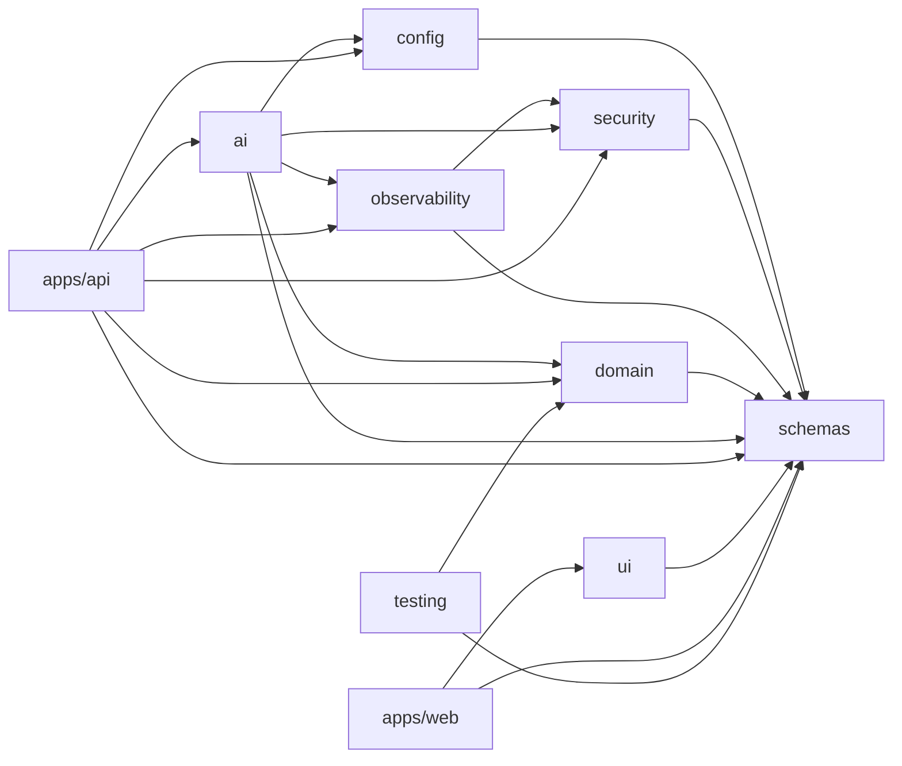
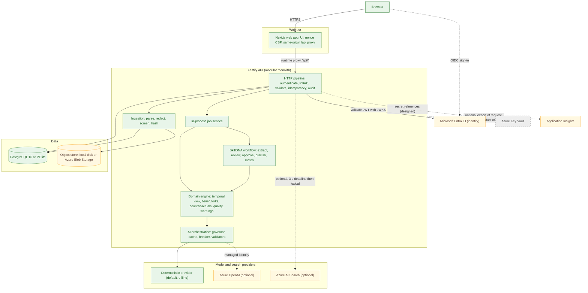
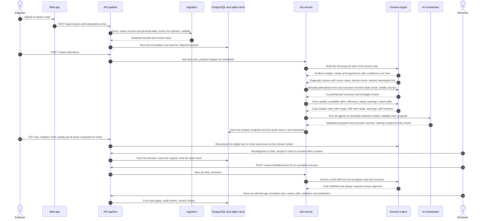
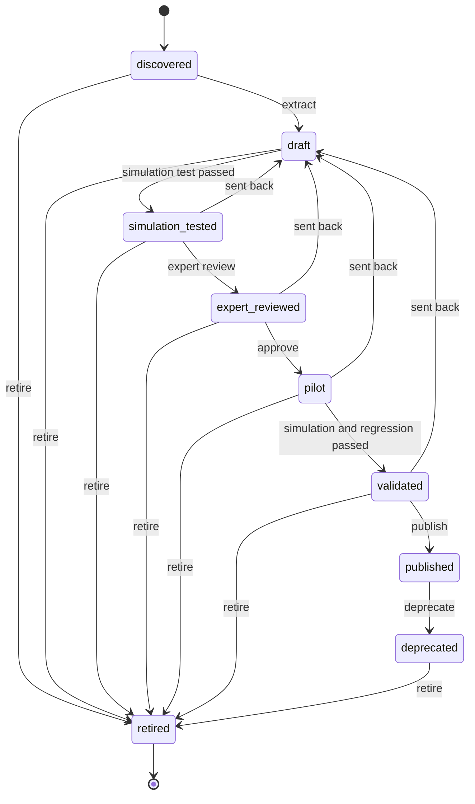
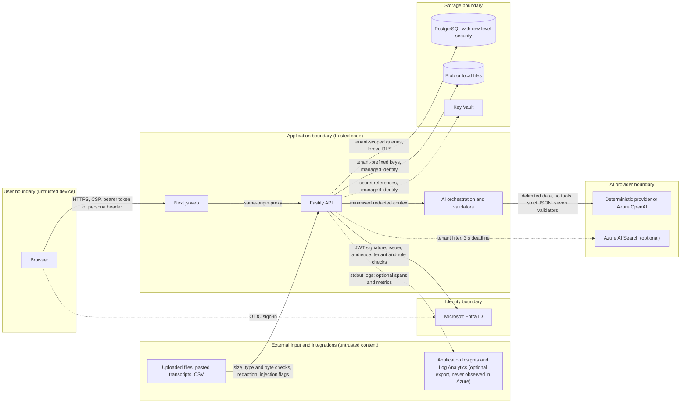
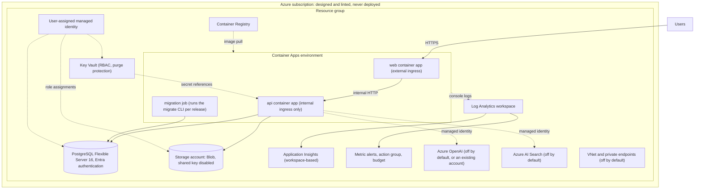

# Architecture

CaseGuard AI reviews technical support cases: it reads the written record of a case, reconstructs what was known at every
decision, asks "was a safer or cheaper step available then?", simulates the alternative from that moment only, scores the
case, and turns reviewed good paths into governed, reusable guidance (SkillDNA). This document explains how the system is built,
what each part owns, how data flows, and what is implemented, validated against mocks, or only designed.

## Documentation index

| Document                                                                                                                     | Read it for                                                                                              |
| ---------------------------------------------------------------------------------------------------------------------------- | -------------------------------------------------------------------------------------------------------- |
| **ARCHITECTURE.md** (this file)                                                                                              | System, modules, runtime, request pipeline, analysis flow, trust boundaries, failure modes, Azure design |
| [DATA_MODEL.md](DATA_MODEL.md)                                                                                               | Entities, ER diagram (diagram D), row-level security, audit chain, idempotency, jobs, migrations         |
| [DOMAIN_ENGINE.md](DOMAIN_ENGINE.md)                                                                                         | The deterministic engine: formulas, invariants, forks, counterfactuals, quality, warnings, SkillDNA      |
| [AI_ORCHESTRATION.md](AI_ORCHESTRATION.md)                                                                                   | "LLM proposes, code disposes": agents, prompts, validators, budgets, providers, mock-AI setup            |
| [SECURITY.md](SECURITY.md)                                                                                                   | Identity, RBAC matrix, tenant isolation, input handling, secrets, supply chain, limits                   |
| [PRIVACY.md](PRIVACY.md)                                                                                                     | Data inventory, synthetic-data policy, redaction, retention                                              |
| [RESPONSIBLE_AI.md](RESPONSIBLE_AI.md)                                                                                       | Human oversight, non-blaming design, uncertainty, bias and failure modes                                 |
| [EVALUATION.md](EVALUATION.md)                                                                                               | Test inventory, calibration on two synthetic cases, temporal-integrity evidence, benchmarks              |
| [LOCAL_DEVELOPMENT.md](LOCAL_DEVELOPMENT.md)                                                                                 | Run, test and debug locally                                                                              |
| [API.md](API.md)                                                                                                             | HTTP conventions, error catalogue, worked examples and the generated route reference                     |
| [USE_CASES.md](USE_CASES.md)                                                                                                 | The personas and what each can do today, tied to real routes and pages                                   |
| [GUIDED_REVIEW.md](GUIDED_REVIEW.md)                                                                                         | The guided review and the report: what each section reads, how it degrades, what is checked and not      |
| [KNOWN_LIMITATIONS.md](KNOWN_LIMITATIONS.md), [ROADMAP.md](ROADMAP.md)                                                       | What is not validated, not built or not yet safe, and the next steps derived from it                     |
| [OBSERVABILITY.md](OBSERVABILITY.md)                                                                                         | The real log and metric contract, Kusto queries, alerts                                                  |
| [THREAT_MODEL.md](THREAT_MODEL.md)                                                                                           | STRIDE and AI-specific threats (SECURITY.md maps to its ids)                                             |
| [REQUIREMENTS.md](REQUIREMENTS.md), [ASSUMPTIONS.md](ASSUMPTIONS.md), [IMPLEMENTATION_PLAN.md](IMPLEMENTATION_PLAN.md)       | Requirements, assumptions and the plan                                                                   |
| [DEPLOYMENT.md](DEPLOYMENT.md), [CI_CD.md](CI_CD.md), [ENTRA_ID_SETUP.md](ENTRA_ID_SETUP.md), [COST_GUIDE.md](COST_GUIDE.md) | Azure deployment design, pipelines, identity setup, costs (none of it executed)                          |
| [adr/](adr/), [runbooks/](runbooks/README.md)                                                                                | Architecture decision records and operational runbooks                                                   |

## 1. Context and goals

| Goal                                              | How the design serves it                                                                                           |
| ------------------------------------------------- | ------------------------------------------------------------------------------------------------------------------ |
| Judge decisions on what was known **then**        | A branded `TemporalView` type; every analysis, warning, prompt and match takes only an as-of view (section 8)      |
| Numbers a reviewer can trust to be reproducible   | A pure, deterministic engine with injected clock, ids and seed; the AI layer cannot change a number                |
| Safe use of language models                       | "LLM proposes, code disposes": minimised redacted context, no tools, seven validators, deterministic fallback      |
| Governed reuse of good practice                   | SkillDNA lifecycle with four-eyes approval, simulation and regression tests, audit, rollback; never auto-published |
| Multi-tenant safety                               | Tenant from the credential only, tenant-scoped repositories, composite keys, forced row-level security             |
| Honest about uncertainty                          | Every figure is labelled estimated or simulated and carries a range ([RESPONSIBLE_AI.md](RESPONSIBLE_AI.md))       |
| Runs anywhere offline, deploys on Azure by design | Embedded PGlite, local files, offline provider by default; Bicep for Azure Container Apps (never deployed)         |

Non-goals: real customer data (synthetic only), ranking or scoring people, automatic case closure, a ticketing system.

## 2. What is implemented, validated, designed

| Status                                                     | Components                                                                                                                                                                                                                                                                                                                                                                                                                                                                                                                                                                                                                                                                                                                                                  |
| ---------------------------------------------------------- | ----------------------------------------------------------------------------------------------------------------------------------------------------------------------------------------------------------------------------------------------------------------------------------------------------------------------------------------------------------------------------------------------------------------------------------------------------------------------------------------------------------------------------------------------------------------------------------------------------------------------------------------------------------------------------------------------------------------------------------------------------------- |
| **Implemented and tested** (local)                         | Domain engine and all computed outputs; ingestion parsers and pipeline; redaction and injection screening; deterministic AI provider, orchestrator, validators, governor, cache, breaker; RBAC; tenant isolation and RLS on PGlite; audit chain; idempotency; job service; lexical search (PostgreSQL full-text); local object store; Fastify API pipeline; Next.js web app (jsdom tests)                                                                                                                                                                                                                                                                                                                                                                   |
| **Implemented, validated only against mocks or stand-ins** | Azure OpenAI provider; Entra JWT validation, the just-in-time provisioning of Entra users (tested against the repository, never with a live tenant) and MSAL browser sign-in; Azure Blob adapter; Azure AI Search adapter (all with fake `fetch`, fake credentials or a local mock server); the tenant provisioning done by the migration job (PGlite only); the optional Application Insights export of request spans and product metrics (fakes, plus one run of the real SDK against a loopback stand-in; off unless `APPLICATIONINSIGHTS_CONNECTION_STRING` is set, never observed in Azure). The `pg` driver has run on PostgreSQL 16 only in CI (1,011 passed, 0 failed), while Entra token authentication to PostgreSQL has **no validation at all** |
| **Designed only**                                          | Everything in Azure (Bicep, Key Vault references, managed identities, private networking, alerts, budget); Redis cache; Content Safety (Prompt Shields); malware scanning; retention enforcement; external anchoring of the audit chain; a durable multi-replica job queue                                                                                                                                                                                                                                                                                                                                                                                                                                                                                  |

"Tested" means covered by automated tests in the repository; [EVALUATION.md](EVALUATION.md#2-test-inventory) says which runs I
performed myself.

Nothing has been deployed to Azure, no Docker image was built locally (no daemon was available; the CI containers job builds both),
and no real Azure OpenAI, Entra, Blob or AI Search call was ever made. Route-group status is in section 16.

## 3. Module boundaries

Arrows point from a package to what it imports (`package.json` dependencies). `packages/domain` also declares `@caseguard/security`
but nothing in its `src` imports it. The web app never imports the API: they meet only through HTTP and the shared `schemas`.

| Package / app            | Owns                                                                                                                                                                                                  | Must not                                                                     |
| ------------------------ | ----------------------------------------------------------------------------------------------------------------------------------------------------------------------------------------------------- | ---------------------------------------------------------------------------- |
| `packages/schemas`       | Zod contracts: entities, case bundle, knowledge-pack format, governance, metrics notices, enums, the **route registry** `ROUTES` (78 routes, permission per route)                                    | Import any other package; contain logic beyond validation                    |
| `packages/config`        | Environment parsing, defaults, the fail-fast guards, the `Secret` wrapper                                                                                                                             | Read secrets from anywhere but the environment                               |
| `packages/security`      | RBAC (`ROLE_PERMISSIONS`), identity strategies (dev persona, Entra JWT), tenant assertions, redaction, injection detection, upload validation, malware hook, URL safety, headers/CSP                  | Know about HTTP frameworks or databases                                      |
| `packages/observability` | Logger with four-layer redaction, correlation context, in-process metrics, health registry, tracing hooks                                                                                             | Log case content                                                             |
| `packages/domain`        | The deterministic engine (section 6 and [DOMAIN_ENGINE.md](DOMAIN_ENGINE.md)): parsers, knowledge pack, temporal view, belief, forks, counterfactuals, quality, metrics, warnings, coaching, SkillDNA | Perform I/O, read the clock or random numbers directly                       |
| `packages/ai`            | Provider abstraction (deterministic, Azure OpenAI), prompt registry, context builder, validators, governor, cache, resilience, orchestrator, evaluation harness                                       | Change a number computed by the domain; call a model with unvalidated output |
| `apps/api`               | HTTP pipeline, route handlers, services, the PostgreSQL/PGlite layer and migrations, object storage, search, job service, composition root                                                            | Put business rules in routes (routes only map HTTP to services)              |
| `packages/ui`            | Design tokens, Fluent theme, accessible charts, investigation graph, shared components                                                                                                                | Call the API                                                                 |
| `apps/web`               | Next.js pages, the same-origin proxy, CSP, dev-persona and MSAL authentication                                                                                                                        | Import `apps/api`                                                            |
| `packages/testing`       | Fixture loaders, builders, fake clock, in-memory database harness                                                                                                                                     | Be imported by production code                                               |

The API is a **modular monolith** ([ADR 0002](adr/0002-modular-monolith.md)): `src/{http,routes,services,db,storage}` with the
route groups `session`, `ingestion`, `cases`, `analysis`, `views`, `counterfactuals`, `skills`, `governance`, `search`, `dashboard`,
`demo` and `system`. A handler receives a `RequestContext` (auth, tenant-scoped repositories, services, logger, metrics, audit,
abort signal) and calls a service; services talk to repositories and to the domain and AI packages through ports.

## 4. Runtime architecture (diagram A)

Green: implemented and tested locally. Amber: implemented, validated only against local mocks (or, for Blob and the local disk
default, the local path is tested and the Azure path is mock-validated). Grey dashed: designed, not implemented or never run.

Key properties:

- **One deployable API process.** Jobs, caches, the AI orchestrator state, rate-limit counters and the circuit breaker live in
  process memory. This is simple and fast, and it is why the multi-replica story is a documented limitation
  ([DATA_MODEL.md](DATA_MODEL.md#9-jobs)).
- **The browser only talks to its own origin.** The web server's `src/proxy.ts` (the Next.js 16 "proxy", formerly middleware) forwards `/api/*`
  and `/livez`, `/healthz`, `/readyz` at request time to the API (`API_INTERNAL_URL`, default `http://localhost:4000` outside production;
  a missing or invalid value in production is a 502 `upstream_not_configured` problem). The API's CORS policy is an explicit allow-list
  (`CORS_ALLOWED_ORIGINS`: unset means `http://localhost:3000` in a local run, and a deployed environment refuses to start without it;
  no wildcard, https only when deployed), and in Azure the API container app has
  **internal ingress only**.
- **Two ways to run it.** Default: PGlite on disk, local object store, lexical search, deterministic AI, persona login. Azure design:
  PostgreSQL Flexible Server, Blob, optional AI Search and OpenAI, Entra tokens, Key Vault ([section 15](#15-azure-deployment-diagram-f)).
- **Providers are swappable.** `AI_PROVIDER`, `SEARCH_PROVIDER`, `STORAGE_PROVIDER` and `CACHE_PROVIDER` select implementations; the
  defaults need no network.

## 5. Request pipeline

Order of operation for every API request (`apps/api/src/http/*`, `app.ts`):

1. **Request id and headers** (`lifecycle`): accept or create `x-request-id`, open the async correlation context
   (`requestId`, `traceId`, `spanId`), set the security headers from `@caseguard/security` (`buildSecurityHeaders` and
   `API_CONTENT_SECURITY_POLICY`), `Cache-Control: no-store`, and an abort signal that fires when the client disconnects.
2. **General rate limit** (`@fastify/rate-limit`, per client address as explained below, 404s included, probes exempt). It runs **before**
   authentication, so 401 and 403 answers are throttled like any other: credential guessing and permission probing cost the
   caller quota (`http-hardening.test.ts`, "throttling runs before authentication").
3. **Authentication in `onRequest`, before the body is parsed.** The authenticator derives the user, roles, permissions and the
   **tenant from the credential only** and stores them in the correlation context. In Entra mode the user is also provisioned just
   in time into the tenant's user list (profile re-synced at most every 5 minutes; a stored `disabled` user always wins).
   Failure is a generic 401 plus an `auth.failure` log line.
4. **Permission check.** The route's declared permission must be in the caller's set; otherwise 403 and an `access.denied` audit
   event, which is throttled to the first refusal per caller and route in each rate-limit window and reports the refusals it left
   out as `suppressedSincePrevious` on the next one. Three routes have no route permission: `session.me`, `dev.personas` and
   `jobs.cancel` (the job service then requires the permission that starts that kind of job).
5. **Body default and validation.** A missing body becomes `{}`; params, query and body are validated with the route's Zod schema (422
   with field paths). Size limits apply (JSON 1 MiB, upload 2 MiB, one file). An upload that was cut at the limit is refused with 413
   and a malformed multipart body with 400.
6. **Heavy-route limit.** Analysis, counterfactuals, skill extraction, simulation, mutation and apply (including applying a match to
   a case), case creation and upload, the ingestion previews, demo seeding, the data export and the audit verification also pass a
   per-user limit.
7. **Handler and service.** The route maps HTTP to a service call. Long operations start a **job** and return 202 with the job.
8. **Idempotency.** Routes marked `idempotent` use the `Idempotency-Key` header. Keys are private to the calling user (route plus a
   hash of the user id, inside the tenant); a replay returns the stored response with `Idempotent-Replayed: true` and is marked
   `details.replayed` in its audit event; the same key with a different request is a 422.
9. **Audit.** Specific audit events are written by the services in the same transaction as the change; a mutating route that did not
   audit itself gets an `api.<routeId>` event; two sensitive reads are audited.
10. **Response.** The result is validated against the route's response schema (a contract break becomes a generic 500), errors are
    RFC 9457 `problem+json` with a `correlationId`, and a single `http.request` log line records method, route pattern, status and
    duration. Only genuine Fastify client errors (`FST_*`) may choose a 4xx status; a dependency fault (Azure SDK `RestError`,
    database or network outage) answers **503 `provider_unavailable`**.

**Client address for rate limits.** In Azure the API has internal ingress and its only caller is the web app, so the socket peer is
always a web replica. To throttle visitors individually, the web server (`apps/web/src/lib/api-forward.ts`) deletes any
`x-cg-client-ip` the client sent and sets its own from the **right-most** `x-forwarded-for` entry, the address the Container Apps
ingress is expected to have appended (ports and IPv6 brackets are stripped; an entry that is not a literal IPv4 or IPv6 address sets no header, and the
entries to its left, which the client controls, are never consulted). The API believes that header only when
`TRUST_CLIENT_IP_HEADER=true` (default `false`; the Bicep template sets it for the API container; **never** enable it on an API
that browsers can reach directly, because a caller could then choose its own bucket and no configuration guard prevents that).
Otherwise, or when the value is not an address, it uses the socket peer, which follows `TRUST_PROXY` (`false`, a hop count, or an
address list; `true` is for local experiments and warns when deployed). IPv6 clients are bucketed by /64. The address feeds only the
two rate limiters and is never logged or audited. Status: implemented on both sides and tested with **simulated headers only**
(`apps/web/src/proxy.test.ts`, `apps/api/test/http-hardening.test.ts`); it has **not been observed behind a real Container Apps
ingress**, so "the right-most entry is the visitor" is an assumption ([ASSUMPTIONS.md](ASSUMPTIONS.md), A-19 and A-20;
[SECURITY.md](SECURITY.md#client-address-for-rate-limits); post-deploy check 12 in [DEPLOYMENT.md](DEPLOYMENT.md#57-post-deploy-smoke-tests)).

Health: `/livez` (process up), `/healthz` (process up, no dependency checks), `/readyz` (cached checks; 503 only when `database` or
`migrations` is down, other dependencies degrade). Details and the test evidence are in [SECURITY.md](SECURITY.md#6-request-pipeline-controls).

**Jobs.** Analysis, counterfactual generation, skill extraction and mutation and demo seeding run in the API process with a
concurrency of 2 and a 10 minute limit per job (the demo seed asks for 20 minutes). Each job persists stages and progress; the process that owns it writes a heartbeat
(`jobs.heartbeat_at`, migration 0009) every 10 seconds. A job whose owner has been silent for 60 seconds is failed as orphaned by
a periodic sweep (every 30 seconds outside local runs; a lone local process fails everything unfinished at start-up) and is never
resumed. A cancel that reaches another replica is noticed by the owner at its next heartbeat, and cancelling needs the permission
that starts that kind of job ([DATA_MODEL.md](DATA_MODEL.md#9-jobs)).

## 6. Case-analysis data flow (diagram B)

Notes on the flow, each traced to code in `apps/api/src/services`:

- **Ingestion** (`services/ingestion`): one pipeline behind preview and create (size and file checks, parse, policy, redaction,
  injection screening, validation of the _redacted_ bundle against the bundle schema because redaction can lengthen a value, semantic
  validation, content hash). Redaction hands the whole bundle to the engine as one batch with one request-wide time budget for the
  tenant's custom patterns, so a pattern is evaluated once per bundle and not once per field; a pattern that cannot be applied fails
  the payload closed (the preview answers "not ok" and shows nothing of it, a create answers 422) instead of storing partly redacted
  text. A preview never writes anything and predicts what a create does: identical content is reported as
  `alreadyIngestedCaseId`, a reference used by a case with different content (an exact lookup, `CaseRepository.findByReference`) is an
  error issue (the create answers 409), so `ok: true` is never followed by a 409 or 422. The unique `(tenant, reference)` index settles
  two creates that race for one reference: the one that loses is answered with the same 409 (`settleDuplicate` in `persist.ts`), never a 500. Pasted text and CSV get a generated `CG-DRAFT-` reference that is a digest of the whole draft, so
  the same content always has the same reference and changed content (another day for time-only stamps, another title) never collides
  with an earlier case. Create stores the redacted payload in the
  object store first and compensates (deletes it) if the database transaction fails. An identical payload returns the existing case.
  Erasing a case (`cases.delete`) also erases the stored idempotent responses that describe it, so a retry with the same
  `Idempotency-Key` creates anew instead of replaying a case that no longer exists.
- **Analysis** (`services/analysis`): job stages `load`, `analyse`, `counterfactuals`, `assess`, `warnings`, `skills`, `agents`,
  `save`. The **input hash** covers the stored payload, pack id and version, action-value and quality configuration, the skill
  library, the engine version and the AI provider and model; identical input is not recomputed (the previous run is reused), and
  `force` re-runs it. The engine seed is `simulationSeed(inputs)`, a hash of the case content only (stored payload hash, event
  count, resolved or not, pack): no generated id, and not the skill library, provider, configuration or engine version that
  the input hash also covers, so reruns reproduce and the same content gives the same numbers in any database. The counterfactual stage simulates up to 12 eligible
  forks: the earliest meaningful fork with all three strategies, the others with `balanced`.
- **Agents** run after the deterministic computation, validated and recorded. In the committed pipeline **model proposals are not
  merged**: every stored artefact comes from the engine ([AI_ORCHESTRATION.md](AI_ORCHESTRATION.md#8-how-the-api-binds-it-appsapisrcservicesai)).
- **Views** (`services/views`) recompute the engine on what was known at `asOf` rather than filtering the final analysis; a small LRU
  cache keeps recent recomputations warm. The digital twin, timeline, investigation graph, action ranking at a decision moment,
  warnings and quality as-of all follow this rule.
- **Counterfactuals** can also be generated on demand (`POST .../forks/:forkId/counterfactuals`, job stages `load`, `simulate`,
  `validate`, `save`), reviewed (`accept` or `reject` with a reason and an optimistic version) and compared with hindsight.
- **SkillDNA** extraction needs a resolved case, a completed, valid, leak-free scenario that a reviewer accepted, and decision-time
  triggers. The result is a draft; governance does the rest.

## 7. SkillDNA lifecycle

States and transitions are `SKILL_TRANSITIONS` in `packages/domain/src/skills/lifecycle.ts`. Every transition needs a reason of at
least 5 characters and an optimistic version; **publication is always a human act**.

Gates (all must hold): `discovered` to `draft` needs `skill:extract`; moving back to `draft` needs `skill:review` and a reason;
`simulation_tested` needs `skill:validate` and a passed simulation test; `expert_reviewed` needs `skill:review` by someone who is
not the creator or the current version's author; `pilot` needs `skill:approve` by someone who is not the creator;
`validated` needs `skill:validate` plus passed simulation **and** regression; `published` needs `skill:publish` by someone who is
neither the creator nor a pilot approver, with a pilot approval on record; `deprecated` and `retired` need `skill:retire` and
no second person (withdrawing only reduces what a skill can do, so it is recorded as a `rejected` decision, which the creator may
make). Only a **full-scope** validation of the version's current content (the whole simulation set, or the regression suite over
every resolved case of the workload) can satisfy or fail a gate; a run on one case is stored but inconclusive. System
actors never approve. Only `pilot`, `validated` and `published` skills are matched against cases. Details:
[DOMAIN_ENGINE.md](DOMAIN_ENGINE.md#13-skilldna).

## 8. Temporal-integrity design

The property: **nothing recorded after an instant can influence anything computed "as of" that instant.** It is enforced at five
layers, so a mistake in one is caught by another.

1. **Type.** `TemporalView` is branded; functions that must respect "known at T" accept nothing else.
   `createTemporalViewBeforeEvent` is the exclusive decision-moment view (it never contains the event itself, later events or the
   resolution); `assertPreResolution` throws if the resolution is present.
2. **Engine.** Reply links only follow replies strictly after what they answer; analysing a prefix equals the full analysis
   restricted to it. Hindsight values are separate fields that detection, warnings and generation never read.
3. **Generation guard.** Every counterfactual records a leak check: distinctive identifiers that first appear after the boundary or
   only in the resolution must not appear in scenario text or evidence.
4. **AI boundary.** The context builder narrows the analysis to the view before anything is rendered into a prompt; the cache key
   includes the boundary; validators reject cited ids, identifiers and 6-word runs from the future and check item-level anchors.
5. **Read path.** The API recomputes views as-of instead of filtering the final result. A person's decision (a claim review, an
   action-value override, a warning dismissal, a fork review) takes part in a window only from the moment it was made, so an as-of
   response depends on the record and on the human input made up to that instant and on nothing else; the confidence ranges of a
   window are seeded from the case, the pack and the visible events alone. Recomputation is bounded by a per-user budget of 30
   cold engine passes per minute, shared with skill matching (429 with `Retry-After` when it is empty; cached windows are
   free). Details: [API.md](API.md#temporal-reads-asof) and `apps/api/src/services/views/README.md`.

Evidence (tests, mutation tests with negative controls) is listed in [EVALUATION.md](EVALUATION.md#4-temporal-integrity-evidence).
The guarantee covers the code paths and cases tested; it is not a proof for arbitrary input.

## 9. Multi-tenancy

| Layer        | Mechanism                                                                                                                                                                                                                      |
| ------------ | ------------------------------------------------------------------------------------------------------------------------------------------------------------------------------------------------------------------------------ |
| Identity     | Tenant from the credential (persona seed or the mapped Entra `tid`); never from path, query or body. Entra users are provisioned into the tenant's user list just in time (implemented and tested against the repository only) |
| Repositories | `repos.forTenant({ tenantId, actorId })`: every statement filtered by `tenant_id`, every written entity checked                                                                                                                |
| Schema       | Composite primary and foreign keys that include `tenant_id`                                                                                                                                                                    |
| Database     | `FORCE ROW LEVEL SECURITY` with a `tenant_isolation` policy; each transaction runs as `caseguard_app` with `app.tenant_id` set                                                                                                 |
| Object store | Keys `<tenant>/<case>/<source>.json` behind a tenant-scoped wrapper                                                                                                                                                            |
| AI           | One orchestrator, budget ledger and cache per tenant; cache keys include tenant and case                                                                                                                                       |
| Idempotency  | Keys are stored per tenant (RLS) and are private to the user who chose them                                                                                                                                                    |
| Search       | Lexical search runs under RLS; the Azure adapter always filters by tenant and re-checks every returned document (a foreign-tenant document is dropped, logged at error and counted as `foreign_tenant_document`)               |

Tested on PGlite (`tenant-isolation.int.test.ts`, `ownership.int.test.ts`); **not verified on a managed PostgreSQL server**, which
must be accessed by a non-superuser member of `caseguard_app` ([DATA_MODEL.md](DATA_MODEL.md#5-row-level-security-and-the-caseguard_app-role),
[SECURITY.md](SECURITY.md#5-tenant-isolation)).

## 10. Audit hash chain

Every mutation writes an audit event in the same transaction. Events form a per-tenant chain
(`hash = sha256(prev_hash + "\n" + canonicalJson(event))`, sequence numbers without gaps, a per-tenant advisory lock for appends);
the application role can only insert and select; a trigger rejects update and delete; `GET /api/v1/audit/verify` walks the chain.
`details` holds ids, counters and enums only. It is tamper-**evident**: a privileged database user can rewrite it consistently, and
no external anchor exists ([DATA_MODEL.md](DATA_MODEL.md#7-the-audit-hash-chain)).

## 11. Configuration and fail-fast guards

`packages/config` parses the environment once at start-up. The process **exits with status 1** and prints every problem (never a
value) when configuration is invalid or unsafe. Examples enforced in code: the persona login (`AUTH_MODE=dev` with `DEV_AUTH_ENABLED=true`) exists only for `APP_ENV=local` or `test`, so `development`, `staging` and `production` require `AUTH_MODE=entra` and `DEV_AUTH_ENABLED=false`; `NODE_ENV=production` with `APP_ENV` unset is refused (an unset value would mean `local`); production also requires
demo mode off, no demo auto-seed and no EICAR scanner; deployed environments require TLS to PostgreSQL, no PGlite, Azure Blob
storage, https and non-wildcard CORS origins, and no Azure OpenAI API key (managed identity only); an Azure OpenAI endpoint must be a bare https origin in every environment; an AI cost cap needs both unit prices; Entra mode needs a
tenant, an audience and a tenant map; `TRUST_PROXY=true` (believe every forwarded hop) is only a warning when deployed, and a hop count or
an address list is the intended setting; `TRUST_CLIENT_IP_HEADER` (believe the web tier's `x-cg-client-ip`) has no guard at all, so it
must be enabled only where nothing but the web app can reach the API. The container then builds the authenticator, which refuses unsafe combinations a second time
(for example dev personas in `staging`). In deployed environments the API also **refuses to start when a documented route has no
handler** (`requireComplete`). The full table is in [SECURITY.md](SECURITY.md#23-fail-closed-configuration-guards-packagesconfig).
Start-up then runs migrations only where `DB_AUTO_MIGRATE` is true (local and test by default), seeds the synthetic tenants in local or
demo environments, sweeps orphaned jobs, removes expired idempotency keys (at start-up and every 10 minutes), seeds the demo portfolio
when `DEMO_AUTO_SEED` is on (the default only for `APP_ENV=local` with demo mode; production refuses both demo mode and auto-seeding;
it runs before the server listens and a failure is logged without stopping the server), and installs handlers that log and exit on
unhandled rejections. A deployed environment never runs the seed, so the migration job (`node dist/db/migrate-cli.js`, also `pnpm db:migrate [--status] [--tenant <id>]...`) creates the `tenants` rows named by `ENTRA_TENANT_MAP` and by any `--tenant` ids, idempotently and without touching an existing tenant; Entra users are then created at first sign-in. This is verified on PGlite only (see [DEPLOYMENT.md](DEPLOYMENT.md) and the migration policy in [DATA_MODEL.md](DATA_MODEL.md)).

## 12. Observability

Structured JSON logs with `level` as a label, ISO `time`, `msg`, and `requestId`, `traceId`, `spanId`, `tenantId`, `userId` from the
async context; four-layer redaction; events `http.request`, `auth.failure`, `access.denied`, `http.error`, ingestion and AI events.
Audit events are in the database, not in the log stream. Product metrics (`caseguard_*`) are in-process and exposed through the
authenticated `GET /api/v1/system/metrics`; there is no Prometheus scrape route. Logs go to stdout; in Azure the intended path is
container stdout to Log Analytics (designed, never deployed). An optional export to Application Insights (request spans and the
product metrics, never logs) starts only when `APPLICATIONINSIGHTS_CONNECTION_STRING` is set. It is implemented and tested against
fakes and one run of the real SDK against a loopback stand-in, and it has never been observed in Azure
([OBSERVABILITY.md](OBSERVABILITY.md#9-optional-export-to-application-insights)). See
[OBSERVABILITY.md](OBSERVABILITY.md).

## 13. Trust boundaries (diagram C)

What crosses each boundary and what stops it: a request from the browser is unauthenticated until the API validates the credential;
uploaded content is untrusted and is redacted and screened before it is stored or shown to any model; model output is untrusted and
is validated before use and never trusted for numbers; storage access is tenant-scoped in the application **and** the database;
secrets never enter code, logs or configuration dumps. Threats per boundary: [THREAT_MODEL.md](THREAT_MODEL.md) and
[SECURITY.md](SECURITY.md#11-mapping-to-the-threat-model).

## 14. Failure modes and degradation

| Failure                                       | What happens                                                                                                                                                                                                                                                                                                                                                                                                                                                                                                                                                                                                                                                                                                                                                                                                                                                                                          | Evidence                                                                             |
| --------------------------------------------- | ----------------------------------------------------------------------------------------------------------------------------------------------------------------------------------------------------------------------------------------------------------------------------------------------------------------------------------------------------------------------------------------------------------------------------------------------------------------------------------------------------------------------------------------------------------------------------------------------------------------------------------------------------------------------------------------------------------------------------------------------------------------------------------------------------------------------------------------------------------------------------------------------------- | ------------------------------------------------------------------------------------ |
| **AI provider** slow, rate-limited or down    | Bounded retries with jittered backoff, then a typed **deterministic fallback**; after five consecutive failures (or three consecutive configuration faults: rejected credentials, a deployment that does not exist, unusable settings) the circuit opens for 30 s and tasks go straight to the deterministic result, after which one probe call decides; the analysis completes because stored artefacts never depend on a model; `GET /system/provider` shows `healthy: false` and `/system/health` shows the dependency as `degraded`, with the code, HTTP status and sanitised cause of the last failed call (repeated configuration faults add a "misconfigured" notice that points to the deployment name, endpoint, credentials and role assignment), and every failed call is logged as `ai.provider.failure` (codes only, never a message); fallbacks appear in metrics and execution records | `orchestrator*.test.ts`, mock Azure server tests                                     |
| AI output invalid, unsafe or leaking          | Rejected by the validators; repair once for schema, citation, grounding or size problems only; otherwise the deterministic result is used with a recorded reason                                                                                                                                                                                                                                                                                                                                                                                                                                                                                                                                                                                                                                                                                                                                      | `validators.test.ts`, evaluation harness                                             |
| AI budget or cost limit reached               | Fallback with a user-safe reason; a cost limit without unit prices refuses every model call (fail closed)                                                                                                                                                                                                                                                                                                                                                                                                                                                                                                                                                                                                                                                                                                                                                                                             | `governor.test.ts`, `orchestrator-budgets.test.ts`                                   |
| AI provider cannot be built                   | Logged, counted (`caseguard_errors_total{component="ai",code="provider_unavailable"}`) and the tenant's orchestrator is built without a provider, so deterministic code serves and the analysis completes; `system.provider` and `system.health` report `degraded` with a reason that points to the server log; creation is retried after 60 s, no restart needed                                                                                                                                                                                                                                                                                                                                                                                                                                                                                                                                     | `ai-service.test.ts`, `system.int.test.ts`                                           |
| **Search** (Azure AI Search) down or slow     | The adapter has a 3 s deadline and any failure (timeout, authentication, network, HTTP error, an oversized or non-JSON answer) falls back to PostgreSQL full-text search; so does an answer in which every document was unusable. Single malformed or foreign-tenant documents are dropped and counted (`caseguard_errors_total{component="search"}`); an empty answer stays empty. The response does not say so (a retrieval metric and warning logs record it)                                                                                                                                                                                                                                                                                                                                                                                                                                      | `search-azure.test.ts`, `search-service.test.ts`, `search-documents.test.ts` (mocks) |
| **Object store** down                         | `/readyz` reports the storage check as down but stays ready (not critical); creating a case fails because the payload is written before the transaction; reading existing cases still works because the redacted payload is also in the database                                                                                                                                                                                                                                                                                                                                                                                                                                                                                                                                                                                                                                                      | `storage.test.ts`, health tests                                                      |
| **Database** down                             | `/readyz` returns 503; requests that need the database answer 503 `provider_unavailable`; liveness stays up so the platform restarts or waits; a failed migration or a changed checksum also makes `/readyz` 503                                                                                                                                                                                                                                                                                                                                                                                                                                                                                                                                                                                                                                                                                      | `http-contract.test.ts`, `migrations.int.test.ts`                                    |
| Any other dependency fault in a request       | A connection or shutdown error from PostgreSQL, a network error code, or an Azure SDK `RestError` or credential error answers **503 `provider_unavailable`** and is logged at `error` with the cause; only genuine Fastify `FST_*` errors may choose a 4xx status, so a dependency's 4xx is never relayed to the caller                                                                                                                                                                                                                                                                                                                                                                                                                                                                                                                                                                               | `problem.test.ts`                                                                    |
| **Entra JWKS** unreachable                    | New tokens whose signing key is not cached (10 minute cache) get **503**, not 401; cached keys keep working                                                                                                                                                                                                                                                                                                                                                                                                                                                                                                                                                                                                                                                                                                                                                                                           | `auth-entra.test.ts` (fake key resolver)                                             |
| API process crash or restart                  | In-flight jobs are lost; they are failed as orphaned (immediately in local environments, after 60 s without heartbeat when deployed); work is not resumed; re-running is idempotent by input hash                                                                                                                                                                                                                                                                                                                                                                                                                                                                                                                                                                                                                                                                                                     | `job-service.test.ts`                                                                |
| A job is cancelled, or the client disconnects | `POST /jobs/:id/cancel` needs the permission that starts that kind of job and stops the work cooperatively at the next stage (a cancel that reaches another replica is noticed by the owner at its next heartbeat, within about 10 s); the previous results stay in place; a client disconnect fires the request's abort signal                                                                                                                                                                                                                                                                                                                                                                                                                                                                                                                                                                       | `analysis-service.test.ts`, `job-service.test.ts`                                    |
| Rate limit exceeded                           | 429 with `Retry-After`; applies before authentication, so 401 and 403 answers count; probes are exempt; counters are per replica                                                                                                                                                                                                                                                                                                                                                                                                                                                                                                                                                                                                                                                                                                                                                                      | `http-hardening.test.ts`                                                             |
| As-of recomputation budget empty              | A user who asks for more than 30 never-visited instants (or cold skill matches) in a minute gets 429 with `Retry-After` before any engine work; cached windows and stored views are free; the budget is per tenant and user and per replica                                                                                                                                                                                                                                                                                                                                                                                                                                                                                                                                                                                                                                                           | `engine-budget.test.ts`, `views-cache.test.ts`, `views-temporal.test.ts`             |
| Application Insights / Azure Monitor          | Nothing the API depends on: the export is optional and off unless a connection string is set; the server waits at most 5 s for the SDK before it listens; a failure to start it is logged (`telemetry.exporter_start_failed`) and counted, and the API keeps serving; the flush at shutdown is bounded at 5 s; logs always go to stdout. Never observed in Azure                                                                                                                                                                                                                                                                                                                                                                                                                                                                                                                                      | [OBSERVABILITY.md](OBSERVABILITY.md)                                                 |
| Key Vault unavailable at deploy or start      | **Designed:** the container app could not start with unresolved secret references. Never exercised                                                                                                                                                                                                                                                                                                                                                                                                                                                                                                                                                                                                                                                                                                                                                                                                    | none                                                                                 |

## 15. Azure deployment (diagram F)

**Designed and linted, never deployed.** `infra/bicep/main.bicep` is a subscription-scope template with modules for monitoring,
identity, optional network and private endpoints, a container registry, storage, PostgreSQL, optional AI Search and Azure OpenAI,
optional Redis, Key Vault, role assignments, Container Apps, a budget and metric alerts. Static validation was done
(`bicep build`, `bicep lint`, parameter scan); no What-If, validate or deploy call has ever been made
([DEPLOYMENT.md](DEPLOYMENT.md), `infra/bicep/README.md`).

Facts from the template (not observed in Azure): the web app has external ingress and the API internal ingress only; environment
variables hard-wire `AUTH_MODE=entra`, `DEV_AUTH_ENABLED=false`, `DB_AUTO_MIGRATE=false`, `STORAGE_PROVIDER=azure-blob`; `AI_PROVIDER`
is `deterministic` unless an OpenAI endpoint is given, and `SEARCH_PROVIDER` is `lexical` unless search is deployed; the cache is
`memory` (the template can create Redis, the application has no Redis support); probes use `/livez` and `/readyz`; storage disables
shared-key access; the PostgreSQL authentication mode is Entra for staging and production. The web app inlines the `NEXT_PUBLIC_*`
values at **build time** (the template exposes exactly those as `webBuildArguments`), whereas the API address `API_INTERNAL_URL` is
purely a runtime variable of the web container, set by the template from the API's internal address and read on every request by
`src/proxy.ts`. None of this has been exercised in Azure.

## 16. Route-group status

The contract (`ROUTES`) has 78 routes. A route group is "implemented" when its handlers exist and call real services; outside deployed
environments the API answers `501` for a contract route nobody claimed. Status when this document was last checked: all 78 routes
have a handler (`apps/api/test/route-coverage.test.ts` asserts it on every run, and a static scan of `apps/api/src/routes` agrees),
including the `dashboard` and `demo` groups (with `services/demo`,
`services/dashboard`, `services/efficiency`, `services/analytics` and the `demo:*` scripts). I started the API with an in-memory
database and called the `GET` routes of those groups: all answered 200 (a reviewer got 403 on `analytics/overview`, a manager 200),
and I exercised the demo routes, `demo:seed` and `demo:reset` by hand
([LOCAL_DEVELOPMENT.md](LOCAL_DEVELOPMENT.md#82-demo-data)). I ran only a subset of the API test files,
so "tests exist" below is not "I ran them"; see [EVALUATION.md](EVALUATION.md#2-test-inventory):

| Group             | Routes                                                                                                                                                                                                          | Status                                                                                                                                                                               |
| ----------------- | --------------------------------------------------------------------------------------------------------------------------------------------------------------------------------------------------------------- | ------------------------------------------------------------------------------------------------------------------------------------------------------------------------------------ |
| `session`         | `session.me`, `dev.personas`                                                                                                                                                                                    | Implemented; `/me` and 401 checked by hand                                                                                                                                           |
| `ingestion`       | samples, ingestion preview and preview-file, case creation (JSON, upload), schemas, examples (9)                                                                                                                | Implemented; tests exist                                                                                                                                                             |
| `cases`           | list, get, delete                                                                                                                                                                                               | Implemented; tests exist                                                                                                                                                             |
| `analysis`        | start, latest, jobs get, cancel (no route permission; checked in the job service), list                                                                                                                         | Implemented; tests exist                                                                                                                                                             |
| `views`           | twin, timeline, event detail, source provenance, evidence ledger, claim review, hypotheses, actions, action values and override, forks, graph, quality, metrics, warnings and dismissal, coaching, compare (19) | Implemented (landed while this was written); tests exist                                                                                                                             |
| `counterfactuals` | run, list, get, review, hindsight                                                                                                                                                                               | Implemented (landed while this was written); tests exist                                                                                                                             |
| `skills`          | matches and apply, the skill overlay, list, get, versions, diff, extract, transition, simulation test, mutation, version decision, rollback, apply (14)                                                         | Implemented (landed while this was written); tests exist                                                                                                                             |
| `governance`      | settings get and update, prompts, users, role assignment, audit, audit verify, reviews, export (9)                                                                                                              | Implemented; tests exist                                                                                                                                                             |
| `search`          | `search.global`                                                                                                                                                                                                 | Implemented; tests exist                                                                                                                                                             |
| `system`          | health, metrics, provider                                                                                                                                                                                       | Implemented; tests exist                                                                                                                                                             |
| `dashboard`       | command center, efficiency overview and executions, analytics overview (4)                                                                                                                                      | Implemented (read-only services over the tenant-bound repositories); tests exist; `GET` smoke: 200                                                                                   |
| `demo`            | state, seed, reset                                                                                                                                                                                              | Implemented (`services/demo`; the API also seeds the portfolio profile at start-up in local demo mode); tests exist; checked by hand: the three routes, `demo:seed` and `demo:reset` |

With both groups present every contract route has a handler, which is what the start-up completeness check
(`requireComplete`, on for deployed environments) needs. The final route table is in the API reference written separately.

## 17. Decisions

[ADR 0001](adr/0001-monorepo-strategy.md) monorepo, [0002](adr/0002-modular-monolith.md) modular monolith,
[0003](adr/0003-database-choice.md) PostgreSQL with PGlite and RLS, [0004](adr/0004-vector-retrieval-choice.md) search provider
abstraction, [0005](adr/0005-ai-provider-abstraction.md) provider abstraction and "LLM proposes, code disposes",
[0006](adr/0006-authentication.md) authentication, [0007](adr/0007-counterfactual-temporal-integrity.md) branded `TemporalView`,
[0008](adr/0008-audit-strategy.md) audit strategy, [0009](adr/0009-skilldna-governance.md) SkillDNA governance,
[0010](adr/0010-azure-hosting-choice.md) Azure Container Apps with Bicep, [0011](adr/0011-custom-svg-graph-and-charts.md) custom SVG
graph, [0012](adr/0012-nextjs-fluentui-same-origin-proxy.md) Next.js with a same-origin proxy.
