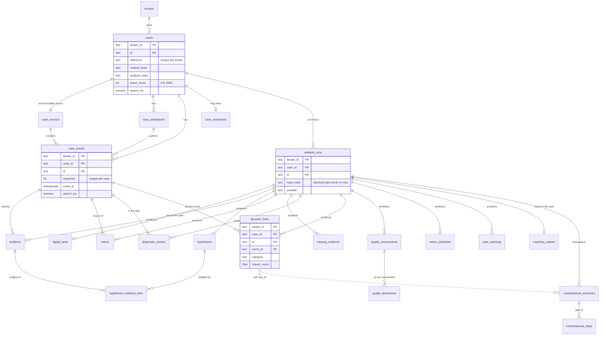
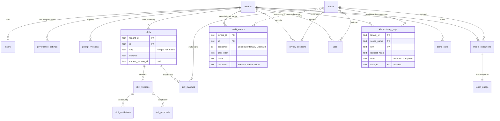

# Data model

This document describes what is stored, how tenants are kept apart, and which rows can never change. It is
written from the SQL migrations in `apps/api/src/db/migrations/` (0001 to 0012), the repositories in
`apps/api/src/db/repositories/`, and the Zod contracts in `packages/schemas/src/`. If a statement here disagrees
with a migration, the migration wins.

Part of the architecture set: see [ARCHITECTURE.md](ARCHITECTURE.md) for the system view and
[SECURITY.md](SECURITY.md) for the security model that the database enforces.

## 1. Storage at a glance

| Concern                                                                          | Where it lives                                                                                           | Notes                                                                                                                                  |
| -------------------------------------------------------------------------------- | -------------------------------------------------------------------------------------------------------- | -------------------------------------------------------------------------------------------------------------------------------------- |
| Relational data, governance, analysis artefacts, audit, jobs                     | PostgreSQL 16 in production design; PGlite (in-process PostgreSQL 18) for local development and tests    | The same SQL runs on both. PGlite is refused when `APP_ENV` is `staging` or `production`.                                              |
| Redacted source payload of each case                                             | Object store: local directory (default) or Azure Blob Storage, key `<tenantId>/<caseId>/<sourceId>.json` | A mirror of `case_sources.payload`. The tenant prefix is enforced by `scopeObjectStoreToTenant`.                                       |
| Search                                                                           | `search_tsv` generated columns and GIN indexes in the same database (see section 6)                      | No separate index to keep in step. An Azure AI Search adapter exists but has been validated against mocks only.                        |
| Caches, rate-limit counters, token budgets, circuit breaker state, the job queue | Process memory                                                                                           | Lost on restart and not shared between replicas. Daily token usage is re-seeded from `token_usage` on start (see AI_ORCHESTRATION.md). |

Every table that holds tenant data has a relational layer (columns used for filtering, sorting and joins) and a
`data jsonb` column that holds the whole entity as validated by its Zod schema. Reads re-validate `data` and throw
`DataIntegrityError` instead of returning malformed rows. Timestamps are `timestamptz` written with millisecond
precision; numbers are `integer` or `double precision` (no `bigint`, no `numeric`).

## 2. Entity-relationship diagrams (diagram D)

Taken from the foreign keys in the migrations. Every foreign key below is composite and includes `tenant_id`
(case children use `(tenant_id, case_id, ...)`); every case child cascades on delete from `cases`. Dotted lines are
soft references that the schema deliberately does not enforce (section 3.2).

### 2.1 The case record and its analysis

### 2.2 Governance, SkillDNA, telemetry and operations

## 3. Conventions

### 3.1 Keys and versions

- Every tenant-owned table has `tenant_id text NOT NULL` as the first column of its primary key. `tenants` itself is
  keyed by `id`.
- Case child tables are keyed `(tenant_id, case_id, id)`, so ids that arrive inside an uploaded bundle (event ids,
  participant ids) only need to be unique within one case.
- Generated ids are `<prefix>_<ULID-like>`; seeded ids are readable slugs (`tenant_contoso_support`). Analysis
  artefact ids are deterministic from `(caseId, stable key)` (`stableId`), which is what lets a re-analysis replace
  rows and carry reviewer decisions forward.
- Mutable rows carry `version integer NOT NULL DEFAULT 1` (`CHECK (version >= 1)`). Updates are optimistic: a stale
  version is a 409.

### 3.2 Soft references (no foreign key, on purpose)

| Column                                       | Why it is not a foreign key                                                       |
| -------------------------------------------- | --------------------------------------------------------------------------------- |
| `cases.source_id`                            | `cases` and `case_sources` reference each other; the source row has the real key. |
| `skills.current_version_id`                  | `skills` and `skill_versions` reference each other; validated in code.            |
| `counterfactual_scenarios.fork_id`           | Scenarios intentionally survive a re-analysis that rebuilds the forks.            |
| `model_executions.analysis_run_id`           | Executions are telemetry and may be recorded before or without a run row.         |
| `audit_events.case_id`                       | Audit events outlive an erased case.                                              |
| `skill_matches.version_id`, `jobs.target_id` | Point at rows whose lifetime differs from the referencing row.                    |

### 3.3 Pagination cursors

Lists use keyset pagination with an opaque cursor: `base64url(JSON [1, <kind>, ...sort-key values])`, a dot and the first 8 hex
characters of `sha256("<kind>:<payload>")`, at most 400 characters (`apps/api/src/db/cursor.ts`). The kinds are `cases`, `events`,
`claims`, `skills`, `audit`, `executions`, `reviews` and `jobs`. The checksum is an integrity check, not a secret: it rejects a
corrupted or hand-edited cursor, and a cursor minted for one list cannot be replayed against another because the kind is part of the
payload.

Anyone can compute a valid checksum for values of their choosing, so decoding also range-checks every value, and a forged cursor
is a **422**, never a database error:

| Sort-key kind | Accepted                                                                                                    |
| ------------- | ----------------------------------------------------------------------------------------------------------- |
| `timestamp`   | A real UTC instant in millisecond ISO form, years 0001 to 9999, that survives a round trip (no 30 February) |
| `text`        | An identifier under the rules of `IdSchema` (every textual sort key is a row id)                            |
| `int`         | A non-negative integer that fits a PostgreSQL `integer` (at most 2,147,483,647)                             |

Anything else raises `ValidationFailedError` ("The pagination cursor is invalid"). A forged but valid cursor can only move the
caller's position inside data the caller may already read, because every list query is parameterised and filtered by tenant. As a
last line of defence the error mapper (`db/errors.ts`) turns SQLSTATE 22003 (out of range), 22007 (invalid date or time text), 22008
(date or time overflow) and 22P02 (malformed text for the type) into a 422 with the message "A value in the request is out of range or
malformed", without copying the value or any SQL text into it. Evidence: `test/cursor.test.ts` and
`test/cursor-forgery.int.test.ts` (both ran and passed, see [EVALUATION.md](EVALUATION.md#2-test-inventory)).

## 4. Table reference

"App role" is the privilege list granted to `caseguard_app` by `caseguard_secure_tenant_table`. Where a table says
"insert only", the application role can read and insert but has no `UPDATE` or `DELETE` privilege at all.

### 4.1 Tenancy and governance (0002)

| Table                 | Key columns                                                                       | App role                      | Notes                                                                                                                                                                                                                                                                                                   |
| --------------------- | --------------------------------------------------------------------------------- | ----------------------------- | ------------------------------------------------------------------------------------------------------------------------------------------------------------------------------------------------------------------------------------------------------------------------------------------------------- |
| `tenants`             | `id`, `name`, `slug` (unique), `synthetic`                                        | select                        | Created by the seed in local and demo runs, and by the migration job in a deployed environment (`provisionTenants`: tenant row plus default settings; idempotent and additive, no user, no audit event; verified on PGlite only). The RLS policy is on `id`, so a session sees only its own tenant row. |
| `users`               | `(tenant_id, id)`, `display_name`, `email`, `roles text[]`, `status`, `synthetic` | select, update, insert (0007) | `CHECK (cardinality(roles) >= 1)`. Plain index on `(tenant_id, lower(email))` for non-empty e-mails; not unique (0007 dropped the unique index because identity providers do not guarantee unique mail). Entra sign-ins are provisioned just in time (see below the table).                             |
| `governance_settings` | `(tenant_id, section)`, `value jsonb`, `version`, `updated_by`, `change_note`     | select, insert, update        | Seven sections: `model`, `quality`, `action_value`, `retention`, `redaction`, `feature_flags`, `export_controls`. Each change bumps `version`.                                                                                                                                                          |
| `prompt_versions`     | `(tenant_id, id)`, `agent`, `semver`, `template_hash`, `status`                   | select, insert, update        | Unique on `(tenant_id, agent, semver)`. Governance view of the prompt registry in `packages/ai`.                                                                                                                                                                                                        |

**Just-in-time users.** In Entra mode the first request of a user inserts a `users` row (`apps/api/src/identity-sync.ts`,
`GovernanceRepository.upsertIdentityUser`, written as the actor `system:auth` inside the caller's tenant, so the RLS
`WITH CHECK` still confines it). The token is the source of truth for display name, e-mail and roles; `synthetic` is
`false`. The stored `status` and creation time are kept, so an administrator's `disabled` always wins: the stored user is
read on every request, and only the write is skipped while the profile is unchanged for 5 minutes (`IDENTITY_SYNC_TTL_MS`,
an in-memory fingerprint of name, e-mail and sorted roles, at most 5,000 remembered profiles). No API route sets a user's
`status` to `disabled`; that has to be done directly in the database. A failed write is logged
(`identity.sync_failed`) and the request falls back to the stored row, so a profile that cannot be saved does not lock a
user out. This is implemented and tested against the repository only; it has not run against a live Entra tenant.

### 4.2 The immutable case record (0003, 0010)

| Table               | Key columns                                                                                                                       | App role                       | Notes                                                                                                                                                                                                                                                                          |
| ------------------- | --------------------------------------------------------------------------------------------------------------------------------- | ------------------------------ | ------------------------------------------------------------------------------------------------------------------------------------------------------------------------------------------------------------------------------------------------------------------------------ |
| `cases`             | `(tenant_id, id)`, `reference`, `workload`, `status`, `synthetic`, `content_hash`, `analysis_state`, `event_count`, `tags text[]` | select, insert, update, delete | `CHECK (event_count BETWEEN 0 AND 2000)`. The only mutable case row (analysis state, last run id). Indexes: list `(tenant_id, opened_at DESC, id DESC)`, by status, by analysis state, by `content_hash`. `UNIQUE (tenant_id, reference)` (0010) is also the reference lookup. |
| `case_sources`      | `(tenant_id, case_id, id)`, `received_sha256`, `stored_sha256`, `storage_ref`, `payload`, `redaction_replacements`                | select, insert                 | Exactly one per case (`UNIQUE (tenant_id, case_id)`). `UNIQUE (tenant_id, received_sha256)` is the ingestion idempotency index. `payload` is the redacted text exactly as stored. Trigger rejects UPDATE and DELETE.                                                           |
| `case_participants` | `(tenant_id, case_id, id)`, `role`, `alias`, `event_count`                                                                        | select, insert                 | Aliases only. No mutation trigger; the application role simply has no UPDATE or DELETE privilege.                                                                                                                                                                              |
| `case_events`       | `(tenant_id, case_id, id)`, `source_id`, `sequence`, `event_ts`, `participant_id`, `type`                                         | select, insert                 | `sequence` is zero-based, gap-free, `< 2000`, unique per case. Timeline index `(tenant_id, case_id, event_ts, sequence)`. Trigger rejects UPDATE and DELETE.                                                                                                                   |
| `case_resolutions`  | `(tenant_id, case_id)`, `resolved_at`                                                                                             | select, insert                 | At most one per case. Kept apart from events because the resolution is the one thing temporal analysis must not see early. Trigger rejects UPDATE and DELETE.                                                                                                                  |

**Case references (0010).** The reference (`CG-SYN-1001`) is what people quote, and it is **unique within a tenant**: the database
enforces `UNIQUE (tenant_id, reference)` (constraint `cases_tenant_reference_uq`), which replaced the plain index of 0003. Until
0010 only the ingest service guarded it, by reading a bounded page of recent cases, so a reference could be reused in a large
workspace and two concurrent ingests could both pass the check; the service still checks first, so that a preview can predict the
outcome, but the constraint is what settles it.

- The comparison is exact and case-sensitive. Another tenant may use the same reference.
- `CaseRepository.findByReference(reference)` is the exact, tenant-bound lookup (through the unique index). A string that cannot be
  a reference (empty, longer than 200 characters, control characters) is a 422; anything else that matches nothing is `null`.
- A case with different content under a used reference is refused: the unique violation (SQLSTATE 23505) becomes a **409** with
  `details.reason: "duplicate"` and the message "A case with this reference already exists in this workspace". The ingest is one
  transaction, so nothing of the refused case remains, and the audit record that shares the transaction rolls back with it. The
  same content again is still the idempotent replay (the content hash), not a conflict.
- Two concurrent ingests of one new reference: PostgreSQL's unique index lets one win. PGlite has one connection, so this race
  cannot be exercised in the tests; it rests on the database's locking.
- **Upgrade.** A database that already holds two cases with one reference in one tenant cannot take the constraint: migration
  0010 fails with SQLSTATE 23505 on `cases_tenant_reference_uq`, nothing from it is applied (it runs in one transaction) and the
  runner names the migration and the constraint. List the pairs with
  `SELECT tenant_id, reference, count(*) FROM cases GROUP BY 1, 2 HAVING count(*) > 1;`, rename or erase all but one case of each (a
  rename must update both the `reference` column and `data->'reference'`) and run `pnpm db:migrate` again.

### 4.3 Analysis artefacts (0004)

An analysis run is stored as a snapshot by `AnalysisRepository.saveSnapshot` in one transaction. `analysis_runs`
are kept as history; the artefact tables hold the latest set, replaced as a whole. Rows that keep their
deterministic id carry the previous reviewer decision forward (claim review state and corrected category, warning
dismissals, fork review state, applied skill matches), and flags only ever accumulate. Per-run limits bound every
list (for example 10,000 evidence rows, 500 forks, 1,000 warnings).

Two carry-forwards the repository cannot know about are done by the analysis service and saved in the same transaction
as the snapshot. An applied skill match keeps who applied it and when, and its `conformance` is recomputed on the new
analysis (never copied); when its skill is no longer matchable (deprecated or retired since) the stored match is kept
as it was, with its `lifecycle` set to the skill's current state, because an application is a human decision and part
of the case's history. A counterfactual scenario keeps its review decision when the regenerated simulation is the same
one (same fork, strategy, steps, numbers and checks; the run, the model execution, the wording of the steps and the leak
check time do not count). A scenario whose simulation changed comes back `pending`, and a `counterfactual.review_reset`
audit event records it with ids and counters only. The engine seeds its rollouts from the case content alone (not from the
analysis input hash, which also covers generated skill ids), so a change of the skill library, the provider or a release
that moves no number leaves every simulated figure and every decision as it was; a change of the governed configuration
or of the engine's model changes the numbers of the paths it touches and resets only those decisions at the next
re-analysis.

| Table                                       | Key columns                                                                                                                           | Notes                                                                                                                            |
| ------------------------------------------- | ------------------------------------------------------------------------------------------------------------------------------------- | -------------------------------------------------------------------------------------------------------------------------------- |
| `analysis_runs`                             | `(tenant_id, case_id, id)`, `status`, `provider`, `model`, `input_hash`, `started_at`                                                 | Index `(tenant_id, case_id, input_hash)` backs "identical input never re-runs". The hash covers engine version and provider too. |
| `digital_twins`, `coaching_reports`         | `(tenant_id, case_id)`, `analysis_run_id`                                                                                             | One per case, replaced by the latest run.                                                                                        |
| `evidence`                                  | `signal_id`, `kind`, `strength`, `category`, `event_id`, `observed_at`, `confidence`                                                  | FK to `case_events`: a piece of evidence can only cite an event of its own case. Index by `observed_at` for as-of reads.         |
| `hypotheses`, `hypothesis_evidence_links`   | `key` (unique per case), `current_confidence`, `current_status`; link `polarity`, `likelihood`, `log_likelihood_ratio`, `observed_at` | Links reference both a hypothesis and an evidence row. Confidence figures are model estimates.                                   |
| `claims`                                    | `category`, `ai_category`, `reviewed_category`, `review_state`, `flags text[]`, `claim_ts`, `simulated`                               | The original AI classification (`ai_category`) is kept next to the reviewed one. Nullable `event_id` for inferred claims.        |
| `missing_evidence`                          | `requirement_id`, `criticality`, `first_relevant_at`, `resolved_at`                                                                   | Partial index on unresolved rows for the command center.                                                                         |
| `diagnostic_actions`                        | `event_id`, `sequence`, `action_key`, `kind`, `destructive`, `is_repeat`, `low_value`                                                 | One per engineer step the engine recognised.                                                                                     |
| `decision_forks`                            | `event_id`, `category`, `severity`, `impact_score`, `is_earliest_meaningful`, `review_state`                                          | Decision-time fields and hindsight fields are separated inside `data` (see DOMAIN_ENGINE.md).                                    |
| `quality_assessments`, `quality_dimensions` | `composite_score`, `composite_low`, `composite_high`, `band`; dimension `key`, `weight`, `raw_score`, `penalty_points`, `score`       | Composite and range are columns so lists can sort on them. `as_of` is set for as-of assessments.                                 |
| `metric_estimates`                          | `key` (unique per case), `value`, `unit`, `status`, `confidence`, `synthetic`                                                         | Every row is an estimate; `synthetic` says whether the case was.                                                                 |
| `case_warnings`                             | `rule_id`, `category`, `priority`, `fingerprint` (unique per case), `raised_at`, `resolved_at`, `state`                               | `fingerprint` is the dedupe key (`#n` suffix for a re-occurrence). Partial index on `state = 'open'`.                            |

### 4.4 Counterfactuals and SkillDNA (0005)

| Table                      | Key columns                                                                                                                           | App role                       | Notes                                                                                                                                                            |
| -------------------------- | ------------------------------------------------------------------------------------------------------------------------------------- | ------------------------------ | ---------------------------------------------------------------------------------------------------------------------------------------------------------------- |
| `counterfactual_scenarios` | `(tenant_id, case_id, id)`, `fork_id` (soft), `strategy`, `status`, `as_of`, `review_state`, `actual_tokens`, `counterfactual_tokens` | select, insert, update, delete | `as_of` is the decision instant the simulation was bounded by. Review fields hold the human accept or reject. The leak check and validity checks live in `data`. |
| `counterfactual_steps`     | `(tenant_id, case_id, scenario_id, id)`, `step_index`, `simulated_at`, `action_key`                                                   | select, insert, update, delete | Unique `(scenario, step_index)`. Every step is labelled simulated in `data`.                                                                                     |
| `skills`                   | `(tenant_id, id)`, `key` (unique per tenant), `lifecycle`, `current_version_id`, `has_proposed_mutation`, `source_case_ids text[]`    | select, insert, update, delete | Library record. Skills keep their source case ids and provenance (the case reference) and are **not** removed when a case is erased.                             |
| `skill_versions`           | `(tenant_id, skill_id, id)`, `semver`, `sequence`, `state`, `content_hash`                                                            | select, insert, update         | Unique per `(skill, semver)` and `(skill, sequence)`. The content hash lets a rollback reuse an earlier validation.                                              |
| `skill_validations`        | `kind`, `outcome`, `executed_by`, `executed_at`                                                                                       | select, insert                 | Insert only: a validation result is never edited.                                                                                                                |
| `skill_approvals`          | `from_state`, `to_state`, `decision`, `approver`, `requested_by`, `decided_at`                                                        | select, insert                 | `CHECK (decision <> 'approved' OR approver <> requested_by)`: the four-eyes rule has a database backstop as well as the domain gate. Insert only.                |
| `skill_matches`            | `(tenant_id, case_id, id)`, `skill_id`, `as_of`, `score`, `applicability`, `applied`                                                  | select, insert, update, delete | Matches are computed as of an instant; `applied` records that an engineer used it.                                                                               |

A skill validation's `scope` (`full`, or `case` for a run on one named case; absent means full) lives in its JSON
`data`. Only a full-scope validation of the version's current content satisfies or fails a lifecycle gate; a case-scope
run is stored as `inconclusive` with its real per-check results. `skill_matches` rows are written by the analysis
snapshot and by an application, never by a read (matches are computed on demand with deterministic ids).

A skill's `effectiveness` (JSON in `data`, recomputed whenever an application is recorded) compares applications with a
simulated "without the skill" baseline in its original fields and, in the optional `precedent` block, with the recorded
path of the case the skill came from (both are estimates; the block is absent when no application could be compared, for
example when the origin case was erased: the skill keeps naming it in `source_case_ids`, but its path is gone).

### 4.5 Telemetry, audit and operations (0006, 0008, 0009, 0011, 0012)

| Table               | Key columns                                                                                                                                              | App role                       | Notes                                                                                                                                                                                                                                                                                      |
| ------------------- | -------------------------------------------------------------------------------------------------------------------------------------------------------- | ------------------------------ | ------------------------------------------------------------------------------------------------------------------------------------------------------------------------------------------------------------------------------------------------------------------------------------------ |
| `model_executions`  | `(tenant_id, id)`, `case_id` (nullable, cascades), `agent`, `prompt_version_id`, `provider`, `model`, `status`, `attempts`, `latency_ms`, `simulated`    | select, insert, update, delete | One row per agent task, including deterministic ones. Hashes and metadata only: prompts and raw model output are not stored unless a caller opts in.                                                                                                                                       |
| `token_usage`       | `model_execution_id` (unique), `prompt_tokens`, `completion_tokens`, `cached_tokens`, `estimated_cost_usd`, `cache_hit`, `simulated`                     | select, insert, update, delete | `estimated_cost_usd` is NULL when no unit prices are configured: cost is unknown, never guessed.                                                                                                                                                                                           |
| `audit_events`      | `(tenant_id, id)`, `sequence`, `actor_id`, `actor_role`, `action`, `target_type`, `case_id`, `outcome`, `details`, `correlation_id`, `prev_hash`, `hash` | select, insert                 | Append-only hash chain. Section 7.                                                                                                                                                                                                                                                         |
| `review_decisions`  | `target_type`, `target_id`, `decision`, `reviewer_id`, `reviewer_role`, `decided_at`                                                                     | select, insert, delete         | Reviewer decisions with the original and new value in `data`. Delete exists only for the erasure cascade. Indexes by target type (0012): `(tenant_id, target_type, decided_at DESC, id DESC)` and `(tenant_id, case_id, target_type, decided_at DESC, id DESC) WHERE case_id IS NOT NULL`. |
| `jobs`              | `(tenant_id, id)`, `kind`, `status`, `case_id`, `idempotency_key`, `created_at`, `cancellable`, `heartbeat_at` (0009)                                    | select, insert, update, delete | Unique `(tenant_id, kind, idempotency_key)` where the key is not null. Section 9.                                                                                                                                                                                                          |
| `idempotency_keys`  | `(tenant_id, scope_name, key)`, `request_hash`, `state`, `response_status`, `response`, `expires_at`, `case_id` (nullable, 0011)                         | select, insert, update, delete | Section 8. Composite foreign key `(tenant_id, case_id)` to `cases` with `ON DELETE CASCADE`; partial index on `(tenant_id, case_id) WHERE case_id IS NOT NULL` (0011).                                                                                                                     |
| `demo_state`        | `(tenant_id, key)`, `value`                                                                                                                              | select, insert, update, delete | Holds the demo seed marker.                                                                                                                                                                                                                                                                |
| `schema_migrations` | `name`, `checksum`, `applied_at`                                                                                                                         | not granted                    | Created by the migration runner, not by a migration. No tenant column and no RLS; the application role has no privilege on it.                                                                                                                                                             |

0008 adds two partial indexes for the command center lists (`case_warnings ... WHERE state = 'open'` and
`missing_evidence ... WHERE resolved_at IS NULL`). Their predicates use only leakproof operators, so they serve the
application role under row-level security. 0009 adds the nullable column `jobs.heartbeat_at` (section 9). 0011 adds
`idempotency_keys.case_id` with its foreign key and partial index (section 8).

0012 adds the two review-decision indexes above. `ReviewRepository.list` can be narrowed to one target type (`claim`, `fork`,
`counterfactual`, `warning`, `skill`, `skill_version`, `action_value`, `hypothesis` or `twin_field`; any other value, including an
empty string, is a 422), alone or within one case, newest first with keyset pagination. The older indexes could not serve that:
the tenant-wide list read and sorted every decision of the type for every page, and the per-case list read all of a case's
decisions to filter them. The migration's header comment records one measurement on PGlite as `caseguard_app` (30,000 decisions in a
tenant, about 700 bytes each, 100 per case): tenant and type, 427 matches, 14.7 ms and 412 buffers with a sort, afterwards 0.4 ms and
54 buffers without one; one type within a case, 103 buffers, afterwards 8. That is a single run on PGlite, not a PostgreSQL 16
benchmark. `test/review-target-type.int.test.ts` also checks through `EXPLAIN` that the planner picks the indexes.

### 4.6 Seeded rows

`seedFoundation` (run when migrations are applied automatically in a local or demo environment) idempotently creates
two synthetic tenants (`tenant_contoso_support`, `tenant_fabrikam_lab`), six synthetic users (one per role in Contoso,
one engineer in Fabrikam to prove isolation) and the default value of every governance section. Existing rows are
never overwritten, so edits survive a re-seed.

## 5. Row-level security and the `caseguard_app` role

Migration 0001 defines the model; every later migration calls `caseguard_secure_tenant_table(table, privileges,
column)` for its tenant tables.

1. `caseguard_app` is a `NOLOGIN` role that owns nothing and holds only the privileges listed per table above.
2. Each tenant-scoped transaction starts with `SET LOCAL ROLE caseguard_app` and
   `SELECT set_config('app.tenant_id', <tenant>, true)`. The settings are transaction-local, so they cannot leak to the
   next request on the same connection.
3. Each tenant table has `ENABLE` and `FORCE ROW LEVEL SECURITY` and one policy, `tenant_isolation`, with
   `USING` and `WITH CHECK` of `tenant_id = nullif(current_setting('app.tenant_id', true), '')`. A session without
   the setting sees and writes nothing.
4. The repositories additionally filter every statement by `tenant_id` and check the tenant of every written entity,
   so isolation does not rest on RLS alone. Foreign keys are composite and include `tenant_id`.

**Production requirement.** PostgreSQL superusers and roles with `BYPASSRLS` ignore row-level security even when it
is forced. The API must connect as a non-superuser that is a member of `caseguard_app` (`GRANT caseguard_app TO
<login role>` when a DBA created the role). PGlite always runs as a superuser, which is why the role switch is
mandatory inside every tenant-scoped transaction. `test/tenant-isolation.int.test.ts` covers cross-tenant access on
PGlite, and `test/ownership.int.test.ts` runs migrations, seeding and the repositories with a non-superuser schema
owner. The equivalent run against a managed PostgreSQL server has not been done (see THREAT_MODEL.md, residual
risks).

## 6. Full-text search columns and indexes (0007)

Six tables have a stored generated column `search_tsv tsvector` (text search configuration `english`) and a GIN
index on it. PostgreSQL maintains the column on every insert and update, so no application code or trigger keeps an
index current, and existing rows were backfilled by the migration.

| Table           | Weight A             | Weight B                                | Weight C                           | Cut with `left()` before indexing |
| --------------- | -------------------- | --------------------------------------- | ---------------------------------- | --------------------------------- |
| `cases`         | `title`, `reference` | `tags` (through `caseguard_text_array`) |                                    | 2,000 / 200 / 2,000 characters    |
| `case_events`   | `data->>'title'`     |                                         | `data->>'body'` (already redacted) | 2,000 / 100,000 characters        |
| `claims`        |                      | claim text, `subject`                   | `data->>'explanation'`             | 2,000 / 200 / 2,000 characters    |
| `hypotheses`    | `name`               | `key`                                   | `data->>'description'`             | 500 / 200 / 5,000 characters      |
| `skills`        | `name`               | `key`, `workload`, `product`            | `data->>'description'`             | 500 / 1,000 / 5,000 characters    |
| `case_warnings` | `data->>'title'`     |                                         | `data->>'message'`                 | 1,000 / 5,000 characters          |

The warning index is partial (`WHERE state = 'open'`): only open warnings are searchable. Every text is cut before it
is indexed because `to_tsvector` fails above 1 MiB of lexemes and an oversized event body must never make an insert
fail. Queries use `websearch_to_tsquery` (the user text only ever travels as a bind parameter) and `ts_rank` with
type weights (case 1, skill 0.9, hypothesis 0.85, warning 0.8, claim 0.7, event 0.6), plain-text `ts_headline` snippets
of at most 300 characters, and a limit of 1 to 100.

**Index use under row-level security.** The `@@` operator is not leakproof, so PostgreSQL does not use the GIN
indexes for a role subject to a policy. For `caseguard_app` the statement reads the tenant's rows through the
`tenant_id` indexes and tests each stored vector: correct and tenant-safe, measured at about 50 ms for 20,000 cases on
PGlite (see `apps/api/src/db/README.md`). The indexes serve sessions that bypass RLS. Past that scale an external
search provider is the documented answer.

## 7. The audit hash chain

`audit_events` is one chain per tenant.

- `sequence` starts at 1 and increases by one; `UNIQUE (tenant_id, sequence)` is the backstop for the per-tenant lock
  (`pg_advisory_xact_lock(hashtext('audit:<tenantId>'))` on PostgreSQL; PGlite has a single connection and needs none).
- `hash = sha256(prev_hash + "\n" + canonicalJson(event without its hash))`. The first event's `prev_hash` is 64 zeros.
  `canonicalJson` sorts keys and rejects values with no stable JSON form.
- The application role has `SELECT` and `INSERT` only. A `BEFORE UPDATE OR DELETE` trigger rejects mutation with or
  without the erasure setting, and is `ENABLE ALWAYS` so it also fires under `session_replication_role = replica`.
- `AuditRepository.verify()` walks the chain in batches of 500 and reports the first bad sequence: a gap or reordering,
  a broken `prev_hash` link, a recomputed hash that differs, or a row that no longer satisfies the schema. It is exposed
  as `GET /api/v1/audit/verify` (permission `audit:read`).
- `details` holds ids, counters and enums only. Case text, prompts and secrets are not allowed there.
- **Two kinds of event are shaped by the request pipeline.** An `access.denied` event is written for the first refusal of a
  caller on a route in each rate-limit window (key: tenant, user, route; at most 10,000 keys remembered) and carries
  `suppressedSincePrevious` with the number of refusals left out since the previous event, so a low-privilege credential
  cannot grow the append-only chain at request speed (every refusal is still answered, logged and counted). A request
  answered from the idempotency store writes its usual `api.<routeId>` success event with `details.replayed: true`.
- Case erasure never deletes audit events, so an erased case's audit trail (with its reference code) remains.

**What the chain does not prove.** A table owner or superuser can disable the trigger, and a DBA who removes the tail
of a chain, or rewrites every later event consistently, is detectable only against an externally anchored head hash.
Anchoring is not implemented. The audit export includes the genesis hash, the recipe and the head so an auditor can
anchor it later.

## 8. Idempotency

`idempotency_keys` backs the `Idempotency-Key` header on the six routes marked `idempotent` in the route registry
(`cases.create`, `cases.createFromFile`, `analysis.start`, `counterfactuals.run`, `skills.extract`, `skills.proposeMutation`).

| Aspect                    | Behaviour                                                                                                                                                                                                                                                                                                                                                                                                                                                                                                                                                                                                                                                                                                                            |
| ------------------------- | ------------------------------------------------------------------------------------------------------------------------------------------------------------------------------------------------------------------------------------------------------------------------------------------------------------------------------------------------------------------------------------------------------------------------------------------------------------------------------------------------------------------------------------------------------------------------------------------------------------------------------------------------------------------------------------------------------------------------------------ |
| Key and scope             | Header value matching `[A-Za-z0-9][A-Za-z0-9._:-]{7,127}`. The scope name is `<routeId>:<first 24 hex characters of sha256(userId)>`, so a key is **private to the calling user** within the tenant: another user of the same tenant can neither replay a stored response nor block a key by registering it first. Primary key `(tenant_id, scope_name, key)`.                                                                                                                                                                                                                                                                                                                                                                       |
| Request fingerprint       | `sha256(canonicalJson({ routeId, params, query, body, file hash and name }))` stored as `request_hash`.                                                                                                                                                                                                                                                                                                                                                                                                                                                                                                                                                                                                                              |
| States                    | `begin` returns `new` (reserved), `replay` (completed with the same hash: the stored response and status are returned and `Idempotent-Replayed: true` is set), `conflict` (same key, different hash: 422) or `in_progress` (409).                                                                                                                                                                                                                                                                                                                                                                                                                                                                                                    |
| Lifetimes                 | A completed key lives 24 hours; a reservation older than 5 minutes is taken over (the first request crashed). Expired keys of a tenant are deleted opportunistically whenever a new key is reserved there, and by a sweep (below).                                                                                                                                                                                                                                                                                                                                                                                                                                                                                                   |
| Failure                   | A handler that throws releases the reservation so the client can retry; nothing is stored for a failed attempt.                                                                                                                                                                                                                                                                                                                                                                                                                                                                                                                                                                                                                      |
| Size                      | A stored response may be at most 1 MiB, otherwise the call fails validation.                                                                                                                                                                                                                                                                                                                                                                                                                                                                                                                                                                                                                                                         |
| Audit                     | A replay still audits the request: the `api.<routeId>` success event carries `details.replayed: true`, and the response has the header `Idempotent-Replayed: true`.                                                                                                                                                                                                                                                                                                                                                                                                                                                                                                                                                                  |
| Link to a case (0011)     | A completed key can name the case its response is about, so that the response is erased with the case. The link is the `caseId` path parameter, else the case of an ingest result (`case.id`), else the case of a job (`job.caseId`), else a top-level `caseId` (`linkedCaseId` in `http/idempotency.ts`). The composite foreign key `(tenant_id, case_id)` to `cases` with `ON DELETE CASCADE` deletes the key in the same statement that deletes the case.                                                                                                                                                                                                                                                                         |
| Storing a linked response | `complete(..., { caseId })` first takes `FOR KEY SHARE` on the case row, so an erasure cannot slip in before the transaction ends (the foreign key takes the same lock). If the case is already gone, the reservation is dropped and nothing is stored, because the response would describe erased data.                                                                                                                                                                                                                                                                                                                                                                                                                             |
| Erasing a case            | `CaseRepository.delete` also runs `purgeCaseResponses`: the linked keys (an index lookup) plus the completed keys without a link whose stored response mentions the case id as a whole word (a pattern delimited by anything that cannot be part of an id, so `case_1` does not match `case_10`). A retry with the same `Idempotency-Key` therefore creates anew instead of replaying a case that no longer exists. `IdempotencyRepository.purgeForCase(caseId)` does the same on its own and returns the number removed.                                                                                                                                                                                                            |
| Expiry sweep              | `purgeExpired(limit)` deletes the oldest expired keys first (1,000 per call by default, 10,000 at most) in one materialised batch with `FOR UPDATE SKIP LOCKED`, so two purges share the work. `main.ts` calls it for every known tenant at start-up and then every 10 minutes (`IDEMPOTENCY_PURGE_INTERVAL_MS`), on every replica and in local runs: at most 10 batches of 1,000 keys per tenant per sweep, and a tenant that fails is logged (`could not purge expired idempotency keys`) and skipped. It matters for tenants that stopped sending requests, because reserving a key already trims that tenant's expired keys. "Known" means the tenants of the dev personas in dev mode plus the tenants of the Entra tenant map. |

Ingestion and analysis are additionally idempotent by content: `case_sources` is unique on the received hash, and an
analysis run is found again by its input hash.

The link, the purge and the sweep are covered by `test/idempotency-erasure.int.test.ts` and `test/idempotency-link.test.ts` (both
ran and passed). The lock-based races (`FOR KEY SHARE` against an erasure, `SKIP LOCKED` between two purges) cannot be exercised on
PGlite, which has one connection; they rest on PostgreSQL's locking by design and have not been run against it.

## 9. Jobs

`jobs` persists long operations so the UI can show real stages and a restarted server can tell what it lost.

- `kind` is one of `case_analysis`, `counterfactual`, `skill_extraction`, `skill_mutation`, `demo_seed`; `status` is
  `queued`, `running`, `succeeded`, `failed` or `cancelled`. The stage list, progress and error live in `data`.
- Jobs run on the API process's event loop with a concurrency of 2 (`JobService`). The queue itself is in memory;
  the table is the record. There is no external queue and no separate worker. A job still running after 10 minutes is
  stopped and recorded as `failed` (`DEFAULT_JOB_TIMEOUT_MS`; a job may ask for another limit, and the `demo_seed` job asks for 20
  minutes).
- **Liveness (0009).** The process that owns running jobs writes `jobs.heartbeat_at` every 10 seconds
  (`JOB_HEARTBEAT_INTERVAL_MS`, only while it owns jobs); the same round trip tells the owner that its job was cancelled from
  another replica or failed as orphaned, and the owner then stops the work. A job's last sign of life is
  `coalesce(heartbeat_at, started_at, created_at)`.
- **Cancelling.** `POST /api/v1/jobs/:jobId/cancel` has no permission at the route (any signed-in user may ask); the job
  service then requires the permission that starts that kind of job: `case:analyze` for `case_analysis`,
  `counterfactual:run`, `skill:extract`, `skill:mutate` and `demo:manage` for the other kinds. A queued job is dropped at once;
  a running job is told to stop, and a job owned by another process (or left over from an earlier one) is marked
  `cancelled` in the table and noticed by its owner at the next heartbeat.
- **Orphan recovery.** `recoverOrphans` marks a `queued` or `running` job as `failed` ("The server running this job
  restarted or stopped responding"); the work is not resumed. In a local or test environment (a lone process) every
  unfinished job is considered lost at start-up. In a deployed environment only a job whose last sign of life is more than
  60 seconds old (`JOB_STALE_AFTER_MS`, six missed heartbeats) is failed, at start-up and then every 30 seconds, so a replica
  that is still working keeps its jobs. This multi-replica behaviour is exercised only in `test/job-service.test.ts`, with two
  `JobService` instances sharing one PGlite database and a fake clock; it has never run with two real replicas.
- `(tenant_id, kind, idempotency_key)` is unique, so a client retry finds the job it already created.

## 10. Migration policy

| Rule                                             | Mechanism                                                                                                                                                                                                                                                                                          |
| ------------------------------------------------ | -------------------------------------------------------------------------------------------------------------------------------------------------------------------------------------------------------------------------------------------------------------------------------------------------- |
| Files are `NNNN_name.sql`, applied in order      | `loadMigrations` rejects names that do not match, and duplicate numbers.                                                                                                                                                                                                                           |
| Each migration runs in its own transaction       | `applyOne` takes `pg_advisory_xact_lock(hashtext('caseguard.schema_migrations'))`, so several replicas starting at once serialise; a migration another process applied meanwhile is skipped.                                                                                                       |
| A released migration is never edited             | The SHA-256 of every file is stored in `schema_migrations`. `migrate` refuses to continue when an applied file's checksum changed; `getMigrationStatus` reports it as `checksumMismatch`, and `/readyz` treats it as down. `test/migrations.int.test.ts` pins the checksum of every released file. |
| Checksums are stable across checkouts            | The text is hashed after removing a UTF-8 BOM and normalising CRLF to LF, so a Windows checkout with CRLF endings produces the same checksum as a Linux one. (`.gitattributes` also pins line endings.)                                                                                            |
| An older replica may run against a newer schema  | Applied migrations that this build does not ship are not drift; only a changed file for a known name is.                                                                                                                                                                                           |
| Deployed environments migrate as a separate step | `DB_AUTO_MIGRATE` defaults to `true` for `local` and `test` only. The Bicep template defines a Container Apps migration job (`migrateJobName`); this path has not been executed (nothing is deployed).                                                                                             |
| Empty-state migration                            | Covered by the integration tests on PGlite. Migrating a real PostgreSQL 16 server is supported by the SQL (nothing newer than 16 is used) but has not been exercised here.                                                                                                                         |

Run them with `pnpm db:migrate` (see [LOCAL_DEVELOPMENT.md](LOCAL_DEVELOPMENT.md)).

The twelve released migrations (`apps/api/src/db/migrations/`), from their own header comments:

| File                                  | What it adds                                                                                                                                                                            |
| ------------------------------------- | --------------------------------------------------------------------------------------------------------------------------------------------------------------------------------------- |
| `0001_foundation.sql`                 | The `caseguard_app` role, the immutability trigger functions and the helper that switches on forced row-level security for every tenant table                                           |
| `0002_tenancy.sql`                    | `tenants`, `users`, `governance_settings`, `prompt_versions`                                                                                                                            |
| `0003_cases.sql`                      | `cases` and the immutable `case_sources`, `case_participants`, `case_events`, `case_resolutions`                                                                                        |
| `0004_analysis.sql`                   | `analysis_runs` and the artefacts of a run (digital twin, evidence, hypotheses and their links, claims, missing evidence, actions, forks, quality, metrics, warnings, coaching)         |
| `0005_counterfactuals_and_skills.sql` | Counterfactual scenarios and steps, and the SkillDNA library (skills, versions, validations, approvals, matches)                                                                        |
| `0006_telemetry_audit_and_ops.sql`    | `model_executions`, `token_usage`, the append-only `audit_events` chain, `review_decisions`, `jobs`, `idempotency_keys`, `demo_state`                                                   |
| `0007_search_and_identity_sync.sql`   | `search_tsv` generated columns and GIN indexes on six tables; the e-mail look-up index and the `INSERT` privilege on `users` for just-in-time Entra provisioning                        |
| `0008_dashboard_read_models.sql`      | Two partial indexes for the tenant-wide command-center lists (open warnings, unresolved missing evidence)                                                                               |
| `0009_job_heartbeat.sql`              | The nullable `jobs.heartbeat_at` column used for job liveness and orphan recovery                                                                                                       |
| `0010_case_reference_unique.sql`      | `UNIQUE (tenant_id, reference)` on `cases` (replacing the plain reference index): one case per reference within a tenant; fails, all or nothing, on data that already holds a duplicate |
| `0011_idempotency_case_link.sql`      | `idempotency_keys.case_id` with a composite foreign key to `cases` (`ON DELETE CASCADE`) and a partial index, so erasing a case also erases the idempotent responses that describe it   |
| `0012_review_target_type_idx.sql`     | Two indexes for listing review decisions of one target type, in the tenant or within one case, newest first                                                                             |

## 11. Immutability, erasure and retention: what exists

**Immutable by construction.** `case_sources`, `case_events` and `case_resolutions` have triggers that reject UPDATE and
DELETE; `audit_events` rejects both unconditionally. The application role holds no UPDATE or DELETE privilege on them.
Content hashes are recorded at ingestion.

**Erasure of a case (implemented).** `DELETE /api/v1/cases/:caseId` (permission `case:delete`, administrator only)
sets `app.allow_erasure = on` for one statement; the triggers then allow the cascade from `cases` (DELETE only, never
UPDATE). The cascade removes the source, participants, events, resolution, every analysis artefact, scenarios and
steps, skill matches, jobs, model executions, token usage and review decisions of that case, and the idempotent responses linked to
it (0011). The repository also purges completed responses without a link whose body mentions the case id (section 8), so a retry
with the same `Idempotency-Key` cannot replay a case that was erased. The service also deletes
the mirrored object, writes the audit event `case.deleted` (counts only) in the same transaction, and refuses with a
409 while a job for the case is queued or running. A second call is a 404. The setting protects against accidents
and application bugs, not against someone who can run arbitrary SQL as `caseguard_app`.

**Demo reset (implemented).** `DemoRepository.resetTenantData` deletes `cases`, `skills`, `jobs`, `token_usage`,
`model_executions`, `review_decisions`, `idempotency_keys` and `demo_state` for one tenant, and the demo service then removes the
mirrored payloads from the object store. Tenants, users, governance settings, prompt versions and audit events are kept; the reset
itself is audited. The counts before and after one reset are in [LOCAL_DEVELOPMENT.md](LOCAL_DEVELOPMENT.md#82-demo-data).

**Idempotency keys** expire after 24 hours; expired keys are deleted when a tenant reserves a new key and by a sweep every 10
minutes, and the responses about an erased case are erased with it (section 8).

**Retention windows (stored, not enforced).** The `retention` governance section holds `caseDataDays` (default 365),
`auditDays` (730), `modelExecutionDays` (90), `analyticsDays` (365) and `legalHold`. They are validated, versioned and
audited like any setting, **but no job reads them**: nothing deletes data when a window passes. Erasure today is a
manual, per-case administrator action. This is a known limitation, not a hidden behaviour.

**Not implemented.** Scheduled retention, bulk erasure by age, archival that respects the audit chain, erasure of
skills derived from an erased case, externally anchored audit head hashes, and backup or restore procedures.
