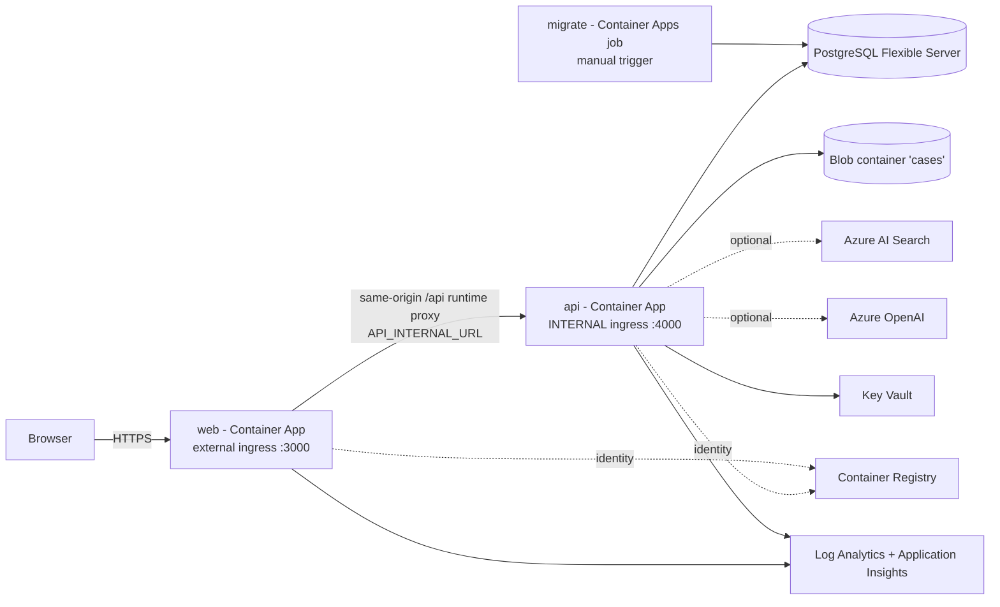

# Deployment guide (Azure)

> **NOTHING HAS BEEN DEPLOYED OR SMOKE-TESTED IN AZURE FROM THIS REPOSITORY.**
> The infrastructure is authored and statically validated (compiles and lints locally). Every Azure-facing step in this guide - What-If, deployment, image build in ACR, migration, smoke test, rollback, deletion - is **unexercised** and needs a human with credentials for a real subscription. Where this document says "expected", it describes the design, not an observed result. All demo data is synthetic.

## 1. What is and is not validated

| Item                                                                 | Status               | Evidence / reason                                                                                                                                           |
| -------------------------------------------------------------------- | -------------------- | ----------------------------------------------------------------------------------------------------------------------------------------------------------- |
| `main.bicep` and every module compile and lint                       | **Validated**        | Bicep CLI 0.48.1: `bicep lint` and `bicep build` with 0 errors and 0 warnings (`infra/bicep/README.md#validate-locally-no-azure-calls`)                     |
| `main.dev.bicepparam` builds                                         | **Validated**        | `bicep build-params`; prod and staging templates were built through temporary copies                                                                        |
| Helper scripts parse; refusal paths behave                           | **Validated**        | PowerShell parser (Windows PowerShell 5.1) and `bash -n`; placeholder, wrong-environment and wrong-name refusals exercised offline with `az` blocked        |
| What-If against a subscription                                       | **Not run**          | No Azure call was permitted while authoring                                                                                                                 |
| Deployment (any stage), role assignments, Key Vault references       | **Not run**          | Needs a subscription; RBAC propagation timing is unobserved                                                                                                 |
| `az acr build` of the API and web images                             | **Not run**          | Dockerfiles are owned by another worker; the Docker daemon was unavailable                                                                                  |
| Migrations on Azure PostgreSQL, extension allow-list, **RLS parity** | **Not run**          | CI runs the integration suite against a PostgreSQL service; managed-PostgreSQL parity (docs/THREAT_MODEL.md section 5) must be verified at first deployment |
| Entra sign-in, token validation, role mapping                        | **Not run**          | Unit-tested with locally generated keys only (docs/ASSUMPTIONS.md A-15)                                                                                     |
| Azure OpenAI, AI Search, Blob, Application Insights integrations     | **Local mocks only** | "Implemented, validated against a local mock only" (docs/ASSUMPTIONS.md A-01)                                                                               |
| Probe paths, scale rules, metric-alert names and dimension values    | **Not run**          | Compile-time property checks only; verify in the portal after the first deployment                                                                          |
| Costs, quotas, regional SKU and model availability                   | **Not validated**    | They depend on region, date and agreement; no price appears in this repository (docs/COST_GUIDE.md)                                                         |

## 2. Architecture



- One user-assigned managed identity serves the apps and the job: AcrPull, Key Vault Secrets User, Storage Blob Data Contributor (on the `cases` container), Search Index Data Contributor, Cognitive Services OpenAI User.
- Secrets live only in Key Vault and reach containers as Key Vault references. Outputs of the templates never contain secrets.
- The API has no public endpoint. Smoke tests therefore go through the web app (which proxies `/api/*`) or run inside the API container.

Full module map, parameters, naming and tags: [infra/bicep/README.md](../infra/bicep/README.md).

## 3. Prerequisites

### Accounts and permissions

- A subscription you may spend money in, with a budget owner. Use a **non-production** subscription for dev.
- The deploying identity needs, at the **subscription** scope (the template creates the resource group):
  - create resource groups and deployments, and write every resource type in the templates - for example **Contributor**;
  - create role assignments - **Owner**, **User Access Administrator**, or **Role Based Access Control Administrator** (prefer the latter with a condition that limits assignable roles to AcrPull, Key Vault Secrets User, Storage Blob Data Contributor, Search Index Data Contributor and Cognitive Services OpenAI User);
  - for budgets, possibly a Cost Management role at the scope (Enterprise/MCA agreements add billing-side settings).
- If you reference an **existing Azure OpenAI account**: permission to create a role assignment on that account.

### Resource providers

Register once per subscription (these commands change the subscription; run them yourself):

```powershell
foreach ($ns in 'Microsoft.App','Microsoft.ContainerRegistry','Microsoft.KeyVault','Microsoft.Storage','Microsoft.DBforPostgreSQL','Microsoft.OperationalInsights','Microsoft.Insights','Microsoft.ManagedIdentity','Microsoft.Network','Microsoft.Consumption','Microsoft.Search','Microsoft.CognitiveServices','Microsoft.Cache','Microsoft.Authorization') {
  az provider register --subscription <subscription-id> --namespace $ns --wait
}
```

### Tools

- Azure CLI signed in (`az login`) with the **containerapp** extension: `az extension add --name containerapp --upgrade`.
- Bicep CLI 0.48 or newer (`az bicep upgrade` or the standalone binary). Older versions may lack the API versions used.
- PowerShell (Windows PowerShell 5.1 or 7) **or** bash 4+ with curl, for the helper scripts. Docker is optional (a fallback for building images).

### Decisions to make before the first deployment

| Decision                       | Notes                                                                                                                                          |
| ------------------------------ | ---------------------------------------------------------------------------------------------------------------------------------------------- |
| Region                         | Check the caveats in section 9 first: PostgreSQL SKU, Container Apps quota, AI Search capacity, Azure OpenAI models                            |
| Entra app registrations        | Create them first and have the ids ready: [docs/ENTRA_ID_SETUP.md](ENTRA_ID_SETUP.md)                                                          |
| Budget amount and contact list | `monthlyBudgetAmount`, `contactEmails` (use a shared mailbox)                                                                                  |
| AI mode                        | Start with the deterministic provider (no Azure OpenAI). Add Azure OpenAI only after model access and quota are confirmed                      |
| Data retention                 | `blobDeleteAfterDays` must match the application retention (governance `retention.caseDataDays`); the default of 0 disables lifecycle deletion |

## 4. Configuration model

| What                                     | Where                                                                                                                                    |
| ---------------------------------------- | ---------------------------------------------------------------------------------------------------------------------------------------- |
| Per-environment values                   | `infra/bicep/main.<env>.local.bicepparam` (git-ignored), copied from `main.dev.bicepparam` or the `*.bicepparam.template` files          |
| Rollout switches                         | environment variables read by the parameter file: `CASEGUARD_DEPLOY_APPS`, `CASEGUARD_IMAGE_TAG`                                         |
| PostgreSQL password (dev, password mode) | environment variable `CASEGUARD_POSTGRES_ADMIN_PASSWORD`, then stored in Key Vault by the template; never in a file or on a command line |
| Application environment variables        | derived by `containerapps.bicep` from parameters (the contract in `BUILD_CONTRACT.md` section 6); secrets are Key Vault references       |
| Subscription and region                  | never in a file: passed to the scripts (`-SubscriptionId`/`--subscription-id`, `-Location`/`--location`)                                 |

`APP_ENV` is `development`, `staging` or `production` for `dev`, `staging` and `prod`. `AUTH_MODE=entra` and `DEV_AUTH_ENABLED=false` in every Azure environment.

**Client address for rate limits.** The per-address rate limit needs the visitor's address, and the API only ever sees the web tier. The template therefore sets two things on the API container:

- `TRUST_CLIENT_IP_HEADER=true` (the primary mechanism). The API has internal ingress and its only caller is the web app. The web server (`apps/web/src/proxy.ts`) removes any `x-cg-client-ip` header a client sent and sets it from the right-most valid entry of `X-Forwarded-For`, which is the address its own Container Apps ingress appended. The API believes that header only when this flag is true and only when the value is a single well-formed IP address; anything else is ignored. The flag defaults to `false`, and **must never be enabled if anything other than the web app can reach the API** (for example if external ingress were ever turned on for the API): a caller could then choose its own rate-limit bucket. No configuration guard enforces this.
- `TRUST_PROXY=1` (secondary, the fallback when the header is absent or invalid): a hop count, so the API believes only the address its own ingress appended to `X-Forwarded-For`. Behind the web tier that address is the web tier's, so a request without a usable `x-cg-client-ip` falls into one shared bucket (it can throttle legitimate users together, but a client cannot choose it). `TRUST_PROXY=true` would let a client choose its own address and only produces a warning when deployed.

**Status:** implemented on both sides and covered by unit and integration tests with **simulated headers only**; it has **not been observed behind a real Container Apps ingress**, so whether the right-most `X-Forwarded-For` entry at the web tier is the visitor's address is an assumption. Check 12 in [5.7](#57-post-deploy-smoke-tests) verifies it; [SECURITY.md](SECURITY.md#client-address-for-rate-limits) has the details and [ASSUMPTIONS.md](ASSUMPTIONS.md) lists the assumptions (A-19, A-20).

## 5. Dev deployment, step by step

All commands assume the repository root as the working directory. Replace placeholders; never paste real ids into files that are committed.

### 5.1 Prepare

1. Create the Entra app registrations ([docs/ENTRA_ID_SETUP.md](ENTRA_ID_SETUP.md)); note tenant id, API client id and SPA client id.
2. Copy the dev profile and fill it in:

   ```powershell
   Copy-Item infra/bicep/main.dev.bicepparam infra/bicep/main.dev.local.bicepparam
   # edit infra/bicep/main.dev.local.bicepparam: owner, costCenter, entra*, entraTenantMap, monthlyBudgetAmount, contactEmails
   ```

3. Confirm you are about to use the right subscription: `az account list --output table`. The scripts never use the "current" subscription; they require it explicitly.

### 5.2 What-If (read-only)

```powershell
./infra/scripts/what-if.ps1 -SubscriptionId <subscription-id> -Location <region>
```

```bash
infra/scripts/what-if.sh --subscription-id <subscription-id> --location <region>
```

The script prints the target (subscription id and name, tenant, resource group, environment, region), refuses a placeholder subscription id or parameter file, and asks for confirmation. Read the output: it must create `rg-caseguard-dev` and the resources in [infra/bicep/README.md](../infra/bicep/README.md#what-is-deployed), and nothing else. Expect What-If to be less precise for the role assignments and the PostgreSQL Entra administrator (they depend on the identity's principal id, a runtime value).

### 5.3 Deploy

```powershell
./infra/scripts/deploy-dev.ps1 -SubscriptionId <subscription-id> -Location <region> -GeneratePostgresPassword
```

```bash
infra/scripts/deploy-dev.sh --subscription-id <subscription-id> --location <region> --generate-postgres-password
```

The script requires you to type the resource group name, then runs:

1. **Stage 1** - `az deployment sub create` with `deployContainerApps=false`: resource group, monitoring, identity, registry, Key Vault (with the database URL, password and Application Insights connection string as secrets), storage, PostgreSQL, role assignments, budget and the Container Apps environment. The registry is empty at this point, which is why the apps are a second stage.
2. **Images** - `az acr build` for `apps/api/Dockerfile` and `apps/web/Dockerfile` (build context: the repository root, filtered by `.dockerignore` - check that local `.env` files and other secrets are excluded before you upload it to Azure), tagged with an immutable tag (git commit by default). The web build receives `NEXT_PUBLIC_*` as build arguments taken from the stage-1 output `webBuildArguments` (nothing else is in that output), because Next.js inlines the `NEXT_PUBLIC_*` values into the image. **Consequence: the web image is specific to one environment's Entra registration.** The API address is not a build argument: it is the runtime variable `API_INTERNAL_URL` of the web container (set by the template from the API's internal address), read on every request by `apps/web/src/proxy.ts`, so it does not tie the image to an environment.
3. **Stage 2** - `az deployment sub create` with `deployContainerApps=true` and the image tag: `web`, `api` and the `migrate` job.
4. **Migration** - starts the `migrate` job and waits for it (see 5.5).
5. **Smoke test** - see 5.7.

`-GeneratePostgresPassword` creates a random password that is stored only in Key Vault and **replaces the stored password on every run**. To keep a password across runs, set `CASEGUARD_POSTGRES_ADMIN_PASSWORD` yourself (16+ characters) instead.

#### Manual equivalent

```powershell
$env:CASEGUARD_DEPLOY_APPS = 'false'
$env:CASEGUARD_POSTGRES_ADMIN_PASSWORD = '<16+ characters from your password manager>'
az deployment sub create --subscription <subscription-id> --location <region> --name caseguard-dev-infra --parameters infra/bicep/main.dev.local.bicepparam
$acr = az deployment sub show --subscription <subscription-id> --name caseguard-dev-infra --query properties.outputs.containerRegistryName.value -o tsv
az deployment sub show --subscription <subscription-id> --name caseguard-dev-infra --query "properties.outputs.webBuildArguments.value" -o tsv   # KEY=VALUE lines for the web build
az acr build --subscription <subscription-id> --registry $acr --image caseguard-api:<tag> --file apps/api/Dockerfile --build-arg GIT_COMMIT=<tag> .
az acr build --subscription <subscription-id> --registry $acr --image caseguard-web:<tag> --file apps/web/Dockerfile --build-arg GIT_COMMIT=<tag> --build-arg <KEY=VALUE> ... .
$env:CASEGUARD_DEPLOY_APPS = 'true'; $env:CASEGUARD_IMAGE_TAG = '<tag>'
az deployment sub create --subscription <subscription-id> --location <region> --name caseguard-dev-apps --parameters infra/bicep/main.dev.local.bicepparam
Remove-Item Env:CASEGUARD_POSTGRES_ADMIN_PASSWORD
```

If ACR Tasks (`az acr build`) is unavailable in your subscription, build with Docker, `az acr login --name <acr>`, push `<acr>.azurecr.io/caseguard-api:<tag>` and `...caseguard-web:<tag>`, then run stage 2.

### 5.4 Entra redirect URI

The web URL (`webUrl` output, `https://<web app>.<environment domain>`) exists only after stage 2. Add it as a **Single-page application** redirect URI on the SPA app registration, then sign in. See [docs/ENTRA_ID_SETUP.md](ENTRA_ID_SETUP.md).

### 5.5 Migrations

`DB_AUTO_MIGRATE` is `false` in Azure. Schema changes run only through the `migrate` job (`node dist/db/migrate-cli.js` from the API image, one replica, no automatic retry):

```powershell
az containerapp job start --subscription <subscription-id> --resource-group rg-caseguard-dev --name <migrate job name>
az containerapp job execution list --subscription <subscription-id> --resource-group rg-caseguard-dev --name <migrate job name> --output table
```

The API's `/readyz` checks the database **and applied migrations**, so on a first deployment the API is not ready until this job has succeeded. With `apiMinReplicas = 0` (dev) this is invisible; with always-on replicas the readiness probe fails (the revision stays unhealthy, no traffic) until the job succeeds. If a job fails, stop and read [docs/runbooks/broken-migration.md](runbooks/broken-migration.md).

If your migrations run `CREATE EXTENSION`, list the extensions in `postgresAllowedExtensions` first: PostgreSQL Flexible Server rejects extensions that are not allow-listed.

### 5.6 Update revisions (new image)

Re-run stage 2 with a new `CASEGUARD_IMAGE_TAG` (the scripts do this). The apps run in **Multiple** revision mode: the new revision receives 100% of traffic once ready and the previous revision stays available for rollback. Run the migration job **before** shifting users when a release contains migrations, and keep migrations backward compatible with the previous revision so rollback stays possible (see [docs/runbooks/rollback-procedure.md](runbooks/rollback-procedure.md)).

Avoid `az containerapp update --image ...` for routine releases: it works, but the change is invisible to What-If and drifts from the template.

### 5.7 Post-deploy smoke tests

Run these in order. None of them has been run by the authors.

| #   | Check                       | How                                                                                                                                                                                                                                                                                                                                                                       | Expected                                                                                                                                                               |
| --- | --------------------------- | ------------------------------------------------------------------------------------------------------------------------------------------------------------------------------------------------------------------------------------------------------------------------------------------------------------------------------------------------------------------------- | ---------------------------------------------------------------------------------------------------------------------------------------------------------------------- |
| 1   | Migration job               | `az containerapp job execution list ...` (5.5)                                                                                                                                                                                                                                                                                                                            | latest execution `Succeeded`                                                                                                                                           |
| 2   | Revisions healthy           | `az containerapp revision list --subscription <id> --resource-group <rg> --name <app> --query "[].{revision:name,active:properties.active,health:properties.healthState,running:properties.runningState}" -o table`                                                                                                                                                       | the latest revision is active and healthy                                                                                                                              |
| 3   | Web reachable               | `curl -sS -o /dev/null -w "%{http_code}\n" -L https://<web fqdn>/` (the first request can take a cold start)                                                                                                                                                                                                                                                              | 200 (or a redirect to a login page that returns 200)                                                                                                                   |
| 4   | API reachable via the proxy | `curl -sS -o /dev/null -w "%{http_code}\n" https://<web fqdn>/api/v1/me` with no token                                                                                                                                                                                                                                                                                    | **401** from the API (a 502 with code `upstream_not_configured` means the web container has no valid `API_INTERNAL_URL`; another 5xx or a 404 means the API is broken) |
| 5   | Repository smoke test       | `node scripts/smoke-test.mjs --web https://<web fqdn> --api https://<web fqdn> --auth enforced --wait 120` (the API is internal-only, but the web server's `apps/web/src/proxy.ts` forwards `/api/*`, `/livez`, `/healthz` and `/readyz` to it at request time, so the web URL answers for the API too; `.github/workflows/deploy-environment.yml` runs the same command) | no failed checks                                                                                                                                                       |
| 6   | API health inside Azure     | `az containerapp exec --subscription <id> --resource-group <rg> --name <api app> --command "node -e \"fetch('http://127.0.0.1:4000/readyz').then(r=>{console.log(r.status);process.exit(r.ok?0:1)})\""` (needs a running replica: send a request or set `apiMinReplicas` to 1 temporarily)                                                                                | prints `200`                                                                                                                                                           |
| 7   | Sign-in                     | sign in with a user assigned an app role; open the cases list                                                                                                                                                                                                                                                                                                             | the session shows the mapped role and tenant                                                                                                                           |
| 8   | Blob storage                | create a case with an upload (if the UI permits)                                                                                                                                                                                                                                                                                                                          | the blob appears in container `cases`                                                                                                                                  |
| 9   | Telemetry                   | run the "verify the log contract" queries in [docs/OBSERVABILITY.md](OBSERVABILITY.md)                                                                                                                                                                                                                                                                                    | rows from the API appear within minutes                                                                                                                                |
| 10  | Seed demo data (dev only)   | as an Administrator, use the demo controls (`POST /api/v1/demo/seed`, needs `DEMO_MODE=true`)                                                                                                                                                                                                                                                                             | synthetic cases appear, labelled synthetic                                                                                                                             |
| 11  | Row-level security          | follow the RLS parity procedure (the table owner bypasses RLS unless `FORCE ROW LEVEL SECURITY` is set)                                                                                                                                                                                                                                                                   | cross-tenant reads are denied when connected as the runtime role                                                                                                       |
| 12  | Per-visitor rate limit      | see "Check 12" below: from client A send more than `RATE_LIMIT_MAX` unauthenticated requests to `https://<web fqdn>/api/v1/me`, each with a different invented `X-Forwarded-For` and `x-cg-client-ip`; then send one request from client B on another network                                                                                                             | A gets **401** until the limit and then **429**; B gets **401**, not 429                                                                                               |

`deploy-dev.*` automates checks 3 and 4 and prints the revision table. A failed smoke test must be treated as a failed deployment.

**Check 12.** The per-address limit defaults to 300 requests per minute (`RATE_LIMIT_MAX`, `RATE_LIMIT_WINDOW_MS`; the template sets neither). To avoid sending 300 requests, temporarily lower it on a **dev** API with `az containerapp update --subscription <id> --resource-group <rg> --name <api app> --set-env-vars RATE_LIMIT_MAX=5` (this creates a revision and drifts from the template; set the value back afterwards). Use clients with different public addresses (for example a laptop and a cloud shell). The requests need no token: the limiter runs before authentication, so unauthenticated calls are counted and answered 401 until the quota is used. Reading the result:

- A reaches 429 and B still gets 401: the buckets are per visitor and the invented headers did not help A.
- B also gets 429: every visitor shares one bucket. Check that the API's start-up line `CaseGuard API started` shows `trustClientIpHeader: true`, that the web container reaches the API through the proxy and sets `x-cg-client-ip`, and the `TRUST_PROXY` hop count; until fixed, a shared bucket throttles everyone together.
- A never reaches 429: a client can choose its own bucket (the web tier is not replacing `x-cg-client-ip`, or the API is reachable directly). Treat it as a defect and set `TRUST_CLIENT_IP_HEADER=false` until fixed.

This check has not been run by the authors.

**Tenant provisioning (a gap found by reading the code, not observed).** The only code that creates the `tenants` row and the
synthetic personas is `seedFoundation`, and the API calls it only when it migrates the database itself (`DB_AUTO_MIGRATE=true`) in
demo mode or a local-like environment. The template sets `DB_AUTO_MIGRATE=false` and the migration job (`node dist/db/migrate-cli.js`)
does not seed, so a freshly deployed environment has no tenant row for `ENTRA_TENANT_MAP` to point at and none of the four personas
the demo story needs. Reading the checks above with that in mind: check 7 can still show the session (it is derived from the token),
but the case writes of check 8 and the demo seed of check 10 (409 `personas_unavailable`) are not expected to succeed until the tenant
and its users are provisioned out of band. Treat check 10 as a known gap and seed the demo data locally instead
([LOCAL_DEVELOPMENT.md](LOCAL_DEVELOPMENT.md#82-demo-data)).

Because the web app proxies `/livez`, `/healthz` and `/readyz` to the API, those three paths are reachable from the internet through the **web** URL even though the API has no external ingress. Read the bodies once after the first deployment. As observed locally, `/livez` and `/healthz` return the service name, version and uptime, and `/readyz` returns the service name and version plus, for each dependency (`database`, `migrations`, `storage`, `search`, `model_provider`), its name, kind, whether it is critical, its status and its latency. They contain no hostnames, connection details or error text (the readiness answer is built with `detail: 'minimal'`). If you consider dependency names, the version or latencies too revealing for an internet-reachable path, ask the API/web owners to trim the response or to stop proxying the readiness path, and keep the Container Apps probes pointed at the API container directly (as they are; the web app uses TCP probes because an HTTP probe on the web container would test the API, not the web app).

## 6. Production deployment with approvals

Production is **never** deployed from a laptop. The intended flow (confirm it matches the workflows in `.github/workflows` and `docs/CI_CD.md`, both owned by the CI/CD worker):

1. **Change request** with the release tag, the What-If output and the migration plan (rollback: see runbook).
2. **Build** - CI builds and scans images; the production image tag is immutable (commit SHA or release version; `latest` is rejected by the template in prod).
3. **What-If job** - runs `az deployment sub what-if` against the production subscription with a **read-only** federated identity and attaches the result.
4. **Approval gate** - a GitHub Environment (`production`) with required reviewers (two people, not the author) and, optionally, a wait timer or deployment-branch restriction.
5. **Deploy job** - OIDC federated credential bound to the `production` environment subject (no stored secrets; [docs/ENTRA_ID_SETUP.md](ENTRA_ID_SETUP.md#7-github-actions-oidc-for-deployment)); deploys stage 2 with the immutable tag.
6. **Migration job** - started by the pipeline; the pipeline fails the release if it does not succeed. Record the time first: PostgreSQL point-in-time restore is the recovery path.
7. **Verification** - the smoke tests in 5.7, then a soak period watching the dashboards and alerts in [docs/OBSERVABILITY.md](OBSERVABILITY.md).
8. **Clean-up** - after the soak, deactivate the previous revision (it is otherwise still running if `minReplicas` > 0).

Production specifics:

- Start from `main.prod.bicepparam.template` (copy to `main.prod.local.bicepparam`). Review every setting; none is a recommendation for your workload.
- `postgresAuthMode = entra`: no database password exists. Operators connect as members of the Entra administrator group (`postgresAdditionalEntraAdmins`) with a token (`az account get-access-token --resource-type oss-rdbms` as the password).
- `enablePrivateNetworking = true`: the data services have public access disabled. Operators need a network path (VPN, jump host, peered VNet) to reach them; Key Vault secrets are reachable through the control plane only. The registry stays public (Entra-authenticated).
- Demo mode must be off; confirm `APP_ENV=production` in the running revision's environment.
- Deleting production is not scripted; do it through a reviewed change, with resource locks removed deliberately.

## 7. Rollback

Short version (full procedure and commands: [docs/runbooks/rollback-procedure.md](runbooks/rollback-procedure.md)): shift traffic back to the previous revision (`az containerapp ingress traffic set ... --revision-weight <previous>=100`), re-activate it first if it was deactivated. Infrastructure changes roll back by re-deploying the previous commit's templates and parameters; some changes are one-way (Key Vault purge protection, PostgreSQL storage growth, SKU changes, soft-deleted names). Database changes roll back by point-in-time restore, which loses data written after the restore point.

## 8. Clean deletion (dev only)

```powershell
./infra/scripts/destroy-dev.ps1 -SubscriptionId <subscription-id> -WhatIf          # read-only rehearsal
./infra/scripts/destroy-dev.ps1 -SubscriptionId <subscription-id> -PurgeSoftDeleted
```

```bash
infra/scripts/destroy-dev.sh --subscription-id <subscription-id> --dry-run
infra/scripts/destroy-dev.sh --subscription-id <subscription-id> --purge-soft-deleted
```

The script deletes by resource group only and refuses unless the group name ends with `-dev`, starts with `rg-<workload>-`, carries the tags `application=caseguard` and `environment=dev`, and has no management locks. It lists what will be deleted and requires you to type the exact resource group name. Afterwards:

- **Key Vault** is soft-deleted; its name stays reserved. The dev profile turns purge protection off so `-PurgeSoftDeleted` can purge it. If purge protection was on, change `nameSalt` to redeploy before the retention period ends.
- **Azure OpenAI** accounts are soft-deleted; `-PurgeSoftDeleted` purges them.
- **Log Analytics** workspaces are soft-deleted for 14 days; use a new `nameSalt` or recover/force-delete manually.
- Check the subscription for leftovers: the `ME_*` infrastructure resource group of the Container Apps environment disappears with the environment; confirm with `az group list`.
- The budget is part of the resource group and is deleted with it.

## 9. Region, quota and model-access caveats

Some services **may be impossible to fully provision** in your subscription or region. The templates fail early or at the resource that cannot be created; nothing is silently skipped.

| Service                        | What can block it                                                                                                                                                                                                                    | How it shows up                                                                                          | What to do                                                                                                                                                                   |
| ------------------------------ | ------------------------------------------------------------------------------------------------------------------------------------------------------------------------------------------------------------------------------------ | -------------------------------------------------------------------------------------------------------- | ---------------------------------------------------------------------------------------------------------------------------------------------------------------------------- |
| **Azure OpenAI**               | Subscription access/approval; the chosen model or version not offered in the region or SKU; **zero default quota** for a model; content-filter or policy restrictions; a soft-deleted account holding the name/subdomain             | account creation or the model deployment fails (`InsufficientQuota`, `SkuNotSupported`, `ModelNotFound`) | Keep `deployOpenAi=false` (deterministic provider) or reference an existing account; request access/quota first; never rely on model names in this repo (none are defaulted) |
| **Azure AI Search**            | The **free** tier: one per subscription, shared capacity, tight storage/index/document limits, no scaling, no private endpoints, no SLA. Capacity shortages for paid tiers in some regions. The index is not created by the template | creation fails, or private networking is rejected by a deployment-time guard                             | Use `basic` or higher for private networking; create the `caseguard` index with an identity holding Search Service Contributor; or keep `SEARCH_PROVIDER=lexical`            |
| **PostgreSQL Flexible Server** | The SKU/tier (for example Burstable) not offered to your subscription or region; offer restrictions on new subscriptions; zone-redundant HA unavailable in the region; vCPU quota; Entra-only auth prerequisites                     | `SkuNotAvailable`, `LocationIsOfferRestricted`, quota errors                                             | Pick another region or SKU (`postgresSkuTier`/`postgresSkuName`); disable HA; request quota                                                                                  |
| **Container Apps**             | Regional availability; per-region core quota; maximum environments; zone redundancy needs a VNet and a zone-enabled region                                                                                                           | environment or app creation fails                                                                        | Another region; request quota; `containerAppsZoneRedundant=false`                                                                                                            |
| **Container Registry**         | ACR Tasks (`az acr build`) can be unavailable for some subscription types or regions                                                                                                                                                 | `az acr build` is rejected                                                                               | Build with Docker and `docker push`                                                                                                                                          |
| **Redis**                      | Classic Azure Cache for Redis is closed to new customers; Azure Managed Redis is not in every region and its SKU names here are assumptions                                                                                          | creation fails                                                                                           | Leave `deployRedis=false` (the application does not use Redis); check current SKUs before enabling                                                                           |
| **Key Vault**                  | The name is reserved by a soft-deleted vault; purge protection makes a deleted vault unrecoverable by name for the retention period                                                                                                  | `VaultAlreadyExists` / name conflict                                                                     | Recover or purge it, or change `nameSalt`                                                                                                                                    |
| **Budgets**                    | Missing Cost Management permissions; some agreement types restrict budget scope                                                                                                                                                      | the `budget` module fails                                                                                | Grant the role or remove the module for that subscription (it never blocks workloads)                                                                                        |
| **Azure Policy / org rules**   | Policies that deny public network access, require tags/regions/SKUs, or restrict app registrations                                                                                                                                   | `RequestDisallowedByPolicy`                                                                              | Adapt parameters (for example enable private networking) or request an exemption                                                                                             |
| **Entra ID**                   | Tenants that restrict app registrations or require admin consent                                                                                                                                                                     | app registration or consent fails                                                                        | Ask a tenant administrator                                                                                                                                                   |

## 10. What needs a human with credentials

- Run What-If and the first deployment, and read the results.
- Register resource providers; request quota (PostgreSQL, Container Apps, Azure OpenAI) and model access.
- Create the Entra app registrations, app roles, assignments and the GitHub OIDC federated credential.
- Build and push images (or run `az acr build`); `apps/api/Dockerfile` was read statically and matches `node dist/main.js` and `node dist/db/migrate-cli.js` (`WORKDIR /app`), but no image has been built by the infrastructure authors.
- Run the migration job and the smoke tests; verify RLS parity on managed PostgreSQL.
- Verify the metric alerts (names, `statusCodeCategory` values, `ResponseTime` is Preview) and the log table/column names in [docs/OBSERVABILITY.md](OBSERVABILITY.md).
- Confirm the API versions and SKU names listed in [infra/bicep/README.md](../infra/bicep/README.md#api-versions-and-assumptions-to-re-verify) against current Azure documentation.
- Decide budgets, retention and the production approvers.

## 11. Common first-deployment failures

| Symptom                                                                              | Likely cause                                                          | Fix                                                                                                                                 |
| ------------------------------------------------------------------------------------ | --------------------------------------------------------------------- | ----------------------------------------------------------------------------------------------------------------------------------- |
| `fail()` message about password, tag, endpoint or tier                               | A deployment-time guard caught an invalid combination                 | Fix the parameter named in the message                                                                                              |
| `MissingSubscriptionRegistration`                                                    | Provider not registered                                               | Register it (section 3)                                                                                                             |
| Key Vault `VaultAlreadyExists`                                                       | Soft-deleted vault with the same name                                 | Purge/recover it or change `nameSalt`                                                                                               |
| Container app fails to provision: cannot pull image or resolve a Key Vault reference | Role assignment not yet propagated; wrong tag; image not built        | Wait a few minutes and re-run stage 2; verify the tag exists: `az acr repository show-tags --name <acr> --repository caseguard-api` |
| `InvalidResourceGroupLocation`                                                       | The resource group already exists in another region                   | Use that region or a different workload/environment name                                                                            |
| `SkuNotAvailable` / `LocationIsOfferRestricted`                                      | PostgreSQL SKU or region restriction                                  | Change region or SKU                                                                                                                |
| Migration job fails                                                                  | See [docs/runbooks/broken-migration.md](runbooks/broken-migration.md) |                                                                                                                                     |
| Anything else                                                                        | [docs/runbooks/failed-deployment.md](runbooks/failed-deployment.md)   |                                                                                                                                     |

Runbooks index: [docs/runbooks/README.md](runbooks/README.md). Observability: [docs/OBSERVABILITY.md](OBSERVABILITY.md). Costs: [docs/COST_GUIDE.md](COST_GUIDE.md).
