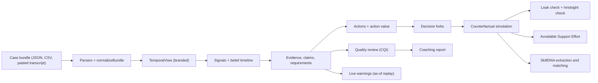

# Domain engine

`packages/domain` (`@caseguard/domain`) is the deterministic core of CaseGuard AI. It turns a support-case record into
evidence, hypotheses, decision forks, counterfactual scenarios, a quality score, an avoidable-effort estimate,
as-of warnings, coaching and SkillDNA candidates. **Everything in it is pure TypeScript with injected clocks, ids and
seeds: no I/O, no network, no model call.** Given the same input it returns byte-identical output. The AI layer
([AI_ORCHESTRATION.md](AI_ORCHESTRATION.md)) may propose wording on top of it; it can never change a number computed
here.

Related: [ARCHITECTURE.md](ARCHITECTURE.md) (where the engine sits), [EVALUATION.md](EVALUATION.md) (calibration on the two
synthetic cases, tests, benchmark), [RESPONSIBLE_AI.md](RESPONSIBLE_AI.md) (limits of every score).

Package dependencies: `@caseguard/schemas` (contracts) and `zod`. `package.json` also declares `@caseguard/security`, but
nothing under `packages/domain/src` imports it today.

## 1. Pipeline



```ts
const view = createFullView(normalized.events, normalized.resolution); // TemporalView
const analysis = runDeterministicAnalysis({ view, pack, config, ctx });
const cf = generateCounterfactuals({
  analysis,
  fork,
  strategies,
  events,
  resolution,
  pack,
  config,
  ctx,
});
```

`EngineContext = { tenantId, caseId, runId, now, createdBy, seed }`. Every timestamp, id and random draw is derived from
it: artefact ids are `stableId(prefix, ...parts)`, randomness is a seeded generator (`util/rng.ts`). The API sets the
seed to `simulationSeed(inputs)` (`apps/api/src/services/analysis/inputs.ts`): a hash of the case's **content** (the stored
payload's content hash, the event count, whether it is resolved, and the pack id and version), so a re-run of the same record
reproduces the identical result and the same content draws the same numbers in any database. The analysis input hash
(`computeInputHash`) stays the identity of an input and is not the seed: it also covers the generated ids of the skill library.
**No generated id enters a seed or an ordering** (section 14).

| Area      | Modules (`src/`)                                            | Public entry points                                                                                                             |
| --------- | ----------------------------------------------------------- | ------------------------------------------------------------------------------------------------------------------------------- |
| Ingestion | `ingest/normalize.ts`, `ingest/parsers/*`                   | `parseCaseBundleJson`, `parseCsvEvents`, `parsePastedTranscript`, `buildDraftPreview`, `normalizeBundle`                        |
| Knowledge | `knowledge/compile.ts`, `knowledge/teams-authentication.ts` | `getCompiledPack`, `TEAMS_AUTH_PACK`                                                                                            |
| Engine    | `engine/*`                                                  | `runDeterministicAnalysis`, `generateCounterfactuals`, `buildDigitalTwin`, `buildTimelineResponse`, `buildInvestigationGraph`   |
| Quality   | `quality/*`                                                 | `computeQualityReview`, `computeQualityReviewAsOf`, `composeQualityScore`                                                       |
| Metrics   | `metrics/*`                                                 | `computeAvoidableEffort`, `computeEfficiency`, `computeReasoningEfficiency`, `buildMetricEstimates`, `buildAnalyticsOverview`   |
| Warnings  | `warnings/*`                                                | `evaluateLiveWarnings`, `replayWarnings`, `viewWarningsAsOf`                                                                    |
| Coaching  | `coaching/*`                                                | `buildCoachingReport`                                                                                                           |
| SkillDNA  | `skills/*`                                                  | `extractSkillCandidates`, `transitionSkill`, `matchSkills`, `proposeMutations`, `runSkillSimulationTest`, `estimateSkillImpact` |

## 2. Input, normalisation and the knowledge pack

**Parsers** (`ingest/parsers`) accept three shapes, all bounded by `DEFAULT_PARSER_LIMITS`: a JSON case bundle, a CSV
of events (column aliases in `CSV_ALIASES`) and a pasted transcript or e-mail thread. Limits include 200,000
transcript characters, 2 MiB payloads, 20,000 lines, 2,000 events, 20,000 characters per body, 30 participants, JSON
depth 16 and 200,000 JSON nodes; callers may lower a limit but never exceed `HARD_PARSER_LIMITS`. Parsing returns a draft
with confidence, warnings and issues for the user to confirm; it never silently guesses a role or a time zone.

**Normalisation** (`normalizeBundle`) validates a `CaseBundle` and produces `{ case, source, participants, events,
resolution }`. It throws `BundleValidationError` (schema-style `{ path, message }` issues) for **non-causal
references** (a reply that points forward, a `repeatOf` that points forward) and canonicalises timestamps (whole seconds
stay `...Z`, finer precision becomes `....mmmZ`). `CaseBundleSchema` rejects the same references.

**Knowledge pack.** The only authored pack is `kp.teams-authentication` v1.0.0 (`TEAMS_AUTH_PACK`): 9 hypotheses with
priors, 30 signals with per-hypothesis likelihoods, 21 diagnostic actions (cost, risk, reliability, outcomes, prerequisites,
produced requirements), 13 requirements and one inference. `getCompiledPack` precompiles keyword regular expressions and
lexicon alternations once (patterns with `g` or `y` flags are rejected). Every pattern scans up to 20,000 characters of an
event on the API's event loop, so **repetition in a pattern must be bounded** (`[\w-]{0,40}`, not `[\w-]*` after a literal):
`packages/domain/test/robustness.test.ts` fails a pattern that needs 100 ms of CPU on inputs derived from the pattern itself, and
the redaction-pattern guard's static check rejects nested repetition and back-references in the shipped patterns. Policy values
in the shipped pack:

| Policy                           | Value                                                                                         |
| -------------------------------- | --------------------------------------------------------------------------------------------- |
| `diagnosisThreshold`             | 0.75                                                                                          |
| `strengthWeights`                | strong 1, moderate 0.75, weak 0.5                                                             |
| `posteriorFloor`                 | 0.01                                                                                          |
| `destructiveHypothesisThreshold` | 0.6                                                                                           |
| `minimumEvidenceForEscalation`   | `req.error-code`, `req.sample-users`, `req.failure-timestamps`, `req.server-side-correlation` |
| `lowValueRelativeScore`          | 0.35                                                                                          |
| `lowValueInformationGainBits`    | 0.08 (retrospective only)                                                                     |
| `repeatWindowMinutes`            | 2,880                                                                                         |
| `customerResponsePriorMinutes`   | min 45, typical 90, max 180                                                                   |
| `maxCounterfactualSteps`         | 8                                                                                             |
| `rolloutCount`                   | 200                                                                                           |
| `forkMinimumImpact`              | 0.25                                                                                          |

A new workload needs a new pack and nothing else in the engine changes; no other pack exists today.

## 3. Temporal integrity (the central invariant)

`TemporalView` is a **branded type**: functions that must respect "what was known at T" accept only it, so the compiler
rejects an unfiltered event array.

- `createFullView(events, resolution)` is the post-hoc view (everything, including the resolution).
- `createTemporalView(events, asOf, { resolution })` is the prefix known at an instant. It also reports
  `withheldFutureEventCount`.
- `createTemporalViewBeforeEvent(events, eventId)` is the **exclusive decision-moment** view: it never contains the
  event itself, any later event or the resolution. Forks and counterfactuals are generated from it.
- `assertPreResolution(view)` throws if the resolution is present. "Known at" is always an instant comparison
  (`knownAt`, `compareIso`), never string order, because sub-second precision can differ.

**Tested invariant: an analysis of a prefix equals the full analysis restricted to what was known by then** (claims,
evidence, an action's decision-time fields, a fork's decision-time fields, hypothesis points). Reply links only follow
replies that come strictly after what they answer; `buildEvidence`, repeat detection and the responder closure ignore
forward `inResponseTo` / `repeatOf`. `PrefixAnalyzer` accumulates the posterior incrementally so prefix analyses are
cheap. The tests that prove this are listed in [EVALUATION.md](EVALUATION.md#4-temporal-integrity-evidence).

**Hindsight versus decision time.** Some fields are retrospective and are kept apart from everything used to decide or
warn: `DiagnosticAction.realizedInformationGainBits`, `informationGainClass`, the "Retrospectively produced little
information" note in `lowValueReasons`, `DecisionFork.retrospective` and every `HindsightCheck`. Detection, warnings and
counterfactual generation never read them. `lowValue`, `isRepeat` and `relativeValueAtDecision` are decision-time. The
"Retrospectively" note is only produced for the complete case (`isCompleteCase`: every recorded event is in view and so
is the recorded resolution, `TemporalView.resolution`, the same notion as `Case.hasResolution`). It is never produced for
a prefix or as-of analysis, nor for an open case (no recorded resolution) analysed over everything recorded so far: in
both, the last action may simply not have been answered yet. A counterfactual scenario's `summary` is
decision-time as well (`decisionTimeSummary`: the decision instant, the simulated steps and the simulated time range);
the comparison with the recorded outcome lives in the `HindsightCheck` and the scenario's explicit comparison fields
(`actualMetrics`, `improvements`), and the investigation graph never prints a stored summary.

## 4. Belief model

State: one posterior over the pack's hypotheses (including a catch-all `hyp.other`).

```text
update(belief, o):
  log w_h  =  ln max(belief_h, 1e-6)  +  w(o) * ln clamp(L(signal(o) | h), 0.01, 0.99)
  w(o)     =  strengthWeight(signal)  *  0.5 ^ repeatIndex(o)          (repeats of one signal count half as much each time)
  belief'  =  normalise( exp(log w_h - max) ), then floor at posteriorFloor and re-normalise
belief of a view  =  the prior folded through update() over the belief-affecting observations, in event order
```

There is exactly one update path (`updateBelief`). The belief timeline, `analyzeView(view).belief` and the prefix
analyser all fold it, so the belief of any view is, bit for bit, the last step of that view's timeline (and an empty view
is the prior). The Hypothesis Arena, the action ranking, a fork's posterior at the decision and the start of every
simulated path therefore agree with the timeline overlay.

- `L(signal | h)` is the pack's likelihood, or the signal's `neutral` value when the pack states none for `h`. Weak signals
  count less (exponent 0.5) and are never decisive on their own.
- Observations from `validation_result`, `resolution_note` and `status_change` events never move belief
  (`affectsBelief: false`); a resolution cannot "confirm" a hypothesis retroactively.
- **Band.** For each event the engine re-runs the whole timeline 80 times with the prior perturbed by `exp(0.3 z)` and
  each likelihood by `exp(0.35 z)` (seeded normal `z`), and reports the 10th to 90th percentile (widened to include the
  point estimate). It is a sensitivity band, not a statistical confidence interval.
- **Status** per hypothesis and step (`hypothesisStatus`):

| Status      | Rule                                                                                             |
| ----------- | ------------------------------------------------------------------------------------------------ |
| `confirmed` | `p >= diagnosisThreshold` (0.75) **and** the hypothesis' confirmation requirements are satisfied |
| `leading`   | highest posterior, `p >= 0.3` and a margin of at least 0.1 over the second                       |
| `ruled_out` | `p < 0.03` after a peak of at least 0.1                                                          |
| `demoted`   | peak at least 0.15 and `p < 0.6 * peak`                                                          |
| `active`    | otherwise                                                                                        |

Confidence is **always a model estimate** driven by authored likelihoods; it is not calibrated against outcomes.

## 5. Evidence, claims and requirements

- **Observations** come from the pack's compiled signal detectors (`engine/signals.ts`): `regex` detectors over the event
  title and body (first 20,000 characters, optionally filtered by event type and participant role) and `structured` /
  `structured_all` detectors over the event's `structured` fields (`exists`, `eq`, `neq`, `includes`, `gt`, `gte`, `lt`,
  `lte`). A signal yields at most one observation per event; `repeatIndex` counts how many earlier events showed it. Each
  observation becomes an `Evidence` item with a category (`confirmed_fact`, `customer_reported`, `engineer_assumption`,
  `diagnostic_evidence`, `ai_inference`, `conflicting_evidence`, `missing_evidence`, `simulated_outcome`), a strength and
  an excerpt, and a source reference that says where in the stored record it was found (section 5.1).
- **Claims** are statement-level assertions with flags (`unsupported_root_cause`, `assumption_as_fact`,
  `ignored_contradiction`, `template_without_evidence`, `contradicted`, `unvalidated_closure`). At most 12 statement
  claims per event and 1,500 per case are kept, strongest signal first (definitive, root-cause or labelled wording, then
  checklist phrasing, then hedged), then earliest; `DeterministicAnalysis.notes` says when a limit applied. An engineer's
  stated working hypothesis becomes an **anchor** that is compared with the leading hypothesis at that moment.
- **Requirements** (`engine/requirements.ts`) track which evidence the pack expects (for example error code, sample users,
  failure timestamps, server-side correlation, fix validation). A requirement is satisfied by an action that produces it or
  by a signal linked to it, and the satisfaction time is recorded.
- Missing evidence is derived from unsatisfied requirements at each point in time.

### 5.1 Source references, and checking a citation (provenance)

Every piece of evidence and every claim that was found in the text of a message says where. Its `sourceRef` is
`{ eventId, sourceId, pointer, field, start, end }`, and the item keeps the `excerpt` the engine recorded.

- **An offset counts into a named text.** The detectors read an event as its title, a line break and its body
  (`eventText`), so a raw offset means nothing without saying which text it counts in. `field` says: `title`
  (`start` and `end` count into `event.title`), `body` (into `event.body`) or `titleAndBody` (a match that crosses the
  line break: into the title, the line break and the body together). `pointer` is true for that field
  (`<source pointer>/title`, `/body`, or the event itself for `titleAndBody` and for a reference that has no field).
  Statement claims point at the exact trimmed sentence (not at the margin that is kept in the claim id), attribute claims
  at the body, and a claim that restates evidence points where the evidence does. A structured detector, a derived claim
  and a twin field joined from several sentences have no location: `field`, `start` and `end` are null, and nothing is
  cited that could not be quoted.
- **The excerpt is a window.** For evidence it is the scanned text from 50 characters before the match to 70 after,
  whitespace folded, with `…` where the text goes on, at most 280 characters. A statement claim's excerpt is the sentence.
- **Verification** (`verifyExcerpt` in `engine/verify-excerpt.ts`) is pure and never trusts the record: it takes the
  stored event and the reference and re-derives the excerpt from the stored text, in the window shape or the sentence
  shape. `verified` means the stored text cut at the recorded place gives exactly the recorded excerpt (markers aside);
  `mismatch` means a place was recorded and the text there is not that (tampered excerpt, wrong offsets, wrong field,
  another event); `not_checkable` means there is nothing to compare (no field, offsets or excerpt, an empty span), for
  example an analysis stored before `2026.3.1`, until it is re-analysed. It never answers `verified` when it did not
  compare, and a reason code (`matches`, `no_location`, `no_excerpt`, `empty_span`, `wrong_event`, `out_of_range`,
  `text_differs`) says why, without any case text. Only a verified citation carries a `context { before, match, after }`:
  verbatim stored text, at most 200 characters on each side and 800 for the span, cut at word boundaries and never
  through a surrogate pair, so an unchecked excerpt is never shown as a quotation.
- **The route** `provenance.resolve` resolves up to 40 links of every type (event, evidence, claim, fork, action,
  hypothesis, requirement, scenario) with their verification, their context and the SHA-256 of the stored source payload
  the event came from (`case_sources.stored_sha256`). As of an instant it resolves against the engine's analysis of what
  was known then; a record that only exists later is `not_yet_known`, never shown. A link that resolves to nothing is
  listed in `unresolved`; it is never dropped. It writes nothing and logs no case text.
- **Recommendations point at their basis.** Every sub-check, penalty, improvement, warning and coaching item carries
  `evidence` links to the events, evidence, claims, forks or requirements it rests on, where the engine has one: a pass is
  cited by what it passed on (the messages that set expectations, the requirements that were met) as a failure is by what
  it failed on. Where there is nothing to cite (a check that passes only because something did not happen, a check that
  does not apply, general guidance) the item cites nothing and says so; those items are listed, each with its reason, in
  the allow-list of `apps/api/test/recommendations-support.ts`. The API invariant test (`recommendations-evidence.test.ts`)
  asserts that every item has a link or is on the list, that every link resolves through the route and that every citation
  of text verifies, for both samples, whole and as of their messages; the domain test of the same name checks the links
  against the engine's own artefacts.

## 6. Actions and the action-value model

Each engineer step is mapped to a pack action (kind, customer effort, operational risk, reliability, expected outcomes).
Value is computed **as of the decision**, never with hindsight:

```text
ActionValue = ( EIG_norm * Relevance * Confidence ) / ( epsilon + w_time*T + w_token*K + w_customer*C + w_risk*R )

EIG        = H(belief) - sum over outcomes of P(outcome) * H(belief after outcome)        (bits)
P(outcome | h) = independent-Bernoulli probability of exactly that outcome's signals, normalised across the action's outcomes
EIG_norm   = clamp( EIG / maxInformationBits, 0, 1 )                                       (maxInformationBits = 2)
Relevance  = clamp( 2 * posterior mass on the hypotheses the action targets, 0, 1 )        (no targets: 0.6 enabling, 0.5 communication, 0.3 other)
Confidence = the action's authored reliability
T, K, C, R = normalised time (typical minutes / 480), tokens (estimate / 20,000), customer effort (effort scale), operational risk
```

Defaults (`DEFAULT_ACTION_VALUE_CONFIG`): weights time 0.3, token 0.1, customer 0.35, risk 0.25, epsilon 0.05, risk ceiling
0.5. Enabling steps earn credit for the better action they unlock (`0.9 * reliability * EIG of the unlocked action`).
`rankActions` returns candidates and blocked actions; `toBreakdowns` adds a ±25% and equal-weights sensitivity run so a
rank that flips under perturbation is visible.

**Safety gating** (an action is blocked, with the reason recorded, when): it is destructive; its risk is at or above the
ceiling; it is a remediation while the targeted hypothesis is below `destructiveHypothesisThreshold` or unconfirmed; it
is an escalation before the minimum evidence exists; it is validation or communication (not diagnostic); it has unmet
prerequisites; or its outcome is already known from evidence on record.

**Per-decision labels.** `lowValue` = repeat, or already known, or (relative value below 0.35 **and** cost at least 0.05
and not a hygiene step). `isRepeat` = same action within 2,880 minutes with a repeat cue, word-set Jaccard similarity of
at least 0.5, or an explicit `repeatOf`. Hygiene steps (enabling or communication or validation at or below medium
customer effort) and trivially cheap steps are not flagged unless repeated or already known. The retrospective
information class uses thresholds 0.5 / 0.2 / 0.05 bits (high / moderate / low / none).

## 7. Decision forks

A fork is a decision point where a materially better safe alternative existed **given only what was known then**.
`engine/forks.ts` evaluates eight rules; when several fire on one event the highest-priority one is primary and the rest
go to `additionalCategories`.

| Priority | Rule id                           | Category                           | Fires when                                                                                                         | Severity base |
| -------- | --------------------------------- | ---------------------------------- | ------------------------------------------------------------------------------------------------------------------ | ------------- |
| 1        | `FORK-R1-premature-destructive`   | `premature_destructive_action`     | A destructive, above-ceiling or remediation step while the targeted hypothesis is below 0.6 or unconfirmed         | 0.90          |
| 2        | `FORK-R2-premature-escalation`    | `premature_escalation`             | Escalation while any of the four minimum-evidence requirements is missing                                          | 0.70          |
| 3        | `FORK-R3-assumption-as-fact`      | `assumption_as_fact`               | A claim flagged `assumption_as_fact` or `unsupported_root_cause`                                                   | 0.70          |
| 4        | `FORK-R4-contradiction-ignored`   | `contradiction_ignored`            | An anchored working hypothesis conflicts with the leader, or a claim flagged `ignored_contradiction`               | 0.75          |
| 5        | `FORK-R5-signal-unused`           | `high_value_signal_unused`         | A strong signal already pointed to a leader (p at least 0.5) that the chosen step did not test                     | 0.60          |
| 6        | `FORK-R6-disproportionate-effort` | `disproportionate_customer_effort` | A request with customer effort at least 0.8 when a candidate at least 0.3 lighter existed and relative value < 0.6 | 0.55          |
| 7        | `FORK-R7-low-value`               | `low_value_action`                 | The action is `lowValue` (decision-time reasons only)                                                              | 0.45          |
| 8        | `FORK-R8-better-alternative`      | `alternative_action_available`     | Relative value < 0.6 versus the best safe candidate, at a meaningful cost, not a hygiene step                      | 0.30          |

```text
impact = clamp( 0.45 * (1 - relativeValue) + 0.35 * maxSeverityBase + 0.20 * eigShare , 0, 1 )      eigShare = (EIG_best - EIG_actual) / maxInformationBits
```

A fork exists only if `impact >= forkMinimumImpact` (0.25). Severity is `high` at 0.7 and above, `medium` at 0.45 and
above. **Earliest meaningful fork** = the first fork in time with `impact >= 0.45` **and** `eligibility.eligible`;
none if no fork qualifies. Eligibility has five checks: `boundary-excludes-future`, `resolution-excluded`,
`alternatives-use-prior-information`, `safe-alternative-exists`, `impact-meaningful`. Each fork records the information
available and unavailable at that moment, up to four safe alternatives with their evidence, a consequence comparison
labelled "Estimated, not measured", an uncertainty score (`1 - 0.7 * rankStability - 0.3 * leaderP`) and a `retrospective`
block that is clearly marked as hindsight.

## 8. Counterfactual simulation

`generateCounterfactuals` answers "what would a safer path have looked like from this fork, using only what was known
then?". It simulates a **policy tree** (state after each action and outcome is computed once and shared by all rollouts):

1. Start from the belief, requirements and observed signals at the decision moment (the exclusive view).
2. At each node pick the top-ranked safe action under the strategy's weights (excluding actions already executed); when
   the leader is at or above the diagnosis threshold but confirmation requirements are unmet, prefer an action that can
   satisfy them. Stop when a non-`other` hypothesis is at or above 0.75 **and** its confirmation requirements are met,
   or after `maxCounterfactualSteps` (8).
3. Sample each action's outcome from its predictive distribution. Run `rolloutCount` (default 200) seeded rollouts
   (seed `ctx.seed|fork:<events before the decision>@<decision instant>|strategy`, never the fork id, which derives from
   the generated case id). The representative path is the modal outcome per node; every metric is reported as
   p10, median, p90.

| Strategy                 | Weights (time / token / customer / risk) | Filter                           |
| ------------------------ | ---------------------------------------- | -------------------------------- |
| `balanced`               | the configured weights                   | none                             |
| `lowest_customer_effort` | 0.15 / 0.05 / 0.60 / 0.20                | effort at or below `medium` only |
| `fastest_diagnosis`      | 0.60 / 0.05 / 0.10 / 0.25                | none                             |

Strategies may converge on the same path: that is a valid result, not an error. Every scenario carries
`labels { simulated: true, estimated: true }`, the assumptions used, per-step evidence, outcome probabilities, the
real path's metrics for comparison and **eight validity checks**: `boundary-respected`, `resolution-excluded`,
`no-future-identifiers`, `steps-safe`, `steps-supported`, `requirements-respected`, `labelled-simulated`, `reproducible`.
A scenario is `valid` only if all pass.

**Comparison confidence** = `0.4 * diagnosisReachedShare + 0.3 * (1 - spread) + 0.3 * (1 - entropyShare)` where `diagnosisReachedShare` is
the fraction of rollouts that reached a diagnosis, `spread = (p90 - p10) / median` of simulated time to diagnosis and
`entropyShare = H(initial belief) / log2(#hypotheses)`. Level `low` if `diagnosisReachedShare < 0.5` or the score is below 0.45,
`medium` from 0.45, `high` from 0.7.

**Real path** (`computeActualPath`, post-hoc) is measured from the fork instant to the first event at which the case was
really diagnosed (top non-`other` hypothesis at or above 0.75 with confirmation requirements met).

### Leak check

`engine/leak-check.ts` (`futureOnlyTokens`, `scanForLeaks`) collects the **distinctive tokens** (IP addresses, host names,
error codes, GUIDs and similar identifiers) that first appear after the boundary or only in the resolution, and scans every
piece of scenario text for them. Tokens that occur in the pack's own text are ignored (`packStaticTokens`), because
scenario text is written from the pack. The identifier pattern runs in linear time and scans at most 32,768 characters per
text. Citing evidence observed after the boundary also counts as a leak. A scenario with any leak is not valid.

### Hindsight check

After generation, `HindsightCheck` re-simulates conditioned on the real resolution hypothesis (`min(100, rollouts)`
rollouts) and compares with the unconditioned scenario. It is labelled with `HINDSIGHT_NOTICE`, requires the
`quality:review` permission at the API, and **never feeds back into generation**.

## 9. Case Quality Index (CQI)

`computeQualityReview` assesses six dimensions from sub-checks, applies rule-based penalties and composes one score with
a range and a band.

```text
CQI = clamp( sum_d  weight_d * rawScore_d  -  min(penaltyCap, sum of applied penalty points), 0, 100 )
weights re-normalised over the assessable dimensions (equal weights if every configured weight is zero)
```

| Dimension                      | Weight | Sub-checks            |
| ------------------------------ | ------ | --------------------- |
| Evidence integrity             | 0.25   | EI-1 to EI-4          |
| Diagnostic reasoning           | 0.20   | DR-1 to DR-3          |
| Scoping completeness           | 0.15   | SC-1 to SC-3          |
| Customer communication         | 0.15   | CC-1 to CC-4          |
| Resolution validation          | 0.15   | RV-\* (closure facts) |
| Efficiency and proportionality | 0.10   | EF-1 to EF-3          |

- **Penalties** (points, cap 40 in total so one failure cannot zero a case): `unsupported_root_cause` 8,
  `template_completion_without_evidence` 4, `repeated_low_value_diagnostic` 3, `destructive_action_without_justification` 7,
  `ignored_contradiction` 6, `premature_escalation` 5, `premature_closure` 8, `unnecessary_customer_request` 3,
  `missing_resolution_validation` 8, `workaround_fix_conflation` 4. Each penalty is rule-based and links its evidence; a
  penalty is shown per dimension as `points / weight` so the display adds up, but it is deducted once at composite scale.
- **Undecidable sub-checks widen the range.** A dimension's raw score counts only decidable sub-checks
  (`100 * earned / decidedWeight`); its low end assumes every undecidable check fails, its high end assumes every one
  passes, and a margin of ±4 (`uncertaintyMargin`) is added on both sides. A dimension with no decidable sub-check is
  "not assessable" (neutral 50, range 0 to 100) and drops out of the weighting. If no dimension is assessable the engine
  reports a neutral 50 with range 0 to 100 rather than inventing a score.
- **Bands**: strong at 85 and above, adequate at 70, needs attention at 50, otherwise poor. Rule parameters live in
  `DEFAULT_QUALITY_RULE_PARAMETERS`; weights, penalty points, cap and bands are governed settings (`quality` section).
- `computeQualityReviewAsOf` produces the same review for a prefix, using only what was known by then. The review also
  returns improvements (with an estimated score after improvements and its range) and links every finding to evidence,
  actions or forks.

A score is **a rule-based estimate about the written record, not a rating of a person**; see
[RESPONSIBLE_AI.md](RESPONSIBLE_AI.md).

## 10. Avoidable Support Effort (ASE)

`computeAvoidableEffort` estimates how much of the effort between the **earliest usable decision fork** and the **confirmed
diagnosis** the best valid simulated alternative would have avoided.

```text
ASE = sum_c  weight_c * avoidableShare_c          over components c that have data (weights re-normalised)
avoidableShare_c = clamp( (actual_c - simulated_c) / actual_c , 0, 100% )
```

| Component                 | Default weight | Real-path quantity (from the fork to the diagnosis) | Simulated side                                   |
| ------------------------- | -------------- | --------------------------------------------------- | ------------------------------------------------ |
| `engineer_effort`         | 0.15           | number of actions                                   | counterfactual action count                      |
| `customer_effort`         | 0.20           | customer effort minutes                             | counterfactual customer effort minutes           |
| `repeated_interactions`   | 0.10           | customer interactions                               | counterfactual customer interactions             |
| `diagnostic_executions`   | 0.10           | diagnostic volume                                   | counterfactual diagnostic volume                 |
| `escalations`             | 0.05           | escalation events in the window                     | share flagged as premature (low end counts half) |
| `waiting_time`            | 0.20           | minutes to diagnosis                                | counterfactual minutes to diagnosis              |
| `token_usage`             | 0.05           | token estimate                                      | counterfactual token estimate                    |
| `compute_usage`           | 0.05           | compute seconds recorded on events                  | scaled by the simulated diagnostic volume        |
| `low_information_actions` | 0.10           | actions in the window                               | share flagged `lowValue` (low end counts half)   |

A component with no data on the real path is excluded and its weight is redistributed (the output says so per
component). Three states: `estimated`; `no_decision_forks` (0%, confidence medium, no counterfactual needed);
`no_valid_counterfactual` (null with a reason). A scenario is usable only if completed, valid, leak-free and not
rejected by a reviewer (`isUsableScenario`). The range is the p10 to p90 of rollouts across all valid strategies at the
chosen fork; the central value is the most favourable valid strategy; confidence follows the counterfactual comparison
confidence and falls to low when the range is wider than 50 points. It is **never a measurement**.

Other metrics (`buildMetricEstimates`, seven in contract order: `case_quality_index`, `evidence_integrity`,
`avoidable_support_effort`, `reasoning_efficiency`, `customer_effort`, `resolution_confidence`, `token_efficiency`) are all
labelled as estimates. `computeReasoningEfficiency` is the mean over ranked decisions of
`value(chosen) / value(best safe) * 100`, decision-time only. `computeEfficiency` labels each figure `measured` (from
`event.ai` telemetry), `estimated` (knowledge-pack fallback), `mixed` or `unavailable`; on a synthetic case the recorded
telemetry is itself simulated, so the token-efficiency display says "simulated telemetry" where it would say "measured"
(since `2026.2.1`; the `basis` field is unchanged). Cost is reported **only** when the
operator supplied unit prices. `buildAnalyticsOverview` emits portfolio aggregates only: counts, averages and pack labels,
no case text, no names, nothing ranked per person.

## 11. Live warnings and as-of replay

`warnings/` evaluates 13 rules against a `Checkpoint`: strictly the information known at one instant, built by restricting an
analysis to events at or before an index, so a rule cannot see a later event.

| Rule        | Category        | Condition                                                                                                   | Kind  | Priority                                            |
| ----------- | --------------- | ----------------------------------------------------------------------------------------------------------- | ----- | --------------------------------------------------- |
| `LQ-SCO-01` | scoping         | A scoping item the pack expects at opening was never obtained or requested, after a 120-minute grace period | state | medium (critical item) or low                       |
| `LQ-EVD-01` | evidence        | Escalation considered (medium) or recorded (high) while minimum evidence is missing                         | state | medium, high                                        |
| `LQ-EVD-02` | evidence        | A cause or assumption stated as fact without supporting diagnostic evidence                                 | state | high                                                |
| `LQ-EVD-03` | evidence        | The engineer's working hypothesis conflicts with evidence already on record                                 | state | high                                                |
| `LQ-EVD-04` | evidence        | Checklist wording used in place of evidence                                                                 | nudge | medium                                              |
| `LQ-TRB-01` | troubleshooting | The same diagnostic or customer request repeated                                                            | nudge | medium                                              |
| `LQ-TRB-02` | troubleshooting | A check whose likely outcome was already known                                                              | nudge | medium                                              |
| `LQ-TRB-03` | troubleshooting | A risky or premature change (fork category R1)                                                              | nudge | critical if destructive or above ceiling, else high |
| `LQ-TRB-04` | troubleshooting | A heavy customer request when a lighter one was available                                                   | nudge | high (very high effort) or medium                   |
| `LQ-COM-01` | communication   | A customer message expecting an answer has waited 4 h (critical at 24 h)                                    | state | medium, high                                        |
| `LQ-COM-02` | communication   | A heavy request that does not say what happens next                                                         | nudge | low                                                 |
| `LQ-CLS-01` | closure         | Closure recorded without validation evidence or the customer's confirmation                                 | state | high, critical if no validation                     |
| `LQ-CLS-02` | closure         | A workaround not separated from the permanent fix                                                           | state | medium                                              |

- **Lifecycle.** `state` warnings clear when the condition stops holding; `nudge` warnings clear at the next engineer
  step. Each warning has a fingerprint (rule + subject) for de-duplication; re-occurrence gets a `#n` suffix. A warning
  can be `raised`, `resolved`, `dismissed`, `suppressed` or `superseded` (a higher tier replaces a lower one).
- **Dismissal** needs a reason (5 to 500 characters), is recorded, and a dismissed warning is never re-raised.
- **Replay.** `replayWarnings` walks the case event by event and through the waiting-time deadlines between events.
  `viewWarningsAsOf` returns the state at an instant. A poisoned-future mutation test (see
  [EVALUATION.md](EVALUATION.md)) proves later events cannot change an earlier warning.
- Defaults: `replyWaitHours` 4, `replyWaitCriticalHours` 24, `heavyEffortScore` 0.8, `scopingGraceMinutes` 120.
- Each warning suggests a safer next step taken from the pack, labelled as an estimate.

## 12. Coaching

`buildCoachingReport` is supportive decision support, not a performance rating (`COACHING_NOTICE`). It composes: a summary;
up to five "went well" items from high-scoring sub-checks and the decisive step; the **missed opportunity** (the
highest-impact fork) with its safer alternative; one learning point per remaining fork category grouped into evidence,
reasoning and customer effort (up to three each); communication advice from CC-1 to CC-4 sub-checks below 0.7; a
recommended next action (the top open warning at the view boundary, else the best next step from the pack, else the top
improvement, else "share what worked"); up to three relevant skills; a confidence level; and a limitations list. Confidence
is `low` when fewer than six events were recorded or the quality range is wider than 25 points, otherwise `medium`; **it is
never `high`**. Output describes the case record and its decisions; it contains no person identifier beyond what the case
text already shows and never ranks people.

## 13. SkillDNA

SkillDNA turns a validated, reviewed counterfactual into a reusable, governed procedure.

**Extraction** (`extractSkillCandidates`) refuses (with a stated reason) unless: the case is resolved with a confirmed,
validated resolution; the scenario is completed, valid and leak-free and has been accepted or corrected by a reviewer
(`requireAcceptedReview`, default on); the fork is eligible; the hindsight-conditioned path reaches the diagnosis; and there
is at least one decision-time trigger. Triggers come from the signals that justified each step; steps are the scenario's own
pack actions (all safe by construction). A draft always requires human approval.

**Lifecycle** (`skills/lifecycle.ts`, `SKILL_TRANSITIONS`; the diagram is in [ARCHITECTURE.md](ARCHITECTURE.md#7-skilldna-lifecycle)):

| From                | Allowed next states                   |
| ------------------- | ------------------------------------- |
| `discovered`        | `draft`, `retired`                    |
| `draft`             | `simulation_tested`, `retired`        |
| `simulation_tested` | `expert_reviewed`, `draft`, `retired` |
| `expert_reviewed`   | `pilot`, `draft`, `retired`           |
| `pilot`             | `validated`, `draft`, `retired`       |
| `validated`         | `published`, `draft`, `retired`       |
| `published`         | `deprecated`                          |
| `deprecated`        | `retired`                             |
| `retired`           | none (terminal)                       |

| Transition                     | Gate (all must hold)                                                                                                                                 |
| ------------------------------ | ---------------------------------------------------------------------------------------------------------------------------------------------------- |
| `discovered` to `draft`        | `skill:extract`                                                                                                                                      |
| back to `draft` from any stage | `skill:review` and a reason                                                                                                                          |
| to `simulation_tested`         | `skill:validate` and a passed simulation test                                                                                                        |
| to `expert_reviewed`           | `skill:review`; reviewer is not the creator or the current version's author; passed simulation                                                       |
| to `pilot`                     | `skill:approve`; approver is not the creator; passed simulation                                                                                      |
| to `validated`                 | `skill:validate`; passed simulation test **and** regression suite                                                                                    |
| to `published`                 | `skill:publish`; publisher is neither the creator nor a pilot approver; a pilot approval on record; passed simulation and regression; always a human |
| to `deprecated` or `retired`   | `skill:retire`                                                                                                                                       |

Every transition needs a reason of at least 5 characters and an optimistic `expectedVersion`; system actors can never
approve (`requireDistinctApprover` in `@caseguard/security`, the distinct-person rules in the domain lifecycle, and a
database CHECK on `skill_approvals`). Role permissions are in [SECURITY.md](SECURITY.md#4-rbac-matrix).

**Matching** (`matchSkills`) only considers skills in `pilot`, `validated` or `published`. The score is the weighted share of
trigger conditions that hold at the as-of instant. An exclusion that holds gives `not_applicable` (0); an unmet required
condition gives `not_applicable` with score `0.5 * coverage`; otherwise `applies` at 0.7 or more and `partial` at 0.35 or
more. Matching re-reads the case through a temporal view, so later events and the resolution cannot influence it.
Trigger conditions and exclusions that were learned with hindsight (the triggers are marked `(hindsight-informed)` and
listed in `provenance.hindsight.parts`) count like any other, but each is checked only against what the matched case had
recorded at that instant; branch probabilities, including `hindsightProbability`, never enter the score or the verdict
(`packages/domain/test/skills-hindsight.test.ts` pins both).
**Conformance** (`checkConformance`) compares the engineer's actual steps with the skill (high at 0.75, moderate at 0.5).
`buildGuidedPlan` gives the next-step plan.

**Evaluation of a skill**: `runSkillSimulationTest` and `runSkillRegressionSuite` replay the skill's path on stored cases
(`replaySkillPath`) against a baseline policy; `estimateSkillImpact` estimates the saving against a simulated baseline
and shows the recorded path of the source case as context (`impactPrecedentOf`); `aggregateSkillEffectiveness`
summarises recorded usage on two bases, both estimates: the simulated baseline, and (optional `precedent` block) the
recorded path of the case the skill came from, which is like-for-like because both are recorded paths from their own
decision point; `proposeMutations` suggests changes from new cases (always a
proposal that goes through the lifecycle); `diffSkillVersions` and `rollbackSkill` support versioning.

**Recorded versus with the skill** (`buildSkillOverlay`, served by `skillOverlay.get`) sets what a matched skill would have
changed beside what the case recorded. It is a comparison laid over the analysis, not a second analysis: it is built from
stored data only (the match as the list route returns it, the version of the skill, the decision points, and the engine's
own figures for the path the case took), it writes nothing and records no audit event, and adopting the plan stays the
separate, governed `skillMatches.apply`.

- **The decision point** is a decision point at which the skill's first recommended action (the first step of its plan that
  names one) was an open alternative, safe and not blocked: the one the skill was distilled from when it qualifies (its
  saving was estimated at exactly that moment), otherwise the earliest where the case did something else, otherwise the
  earliest. None qualifies: there is none, and the overlay says so (Case Two has no decision point of its own).
- **The figures.** A skill states its saving in time to **diagnosis**, customer effort and tokens, each measured from the
  decision point of the case it came from, so each row sets the engine's figure for the recorded path from the decision point
  in that same measure beside it. `withSkill` is the recorded range minus the skill's saving, range against range
  (`low = recorded low - saving high`, `mid = recorded mid - saving mid`, `high = recorded high - saving low`), never below
  zero (a result held at zero says so in the row's `basis`); for the case the skill came from this reproduces the skill's own
  replay, for another case the saving is assumed to carry over, and the overlay says that too. Time to useful evidence is
  shown as recorded and nothing more: the skill states no saving for it. A row whose input is missing says which one, and its
  `withSkill` is null.
- **Nothing is estimated** where the skill does not apply to the case, where the case already did what the skill recommends at
  the decision point, where the skill states no saving, where no decision point relates to the skill, and where the engine
  stored no simulation of it.
- **Hindsight is withheld.** The path from a decision point includes events that come later, so its figures are shown only when
  no event of the case lies after the instant of the match (the whole record). As of an earlier instant the rows have no
  recorded and no with-skill figure and say why; and the API does not match the skill extracted from the case itself as of
  an earlier instant at all, because its triggers were learned partly from what happened later.

## 14. Hardening notes

- **As-of views.** `buildTimelineResponse` ranks hypotheses by the last belief step known at `asOf`, never by final
  confidence. `buildInvestigationGraph` recomputes an action's realised information from the answers known by `asOf` and
  colours steps from decision-time fields only; the whole-record graph (`asOf: null`) is retrospective.
- **Claim limits and compiled patterns** as in section 5; authored patterns with `g` or `y` flags are rejected.
- **Performance.** EIG is cached per ranking, the weight sensitivity re-scores the ranked candidates instead of re-ranking,
  and `PrefixAnalyzer` accumulates the posterior incrementally. Outputs are byte-identical to the previous implementation for
  both synthetic cases and seeded mutations (compared by a differential run). `packages/domain/bench/bench.ts` and
  `hardening-bench.ts` measure typical and hostile inputs; results are in [EVALUATION.md](EVALUATION.md#6-performance).
- **Determinism.** `src/` contains no `Date.now()`, no `Math.random()`, no file or network access (checked with a
  search); the only Node import is `node:crypto` for hashing. The clock and seed are parameters.
- **Reproducibility across databases (`2026.3.0`).** Same content and same configuration give the same numbers in any
  database. The rule is that **no generated id enters a seed or an ordering**: tenant, case, run, source and skill ids, and
  every id derived from them with `stableId` (claims, evidence, forks, scenarios, hypotheses, quality items), differ per
  database, so they may label a record but never decide a number. In practice: the rollout seed names the decision by the
  number of events before it and its instant, not by the fork id; the skill-impact baseline seed names the plan moment
  (`plan.asOf`), not the skill id; claims at one instant keep their derivation order instead of being tie-broken by claim
  id; evidence, improvements, skill matches and coaching skills break ties by content (score, then name) or by their fixed
  derivation order; the API seed (`simulationSeed`) leaves out the skill library, the provider, the governed
  configurations and the engine version, and the seed of an as-of window (`passContext`) is the visible events and the pack
  alone. `packages/domain/test/determinism-across-ids.test.ts` runs both samples under four sets of generated ids and
  compares every figure after replacing ids by what they stand for (so a different order of the same things fails too);
  `apps/api/test/determinism-across-ids.int.test.ts` does the same through two fresh databases.
- **Engine version.** `ENGINE_VERSION` (`apps/api/src/services/analysis/inputs.ts`, currently `2026.3.1`) is part of the
  analysis input hash, so a change of meaning re-analyses stored cases instead of reusing them. `2026.2.0`: a view's belief is
  one number (the last step of its own timeline), scenario summaries are written from the decision instant and the simulated
  path alone, and the "Retrospectively produced little information" note needs a complete case with a recorded resolution
  (sections 3 and 4). `2026.2.1`: the token-efficiency figure of a synthetic case displays "simulated telemetry" instead of
  "measured" (text only: the `basis` field and every number are unchanged, and real cases keep "measured"). `2026.3.0`:
  the reproducibility rule above; every simulated figure (rollout metrics and ranges, the Avoidable Support Effort and the
  token figures derived from it, confidence bands, skill baselines) moved once, and the order of claims, improvements and
  skill matches that were tied by a generated id changed. `2026.3.1`: source offsets name the text they count into
  (section 5.1) and the quality sub-checks, and so the coaching items built from them, cite more of their basis; **no
  detection, id, score, band, fork or simulated figure changed** (`packages/domain/test/engine-golden.ts` and
  `fixtures/engine-golden.json` pin the digests of both samples as `2026.3.0` produced them, with only the source
  linkage and the citation lists left out of the comparison). Stored artefacts are replaced at the next analysis; until
  then a stored citation has no field and is `not_checkable`. After a version
  change a reviewer's decision on a counterfactual scenario survives only if the regenerated simulation is identical;
  otherwise it is reset and the reset is audited. Because the seed no longer covers the engine version, the skill library or
  the provider, a change of the library or the provider, or a release that changes no number, re-runs the analysis (new
  input hash) without redrawing anything; a decision on a scenario then survives it.

## 15. What the engine does not do

- It reads the written record only; it cannot see calls, tools or experience that were not written down.
- Likelihoods, priors, costs, reliabilities and effort scales are **authored by hand** for one workload (Teams
  authentication) and are not fitted to data. Posteriors, ranges and bands are model estimates, not probabilities of truth.
- There are two synthetic cases for calibration; nothing here has been validated against human-labelled real cases.
- Counterfactual time and effort are simulated from pack priors (for example customer response time 45/90/180 minutes), not
  measured.
- The engine has no concept of a person; it never ranks, scores or identifies individuals.
