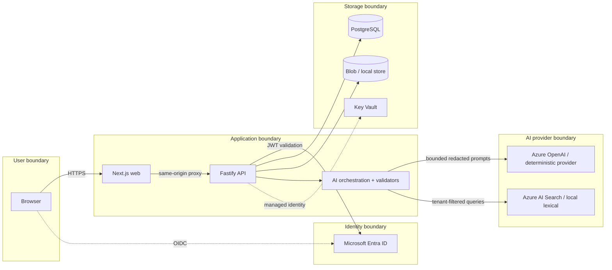

# Threat Model

Method: Microsoft STRIDE per element over a data-flow diagram, plus AI-specific abuse cases. Status: initial model for the prototype; re-review whenever a trust boundary, provider or data class changes.

## 1. Scope and assets

| Asset                                | Why it matters                                                         |
| ------------------------------------ | ---------------------------------------------------------------------- |
| Case content (emails, notes, logs)   | May contain sensitive operational data even when synthetic in the demo |
| Evidence ledger and quality scores   | Drive coaching and skill creation; tampering misleads decisions        |
| SkillDNA                             | Reusable guidance — a poisoned skill propagates bad advice             |
| Audit log                            | Accountability for human and AI actions                                |
| Tenant boundary                      | Cross-tenant disclosure is the highest-impact failure                  |
| Secrets (DB credentials, model keys) | Must never be in code, logs, or UI                                     |
| Model prompts and policies           | Integrity of safety and citation rules                                 |

Actors: authenticated users (Engineer, Reviewer, Manager, Skill Curator, Administrator), unauthenticated internet users, malicious case authors (untrusted content), compromised dependencies, a curious tenant.

## 2. Data-flow and trust boundaries

## 3. STRIDE analysis

| #   | Element      | Threat (STRIDE)                                             | Mitigation                                                                                                                                             | Test / evidence                             |
| --- | ------------ | ----------------------------------------------------------- | ------------------------------------------------------------------------------------------------------------------------------------------------------ | ------------------------------------------- |
| T1  | API          | **S**poofing via forged identity header                     | Dev persona only when `APP_ENV` ∈ {local,test,development}; staging and production require a validated Entra JWT (issuer, audience, signature, expiry) | `security: dev-auth rejected in production` |
| T2  | API          | **S**poofing of tenant via client-supplied tenant ID        | Tenant derived only from validated identity; never from request body/query                                                                             | `security: cross-tenant access`             |
| T3  | Case store   | **T**ampering with events after ingestion                   | DB triggers reject UPDATE/DELETE on source and event tables; content hash recorded                                                                     | `integration: immutability`                 |
| T4  | Audit log    | **T**ampering / **R**epudiation                             | Append-only table with hash chain; verification endpoint; no delete path                                                                               | `integration: audit chain`                  |
| T5  | Ledger       | **R**epudiation of reviewer corrections                     | Corrections are new records; original AI classification preserved; audited with reason                                                                 | `integration: review audit`                 |
| T6  | API          | **I**nformation disclosure across tenants                   | Composite FKs, application-layer scoping, RLS with per-transaction tenant setting                                                                      | `security: RLS`                             |
| T7  | Logs         | **I**nformation disclosure via logs                         | Structured logger with redaction paths; secret patterns scrubbed                                                                                       | `unit: log redaction`                       |
| T8  | API          | **D**enial of service via large or abusive requests         | Body limit, multipart limits, rate limiting, timeouts, pagination caps                                                                                 | `security: oversized payload`               |
| T9  | AI           | **D**enial of wallet via unbounded prompts                  | Per-agent token budgets, depth limits, circuit breaker, cost caps                                                                                      | `unit: token governor`                      |
| T10 | API          | **E**levation of privilege via role confusion               | Deny-by-default permission matrix; skill approval requires distinct approver                                                                           | `security: unauthorized role action`        |
| T11 | Upload       | Malicious file (type spoofing, oversized, hostile metadata) | Extension + magic-byte + size allowlist; content-type enforcement; malware-scan hook; text-only parsing                                                | `security: malicious file metadata`         |
| T12 | Web          | XSS via case content rendered in the UI                     | React escaping; no `dangerouslySetInnerHTML`; strict CSP; content is rendered as text                                                                  | `e2e: hostile content rendering`            |
| T13 | Web/API      | CSRF                                                        | Bearer/header-based auth (no ambient cookie auth for state changes); SameSite strict cookies for dev persona; custom header required                   | `security: csrf`                            |
| T14 | API          | SSRF through user-supplied URLs                             | No server-side fetch of user URLs; outbound allowlist for provider endpoints only                                                                      | `unit: url safety`                          |
| T15 | Supply chain | Vulnerable or malicious dependency                          | Lockfile, dependency audit in CI, Dependabot, secret scanning, CodeQL (no SBOM is generated yet; see CI_CD.md)                                         | CI workflows                                |

## 4. AI-specific threats

| #    | Threat                                                                   | Mitigation                                                                                                                                                                                                                                                                | Verification                                 |
| ---- | ------------------------------------------------------------------------ | ------------------------------------------------------------------------------------------------------------------------------------------------------------------------------------------------------------------------------------------------------------------------- | -------------------------------------------- |
| AI-1 | **Prompt injection** inside case notes ("ignore previous instructions…") | Heuristic detector flags (the evidence is still stored and shown; nothing is dropped or quarantined); instructions and data are structurally separated (data wrapped and labelled untrusted); the model has **no tools**; outputs are schema-validated and policy-checked | `security: prompt injection in case notes`   |
| AI-2 | **Hallucinated or forged citations**                                     | Every cited event/evidence ID must exist **in the same tenant, same case, at or before the temporal boundary**; unsupported citations are rejected and never stored                                                                                                       | `unit: citation validation`                  |
| AI-3 | **Temporal leakage** of the final resolution into earlier analysis       | Branded `TemporalView` gatekeeper; counterfactual generator never receives resolution; metamorphic tests; leak-check stored per scenario                                                                                                                                  | `unit/property: temporal integrity`          |
| AI-4 | **Cross-case or cross-tenant context leakage**                           | Retrieval is tenant- and case-scoped by construction; prompts built from an allowlisted evidence set                                                                                                                                                                      | `integration: retrieval isolation`           |
| AI-5 | **Unsafe recommendations** (destructive/security-weakening actions)      | Safety policy validator blocks them regardless of score; reviewer approval required for risky actions                                                                                                                                                                     | `unit: safe-action restriction`              |
| AI-6 | **Skill poisoning** (malicious or wrong skill published)                 | No auto-publish; lifecycle gates; distinct approver; simulation test; audit; rollback                                                                                                                                                                                     | `security: unsafe skill publication attempt` |
| AI-7 | **Over-trust in model estimates**                                        | Confidence presented as model estimates with ranges; synthetic/simulated labels; no automatic closure or disciplinary use                                                                                                                                                 | UI review, Responsible AI doc                |
| AI-8 | **Secrets or PII sent to the model**                                     | Redaction before persistence and before prompts                                                                                                                                                                                                                           | `unit: redaction`                            |

## 5. Residual risks and follow-ups

- The deterministic provider's injection heuristics are pattern-based and can be evaded; the Azure path should add Azure AI Content Safety _Prompt Shields_ (listed in the roadmap, **not implemented**).
- In-memory rate limiting is per replica; multi-replica production needs a shared store.
- Rate limits count the client address that the web tier reports in `x-cg-client-ip`. The API believes it only with `TRUST_CLIENT_IP_HEADER=true`, which has no configuration guard and must never be enabled on an API that browsers can reach directly. This was tested with simulated headers only and never observed behind a real Container Apps ingress; verify it with post-deploy check 12 ([DEPLOYMENT.md](DEPLOYMENT.md#57-post-deploy-smoke-tests), [SECURITY.md](SECURITY.md#client-address-for-rate-limits)).
- Entra integration has not been exercised against a live tenant in this environment.
- Malware scanning is an integration hook only; no scanner is bundled.
- Row-level security parity on managed PostgreSQL must be verified during first deployment.
